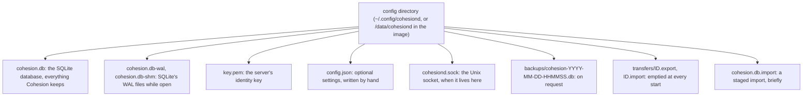
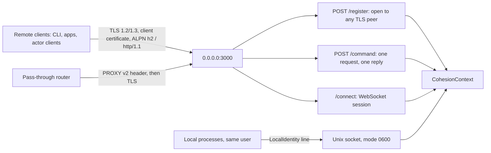
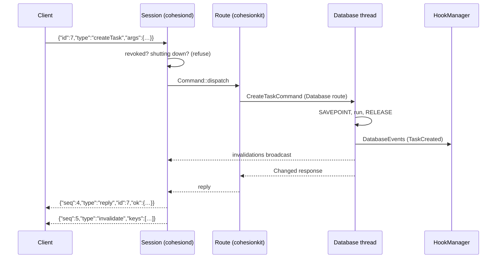
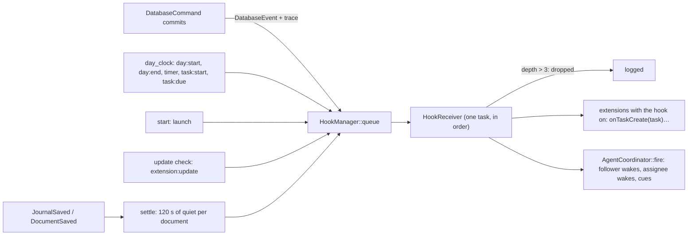
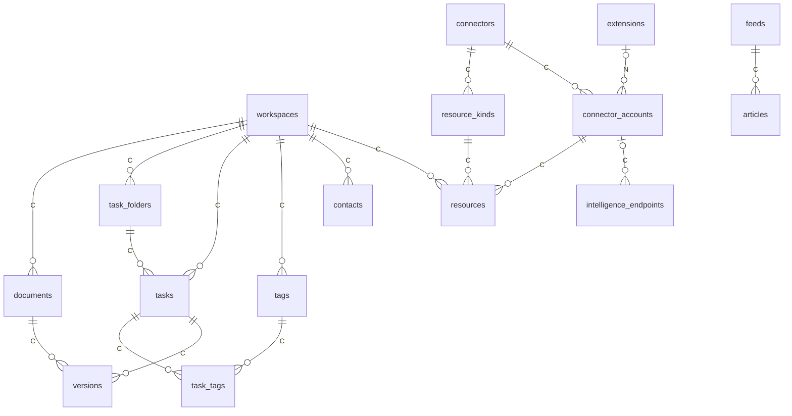
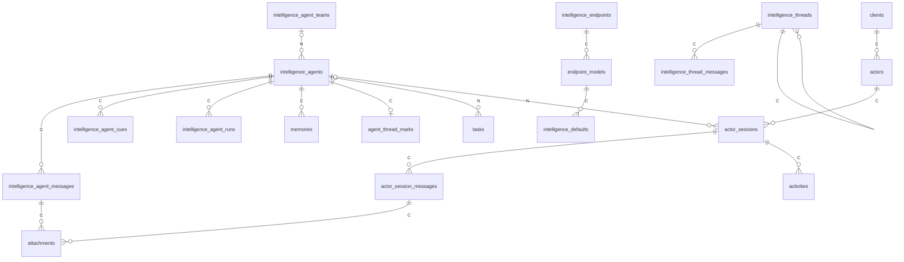
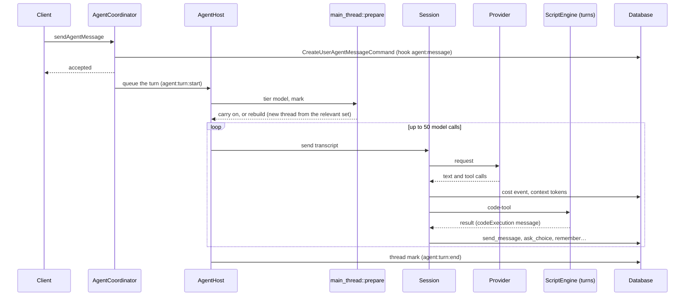
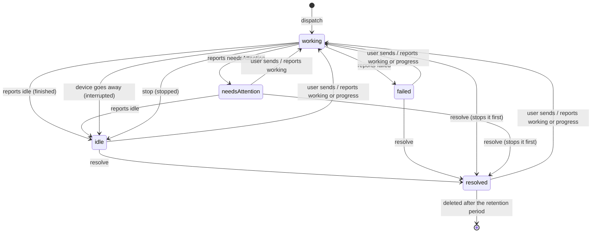
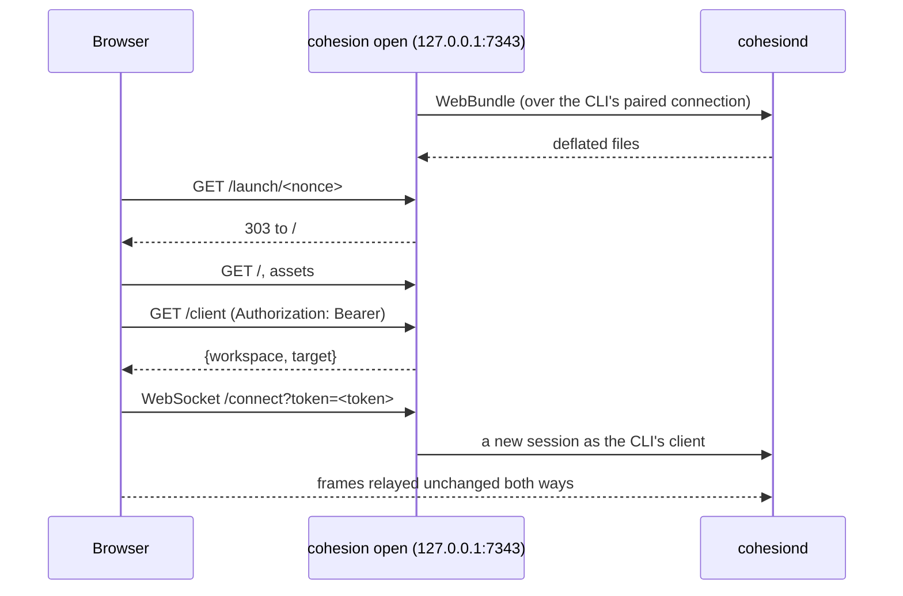

# Architecture

This is the technical reference for the `cohesion` repository: how it is built,
how the daemon runs, what it stores, how agents and actors work, how clients
reach it, and how it is kept safe and tested. It was written from the code on
`master` (November 2026) and cites the file and symbol each fact comes from;
when the two disagree, the code is right and this page is the bug.

Product questions (who Cohesion is for, which surface gets a feature) are in
[product-direction.md](product-direction.md). Installing and running a server is
in [self-hosting.md](self-hosting.md), and everyday CLI use in [cli.md](cli.md).
The rules for changing the code are in [design-principles.md](design-principles.md),
[security-model.md](security-model.md) (the trust model) and
[conventions.md](conventions.md) (layering and conventions), and the recipes in
`CONTRIBUTING.md`.

The sections follow eight groups of questions:

- [A. Repository and build](#a-repository-and-build)
- [B. Daemon and wire protocol](#b-daemon-and-wire-protocol)
- [C. Storage and search](#c-storage-and-search)
- [D. Agents](#d-agents)
- [E. Actors](#e-actors)
- [F. Clients](#f-clients)
- [G. Extensions, connectors and feeds](#g-extensions-connectors-and-feeds)
- [H. Security, operations and quality](#h-security-operations-and-quality)

## Where to look

| For | Look in |
|---|---|
| A model, request, reply, invalidation, hook kind | `cohesion-core/src/{model,protocol}/`, `cohesion-core/src/invalidation.rs`, `cohesion-core/src/model/hook_kind.rs` |
| The words clients show for kinds | `cohesion-core/src/protocol/vocabulary.rs` |
| A database command and its tests | `cohesion-db/src/commands/<domain>.rs`, `cohesion-db/src/commands/<domain>/tests.rs` |
| The schema | `cohesion-db/src/migrations.rs` (`MIGRATIONS`, append only), `every_model!` in `cohesion-db/src/db_macros.rs` |
| Transactions, events, invalidation publishing | `cohesion-db/src/database_context.rs`, `cohesion-db/src/database_event.rs` |
| The script API | `cohesion-js/src/{globals,entities,script_api.rs}`, sandboxes in `cohesion-js/src/sandbox/`, the engine in `cohesion-js/src/engine/` |
| Models and providers | `cohesion-intelligence/src/{providers,catalog,session}/` |
| Agents, cues, forks | `cohesion-intelligence/src/agents/`; what each role may reach: `cohesion-js/src/engine/agent_role.rs` |
| Routes that aren't one database command | `cohesionkit/src/routes/<domain>_routes.rs` |
| Hooks and timed events | `cohesionkit/src/hooks/` (`hook_manager.rs`, `hook_receiver.rs`, `hook_events.rs`, `day_clock.rs`) |
| Extensions, connectors, actors | `cohesionkit/src/{extension_manager,connectors}/`, `capability_clients.rs`, `actor_sessions.rs`, `script_actors.rs` |
| Transports, TLS, sessions, pairing | `cohesiond/src/server/` |
| CLI commands, `cohesion open` | `cohesion/src/cli/`, `cohesion/src/web_proxy/` |
| The web UI | `web/src/lib/{protocol,stores,features,ui,shell,format}/`, `web/src/routes/`, and `web/README.md` |

`cargo doc --workspace --no-deps --open` renders the per-item documentation.
Each crate's root opens with a `//!` summary.

---

## A. Repository and build

### 1. Crates, packages and directories

The repository is one Cargo workspace (`Cargo.toml`: `resolver = "2"`, edition
2024, licence `AGPL-3.0-only` except `cohesion-rs`, which is `MIT`, every
member at version `0.1.0`) plus one npm
package, the web UI in `web/`. No crate declares cargo `[features]`.

| Crate | Kind | What it is for | Depends on (in the workspace) |
|---|---|---|---|
| `cohesion-macros` | proc-macro | The derives and attributes every other crate uses: `Model`, `Projection`, `ColumnGroup`, `Fields`, `FromRequest`, `Commands`, `Replies`, `TextEnum`, `TsInterface`, `TsWire`, `JsOptions`, `#[js_entity]`, `#[js_global]`. cohesion-core re-exports them. | none |
| `cohesion-rs` | lib, `MIT` | What a client needs to talk to a daemon, for clients outside this repository (the Linux WebUI harness): keys, certificates, `key_fingerprint`, setup codes and the socket handshake (`auth/`), private file helpers (`private_files.rs`), and the client's view of the protocol's envelope (`protocol.rs`: `Frame`, `Hello`, `Reply`, `Outcome`, the `WebBundle` reply, `RegisterRequest`, `PROTOCOL_VERSION`), which leaves every other message and reply as raw JSON. cohesion-core re-exports all but `protocol.rs`'s client types from its own paths, and its `protocol/envelope/client_tests.rs` checks the daemon's frames decode into them. | none |
| `cohesion-core` | lib | Types every crate shares: the domain models (`model/`), the wire protocol (`protocol/`), invalidations, keys, certificates and setup codes (`auth/`, re-exported from cohesion-rs but for PKCE), the `Caller`, logging (`log/`), config paths (`paths.rs`), private file helpers (`private_files`, from cohesion-rs), the storage-agnostic `Value` layer, and `ts_wire`, which declares the protocol as TypeScript. No database and no script engine. | cohesion-macros, cohesion-rs |
| `cohesion-db` | lib | SQLite persistence: `Container` (the rusqlite connection, query builders, migrations), the `DatabaseCommand` trait and every command, `DatabaseContext` (the one database thread), events and `InvalidationWatch`, `GuardedDatabaseContext` (what scripts hold), `CredentialManager`, `Secrets` (the pairing window), `WorkTracker`, `ActivityTracker`, backup, export and import (`transfer.rs`), retention. | cohesion-core |
| `cohesion-internet` | lib (+ `build.rs`) | Reading the web: `article_snapshot` (a page as Markdown), `feed` (RSS, Atom and JSON Feed, with autodiscovery), `fetch`, `pipeline`, and Coherence, Cohesion's own HTML reader (`coherence/`, whose JSON rules `build.rs` compiles in). Blocking reqwest; knows nothing of the database or scripts. | cohesion-core |
| `cohesion-internet-harness` | bin, `publish = false` | A tool: `cargo run -p cohesion-internet-harness -- page <url>` or `feed <url>` prints the Markdown the daemon would store, for building Coherence's rules. Nothing depends on it. | cohesion-core, cohesion-internet |
| `cohesion-js` | lib | The QuickJS script runtime (rquickjs): `ScriptEngine` and its worker pools, `Sandbox`, globals and `Mount`, JS entities, `script_api` (which yields the `.d.ts`), `service_declarations`, `AgentRole`, and the traits a higher crate implements: `ConnectorAccess`, `ServiceAccess`, `ActorAccess`. Strips TypeScript with `swc_ts_fast_strip`; vendors the Pele diagram renderer in `vendor/pele`. | cohesion-core, cohesion-db, cohesion-internet, cohesion-macros |
| `cohesion-intelligence` | lib | LLM conversations: provider backends (`providers/`), the models.dev catalog (`catalog/`), `Session` and its tools, `AgentCoordinator` and the agent machinery (`agents/`), `SpendLimits`, and the `AccountCredentials` trait. | cohesion-core, cohesion-db, cohesion-js |
| `cohesionkit` | lib (+ `build.rs`) | The facade the daemon builds on: `CohesionContext`, the `Route` impls (`routes/`), hooks (`hooks/`), `ExtensionManager`, connectors, feeds, periodic cleanup, `Security`, `Presence`, `CapabilityClients`, `ActorSessions`, `EndpointRelay`, `PendingImport`, and `web_bundle` (the web UI compiled into the binary). | all of the above but the harness |
| `cohesiond` | bin | The daemon: opens the database, builds `CohesionContext`, prints the first setup code, serves HTTPS with client certificates and a Unix socket until a signal. Also `examples/fake_actor.rs`, a minimal actor client. | cohesionkit |
| `cohesion` | bin | The CLI: `setup`, `api`, the noun commands (`cli/`), and `open`, the loopback proxy that serves the web UI (`web_proxy/`). Never links rusqlite, rquickjs or cohesion-intelligence. | cohesion-core |

```mermaid
flowchart BT
  macros[cohesion-macros] --> core[cohesion-core]
  rs[cohesion-rs] --> core
  core --> db[cohesion-db]
  core --> net[cohesion-internet]
  db --> js[cohesion-js]
  net --> js
  js --> intel[cohesion-intelligence]
  intel --> kit[cohesionkit]
  kit --> daemon[cohesiond]
  core --> cli[cohesion CLI]
  net --> harness[cohesion-internet-harness]
  web[web/ build] -. build.rs compresses it in .-> kit
```

Arrows point from a crate to the crates that use it. A crate may use anything
below it, not only its neighbour: cohesionkit uses cohesion-db, cohesion-js and
cohesion-internet directly.

Dependencies point one way. Where a lower crate needs something only a higher
one can do, it declares a small trait and the higher crate implements it:

| Trait | Declared in | Implemented by |
|---|---|---|
| `ConnectorAccess` | `cohesion-js/src/connector_access.rs` | `AgentConnectors` (`cohesionkit/src/connectors/agent_connectors.rs`) |
| `ServiceAccess` | `cohesion-js/src/service_access.rs` | `ScriptServices` (cohesionkit) |
| `ActorAccess` | `cohesion-js/src/actor_access.rs` | `ScriptActors` (`cohesionkit/src/script_actors.rs`) |
| `AccountCredentials` | `cohesion-intelligence/src/account_credentials.rs` | `EndpointRelay` (cohesionkit) |
| `DatabaseEventListener` | `cohesion-db` | `HookManager` (`cohesionkit/src/hooks/hook_manager.rs`) |

The rest of the top level:

| Path | What it is |
|---|---|
| `web/` | The web UI: SvelteKit 2 and Svelte 5, built to static files (package `cohesion-web`, private). See [16](#16-the-web-ui). |
| `scripts/` | Shell helpers for development, installing and releasing, and `third-party-notices.mjs` ([2](#2-building-running-and-testing)). |
| `dev/` | Ignored by git. `scripts/server.sh` uses it as the daemon's config directory and `scripts/client.sh` uses `dev/client` as the CLI's. |
| `docs/` | This page, product direction, self-hosting, the CLI guide and licensing. |
| `.github/` | Workflows (`checks.yml`, `image.yml`, `release.yml`), issue and pull request templates. |
| `.githooks/` | `pre-commit` (runs `cargo fmt` and `cargo clippy --fix` when Rust is staged, prettier on staged `web/` files, and re-stages them) and `commit-msg` (removes Claude and Anthropic attribution lines). Turned on per checkout with `git config core.hooksPath .githooks`. |
| `.claude/` | Skills for coding agents working here (`verify`, `dirty-checkout`, `finish-task`, `protocol-change`, `web-ui-change`, `run-locally`, `copywriting`) and a `launch.json` for the web UI in mock mode. |
| `rust-toolchain.toml` | Rust `1.99`, with rustfmt and clippy. The Dockerfile's builder (`rust:1.99-slim-trixie`) must move with it. |
| `.cargo/config.toml` | Sets `LIBSQLITE3_FLAGS = "-DSQLITE_DEFAULT_MEMSTATUS=0"`, which speeds up parallel tests. |
| `MAJOR_VERSION` | `001`, the major part of release versions ([3](#3-what-ships)). |
| `Dockerfile`, `.dockerignore` | The one image ([3](#3-what-ships)). |
| `THIRD_PARTY_NOTICES.md` | Licences of the crates compiled into `cohesiond` and `cohesion`, written by `node scripts/third-party-notices.mjs` (which runs `cargo metadata` for `x86_64-unknown-linux-gnu`). |

Two profile settings in `Cargo.toml` matter day to day: `libsqlite3-sys` and
`rquickjs-sys` build at `opt-level = 3` even in debug builds (every test
migrates a database, and the JS runtime's limits assume an optimised QuickJS),
and the release profile strips symbols without LTO (set
`CARGO_PROFILE_RELEASE_LTO=true` for an LTO build).

### 2. Building, running and testing

**Rust**, from the repository root:

| To | Run |
|---|---|
| Build | `cargo build --workspace` (release: `cargo build --release --workspace --locked`) |
| Format | `cargo fmt --all --check` (fix with `cargo fmt --all`) |
| Lint | `cargo clippy --workspace --all-targets --locked -- -D warnings` |
| Test | `cargo test --workspace --locked`; one test: `cargo test -p <crate> <name>` |
| Check models against the schema | `cargo test -p cohesion-db every_model_matches_the_schema` |
| Run the daemon | `scripts/server.sh` (`target/debug/cohesiond -c dev`, extra arguments passed on) |
| Run the CLI | `scripts/client.sh …` (`target/debug/cohesion -c dev/client …`) |
| Install both | `scripts/install.sh` (builds the web UI, then `cargo install --path cohesiond` and `--path cohesion`) |
| Install the daemon only | `scripts/install-server.sh` (web UI, then `cargo install --path cohesiond`) |
| Install the CLI only | `scripts/install-cli.sh` (`cargo install --path cohesion`; the CLI doesn't hold the web UI) |
| Try an actor client | `cargo run -p cohesiond --example fake_actor -- <socket> [name]` |

**The web UI**, from `web/` (`web/package.json`):

| Script | Does |
|---|---|
| `npm run dev` | `vite dev` on port 5173. `.env.development` sets `VITE_DEV_PROXY=1`, so the page sends `/client` and `/connect` through Vite's proxy to `cohesion open --dev` on `VITE_PROXY_PORT` (default 4000), which adds the token from `COHESION_DEV_TOKEN` (`web/vite.config.ts`). `VITE_MOCK=1 npm run dev` uses the in-memory daemon instead ([16](#16-the-web-ui)). |
| `npm run build` | `vite build` into `web/build/`, plus `build/third-party-licenses.md` for the npm packages it bundles |
| `npm run check` | `svelte-kit sync && svelte-check` |
| `npm run lint` | `prettier --check . && eslint .` (fix formatting with `npm run format`) |
| `npm test` | `vitest run` |
| `npm run generate` | Rewrites `src/lib/protocol/generated.ts` and `vocabulary.json` from the Rust types ([5](#5-the-wire-protocol)) |

`scripts/web-dev.sh` puts the two halves together: it makes a random token,
starts `cohesion -c dev/client open --dev --port ${VITE_PROXY_PORT:-4000}
--no-browser` in the background, then runs `npm run dev`.

**How the web UI gets into the daemon.** At compile time, not at run time.
`cohesionkit/build.rs` walks `web/build/`, compresses each file with raw
deflate into `OUT_DIR`, and writes a table of `include_bytes!` entries that
`cohesionkit/src/web_bundle.rs` includes as `WEB_FILES`. `web_bundle()` builds a
`WebBundle` from them once, and `web_bundle_hash()` is a SHA-256 over every
path and its bytes (`WebBundle::new`, `cohesion-core/src/protocol/server_requests.rs`).
If `web/build/index.html` is missing the build prints a cargo warning and
embeds nothing: the daemon then reports `web_bundle_hash: null` and refuses
`WebBundle` with "This cohesiond was built without the web UI". So build the
web UI before the daemon. The daemon never serves these files over HTTP; a
client fetches them with the `WebBundle` request and serves them itself
([16](#16-the-web-ui)).

**CI.** `.github/workflows/checks.yml` ("Checks") runs on every pull request
and every push to `master`, on `ubuntu-24.04`, cancelling an older run of the
same ref:

| Job | Steps |
|---|---|
| Rust | `cargo fmt --all --check`, `cargo clippy --workspace --all-targets --locked -- -D warnings`, `cargo test --workspace --locked` (with `Swatinem/rust-cache`; the web UI isn't built first, so cohesionkit compiles with an empty bundle) |
| Web UI | In `web/`, with Node from `web/.nvmrc` (26): `npm ci`, `npm run check`, `npm run lint`, `npm test`, `npm run build` |
| Generated files | `npm run generate`, `node scripts/third-party-notices.mjs`, then `git diff --exit-code`, failing if `generated.ts`, `vocabulary.json` or `THIRD_PARTY_NOTICES.md` is stale |

`image.yml` and `release.yml` build and publish the image ([3](#3-what-ships)).
There is no deploy job and nothing scheduled.

### 3. What ships

One artifact: the container image `ghcr.io/cohesionhq/cohesion:<version>`, for
`linux/amd64`, holding both `cohesiond` and `cohesion`. No binaries, tarballs or
packages are attached to releases; building from source is `scripts/install.sh`.

**Versions.** A release is `v` + `MAJOR_VERSION` + a five-digit minor, such as
`v00100018`. `cohesion_core::VERSION` is `COHESION_VERSION` from the build
environment, else the crate version `0.1.0`; it is what `cohesiond --version`,
`About` and the `hello` frame's `server` (`cohesiond/<VERSION>`) show.

**Releasing.** The Release workflow (`release.yml`, run by hand) runs
`scripts/release.sh`, which reads `MAJOR_VERSION` at the commit, refuses a
commit that already has a release tag, takes the next minor after the last tag
of that major, tags and pushes it, and creates a GitHub release whose notes are
the commit subjects since the previous tag. It then calls `image.yml`, because
a tag pushed with the workflow's own token starts no workflow. `image.yml` also
runs on any pushed `v*` tag: it checks the version is `v` and eight digits,
builds the tag with `docker/build-push-action` (build argument
`COHESION_VERSION`, OCI labels, GitHub Actions cache) and pushes it.
`scripts/publish-image.sh [commit]` is the local route: it builds a commit with
podman from `git archive`, tags it with the short commit hash and pushes it
with the `gh` login.

**The Dockerfile**, stage by stage:

1. `web` (`node:26-slim`): `npm ci`, then `npm run build`.
2. `chef` (`rust:1.99-slim-trixie`): installs `cargo-chef` 0.1.78.
3. `planner`: `cargo chef prepare`, a recipe that changes only with manifests, the lockfile and the toolchain.
4. `build`: `cargo chef cook --release --locked -p cohesiond -p cohesion` (the cached dependency layer), then the source, `web/build` from the first stage, `ARG COHESION_VERSION` (declared late so a new version doesn't invalidate the dependency layers) and `cargo build --release --locked -p cohesiond -p cohesion`.
5. Final (`debian:trixie-slim`): `ca-certificates` and `tzdata`; user `cohesion` (uid 1000) with home `/data`; `/usr/local/bin/cohesiond`; the real CLI at `/usr/local/libexec/cohesion` behind the wrapper `scripts/docker-cohesion.sh` at `/usr/local/bin/cohesion`; licences under `/usr/share/doc/cohesion/`; `XDG_CONFIG_HOME=/data`, `XDG_RUNTIME_DIR=/run/cohesion`; `VOLUME /data`; `EXPOSE 3000`; `ENTRYPOINT ["cohesiond"]`.

Running the image is in [23](#23-deployment).

---

## B. Daemon and wire protocol

### 4. Starting the daemon

**Flags** (`cohesiond/src/args.rs`, `CohesiondArgs`):

| Flag | Environment | Meaning and default |
|---|---|---|
| `-c, --config <DIR>` | | The config directory. Default `dirs::config_local_dir()/cohesiond`: `~/.config/cohesiond` on Linux, `~/Library/Application Support/cohesiond` on macOS. Created with mode 0700 if missing. |
| `--host <HOST>` | | The IP address or DNS name put in setup codes. Default: this machine's outbound IPv4 address, found by pointing a UDP socket at 192.0.2.1 without sending anything, else `127.0.0.1`. |
| `--port <PORT>` | `COHESIOND_PORT` | The HTTPS port, default `3000` (`DEFAULT_PORT`, `cohesion-rs/src/auth/setup.rs`). Listens on `0.0.0.0` (IPv4 only). |
| `--public-port <PORT>` | `COHESIOND_PUBLIC_PORT` | The port put in setup codes when a forwarded port differs. Default: `--port`. |
| `--socket <PATH>` | | The Unix socket. With `--config`, `<config>/cohesiond.sock`; with the default config directory, `$XDG_RUNTIME_DIR/cohesiond.sock` where there is one (`dirs::runtime_dir()`), else `<config>/cohesiond.sock` (`paths::default_socket_path`, `paths::socket_path_in`). |
| `--log-level <LEVEL>` | `COHESIOND_LOG` | `debug`, `info` (default), `warn` or `error`. SQL statements log at `debug`. |
| `--exit-with-parent` | | Exit when stdin closes, for an app that starts the daemon with a pipe. |
| `--proxy-protocol <ADDR>` | | Repeatable. Peers trusted to send a PROXY v2 header ([below](#behind-a-pass-through-router)). |

**`config.json`** in the config directory (`cohesiond/src/settings.rs`,
`ConfigFile`) is optional, read at start and never written. Unknown keys stop
the daemon (`deny_unknown_fields`). Its keys mirror the flags in snake_case:
`host`, `port`, `public_port`, `socket` (relative to the config directory unless
absolute), `log_level`, `exit_with_parent`, `proxy_protocol` (a list of
addresses). A flag or environment variable beats the file, the file beats the
default; `exit_with_parent` is true if either says so, and a non-empty
`--proxy-protocol` list replaces the file's.

**The config directory.** Directories are created 0700 and files 0600, with the
mode set before any data is written (`cohesion-rs/src/private_files.rs`).



- `cohesion.db` holds everything, images, extension scripts and credentials included ([8](#8-the-database)).
- `key.pem` is the server's P-256 key, PKCS#8 DER despite the name, made on first start (`Authentication::generate`). No certificate file is stored.
- `backups/` is written by `BackupDatabase` and never pruned ([10](#10-backup-export-and-import)).
- `transfers/` holds exports and imports in progress and is deleted at every start (`clear_transfers`).
- `cohesion.db.import` exists between finishing an import and the restart that renames it over `cohesion.db`.

**Listeners** (`cohesiond/src/server/serve.rs`, `start`):



1. **HTTPS on `0.0.0.0:<port>`**, through `PeerAcceptor` and rustls (aws-lc-rs, TLS 1.2 and 1.3). Every connection must present a client certificate. Routes:
   - `POST /register`, for any TLS peer, body at most 4 KiB (`REGISTER_BODY_LIMIT`): pairing ([6](#6-pairing-and-trust)).
   - `POST /command`: one `Request` in the body, one `reply` frame back. No session, no `hello`, no invalidations.
   - `/connect`: a WebSocket session ([5](#5-the-wire-protocol)), also over HTTP/2 (extended CONNECT is on).
   - `/command` and `/connect` sit behind `require_registered`: a certificate that belongs to no live client gets 403 "This client isn't registered. Run `cohesion setup` with the setup code."
   - There are no other routes: no health check, no metrics and no static files. A browser has no client certificate and gets nothing.
   - Timeouts: a peer must send its first byte within 10 s of the TLS handshake (`FIRST_BYTE`); HTTP/1.1 headers within 30 s; HTTP/2 pings every 30 s and gives up after 20 s.
2. **The Unix socket** (`unix_socket.rs`, `unix_socket_exchange.rs`, `local_acceptor.rs`), bound under umask 0077 and set to 0600, removed at shutdown. Newline-delimited JSON; the first line is a `LocalIdentity`.

If either listener fails, `start` returns and the daemon exits 1 so a
supervisor restarts it. There is no plain-HTTP or IPv6 listener.

**TLS identity.** At every start the daemon signs a fresh self-signed
certificate for `cohesiond` with `key.pem` (rcgen). Its identity is the key's
fingerprint: lowercase hex SHA-256 of the SubjectPublicKeyInfo
(`key_fingerprint`), which stays the same across those certificates. Setup
codes carry it, and clients pin it: the CLI's `ServerVerifier`
(`cohesion/src/client_tls.rs`) accepts only a certificate with that
fingerprint and still checks the TLS signatures. In the other direction the
daemon's `ClientVerifier` (`client_cert_verifier.rs`) demands a certificate but
accepts any, since only the handshake's proof of key possession matters; who
the client is is decided after the handshake, when `PeerAcceptor` looks the
fingerprint up (`LookupClientByFingerprintCommand`), with a 30-second cache of
unknown fingerprints (`UnknownPeers`, 1024 entries).

#### Behind a pass-through router

A connection's address is a claim, not a credential, and it is only ever
shown and recorded. By default it is the TCP peer's own address. With
`--proxy-protocol <ADDR>` (or `proxy_protocol`), a connection from one of
those addresses must start with a PROXY protocol v2 header
(`cohesiond/src/server/proxy_protocol.rs`), read before TLS:

- the 12-byte signature, version and command `0x21` (v2 PROXY; LOCAL is refused), family TCP over IPv4 or IPv6, an address block of at most 216 bytes (`MAX_ADDRESSES`), extensions skipped;
- within 5 seconds (`HEADER_WITHIN`); a missing, malformed or late header drops the connection with a warning.

The header's source address becomes `Peer.ip` and `Caller.address`, shown in
the clients list, logs and security events. A peer not in the list is never
read for a header. Nothing is admitted or refused by address: admission is by
certificate and setup key. `Security` remembers refused pairings for at most
4096 addresses, once an hour each (`REPORT_CAPACITY`, `REPORT_EVERY`).

**Startup** (`cohesiond/src/main.rs`, `cohesionkit/src/cohesion_context.rs`):

1. Parse arguments, resolve the config directory, read `config.json`, install the console logger, start listening for SIGINT and SIGTERM.
2. `Container::open` the database (WAL) and `migrate()` it ([8](#8-the-database)). A failure stops the daemon.
3. `clear_transfers`.
4. Load or make `key.pem` and sign the certificate; the setup address is `host`, `public_port` and the fingerprint.
5. `CohesionContext::new`: `WorkTracker`, `HookManager`, `DatabaseContext` (which starts the database thread), `ScriptEngine`, `ExtensionManager`, `CapabilityClients`, `ActorSessions`, `AgentCoordinator`, `ModelCatalog`, `Presence`, `Security`, `PendingImport`, and the hook receiver.
6. `context.start()`: `ShutdownCleanupCommand` first (repairing a crash), the model catalog refresh in the background, one `launch` hook, the day clock, and the timed passes: cleanup (now, then hourly), resource refresh (after 60 s, then every 30 minutes), feed refresh (after 60 s, then hourly), extension update check (now, then daily).
7. If no client is paired, open pairing and print `Setup code: <code>` to stdout, never the log (`open_first_pairing`).
8. Serve. `main` then waits for the server to end, a signal (or stdin closing with `--exit-with-parent`), or a finished import.

**Shutdown** (`cohesiond/src/shutdown.rs`, `CohesionContext::shutdown`):

1. `work.close()`: `WorkTracker` refuses new work. Every request on every transport is answered "Cohesion is shutting down. Try again once it has restarted.", and so are `/register`, offers, day-clock ticks and timed passes; running work may still start follow-on work (hooks, cue runs, scripts, model calls). Running activities are cancelled. The listeners keep answering.
2. `hooks.settle_all()`: every `journal:settled` and `document:settled` hook still waiting is queued now ([7](#7-hooks-and-events)).
3. `work.idle()`: wait for all work.
4. `database.close()`: run what is queued, then `ShutdownCleanupCommand` as the last write, then drop the connection. In one transaction it runs `SettleAgentThreadMarksCommand`, `SettleAgentActivityCommand`, `SettleActivitiesCommand`, `SettleActorSessionsCommand` and `SettleAgentAsksCommand` (`cohesion-db/src/commands/shutdown_cleanup.rs`). Startup runs it again, for a daemon that crashed. State a stopped daemon must not leave behind is one more `ctx.run` there.

Every 5 seconds the daemon logs what it is still waiting for. After 5 minutes,
or a second signal, it stops waiting, still closes the database, and exits 1.
It exits 0 only when shutdown was clean and the server hadn't failed. After an
import, a clean shutdown is followed by `restart::onto`, which renames the
staged database into place and `exec`s the same binary with the same arguments
([10](#10-backup-export-and-import)).

**How a client finds the daemon.** A remote client is told by a setup code:
base64 of `<key>|<host:port>|<fingerprint>` ([6](#6-pairing-and-trust)). It
connects to `https://host:port` with its client certificate, pinning the
fingerprint. A local client uses the socket path, the default one or
`--socket`. A browser goes through `cohesion open` or a WebUI harness, never
straight to the daemon ([16](#16-the-web-ui)).

### 5. The wire protocol

**Transports.** All three run the same session code
(`cohesiond/src/server/session.rs`, or `request_handler.rs` for one-off
requests) over the `Exchange` abstraction (`transport.rs`).

| Transport | Framing | Identity | Keepalive |
|---|---|---|---|
| WebSocket `/connect` | One JSON frame per text message; binary messages are ignored; at most 64 MiB (`BODY_LIMIT`) | The client certificate | The daemon pings every 30 s; a session that hears nothing for 60 s ends |
| `POST /command` | One `Request` JSON body; one `reply` frame back | The client certificate | none |
| Unix socket | One JSON frame per line, at most 64 MiB; the first line, the `LocalIdentity`, at most 4 KiB within 10 s; blank lines skipped | The local key, and the peer's uid must equal the daemon's | none |

**The envelope** (`cohesion-core/src/protocol/envelope.rs`).

From client to daemon, a `ClientFrame`:

| `type` | Shape | Meaning |
|---|---|---|
| any command name | `{"id": 7, "type": "createTask", "args": {…}}` | A request. `id` is optional and comes back on the reply. `type` is the camelCase command; `args` holds snake_case fields and is left out (or `null`, or `{}`) for a command without arguments. |
| `subscribe` | `{"type": "subscribe", "id": 1}` | Start receiving `invalidate` and `reset` frames. Answered `accepted`. |
| `hello` | `{"type": "hello", "id": 1, "actors": [ActorDefinition…]}` | Offer actors; this session now serves its client's actors ([14](#14-actor-clients-and-actor-sessions)). |
| `callResult` | `{"type": "callResult", "call_id": 3, "ok": {"kind": "accepted"}}` or `"error": "…"` | The answer to a daemon `call`. |
| `actorSessionUpdate` | `{"type": "actorSessionUpdate", "id": 9, "session_id": 12, "kind": …}` | Progress on an actor session. |
| `actorUsage` | `{"type": "actorUsage", "id": 10, "actor": "…", "plan": […], "pool": …}` | An actor's plan usage. |

From daemon to client, a `Frame`: `{"seq": n, "type": …}`, where `seq` counts
from 0 in send order within the session. `ServerMessage`:

| `type` | Shape |
|---|---|
| `hello` | Always first: `{protocol, server, client_name, web_bundle_hash, vocabulary}` |
| `reply` | `{id, ok: {type, data}}` or `{id, error: {code, message, field?}}` |
| `invalidate` | `{keys: [Invalidation…]}` |
| `reset` | Invalidations were dropped because the client fell behind: refetch everything |
| `call` | `{call_id, call: ClientCall}`, only to a session that sent `hello` |
| `evicted` | `{reason: "replaced" \| "revoked"}`, the last frame before the daemon closes the session |

A session reads up to 64 requests ahead (`QUEUED_REQUESTS`) and runs them side
by side, so replies come back in the order they finish; match them by `id`.

**Requests, replies and routes.** `Command` (`cohesion-core/src/protocol/command.rs`)
is one enum with a variant per request, 190 of them, each tagged
`#[reply(ReplyType, via = Kind)]`. `#[derive(Commands)]` generates the
dispatch; the request structs live in the `*_requests.rs` modules beside it,
and `ReplyData` (`reply_data.rs`) is the enum of reply payloads. Each
request is handled by a `Route<Kind, Request>` (`cohesion-core/src/protocol/route.rs`),
and its kind decides where it runs:

| Kind (`route_kinds.rs`) | Count | Runs |
|---|---|---|
| `Database` (the default) | the rest | One blanket impl (`cohesionkit/src/routes/database_routes.rs`): the request becomes one `DatabaseCommand` through `#[derive(FromRequest)]` and runs on the database thread. |
| `Local` | 38 | Against `CohesionContext`, without knowing the sender: `About`, `WebBundle`, `WebBundleHash`, `BackupDatabase`, `DeleteClient` (`client_routes.rs`), the actor session requests (`actor_routes.rs`), connectors, `AddFeed`, `RefreshFeed`, `RefreshFeeds`, `ResnapshotArticle`, `RenderMermaid`, the five export and import requests (`transfer_routes.rs`), and every extension request but `CallExtension`. |
| `Intelligence` | 8 | `UpdateModelCatalog` (`catalog_routes.rs`); `UpdateIntelligenceAgent`, `DeleteIntelligenceAgent`, `SetAgentMessageReaction`, `SendAgentMessage`, `StopAgentTurn`, `RespondToAgentChoice`, `RemoveAgentCue` (`agent_routes.rs`). |
| `Script` | 2 | `RunScript`, `Documentation` (`script_routes.rs`). |
| `FromClient` | 5 | The only kind that sees its sender: `BeginPairing`, `GetPairingAccess`, `ListClients`, `RevokeOtherClients` (`client_routes.rs`) and `CallExtension` (`extension_routes.rs`). |



Before any command runs, `handle_request` refuses a revoked client
("This client was revoked.") and runs the command as tracked work, so it is
refused once shutdown begins. A database command's events reach the
`HookManager` before the reply is sent, so the hooks it raises are queued by
the time the client hears back.

**Invalidations.** The daemon pushes what went stale, never the data;
clients refetch. `Invalidation` (`cohesion-core/src/invalidation.rs`, tagged
`{kind, id}`) has the keys `workspace(id)`, `intelligenceCostEvents`,
`agent(id)`, `agentTeams`, `taskFolders(ws)`, `documents(ws)`,
`taskList{workspace_id, folder_id}` (null folder is the inbox),
`connectorAccounts`, `resources(ws)`, `resourceKinds(ws)`, `feeds`,
`feedArticles`, `intelligence`, `clients`, `security`, `storage`, `profile`,
`tags(ws)`, `contacts(ws)`, `savedTaskViews(ws)`, `extensionUpdates`,
`memories`, `activities`, `actors`, `actorSessions`, `actorSession(id)`,
`actorUsage`, and `notification{title, message}`, which carries a notification
that nothing stores. A command names the keys it touched in its `Changed`
response; they go out on a 256-slot broadcast only if it commits.
`DatabaseContext::publish` sends a key outside any command (a client coming
online, actor usage). A session gets invalidations only after `subscribe`;
the web UI subscribes first on every connection, the CLI only to follow an
agent's turn.

**Versioning.** `PROTOCOL_VERSION` is `1` and stays 1 while Cohesion is in
active development. There is no negotiation: the web UI compares the number in
`hello` with its own and, if they differ, stops with a notice to reload
(`web/src/lib/protocol/connection.svelte.ts`). The wire changes together with
the daemon and its clients. `hello.vocabulary` (`protocol/vocabulary.rs`) holds
the daemon's words for its kinds, in display order: permissions, hooks, task
priorities and sizes, version changes, activity and actor session statuses
and stops, agent colours, personalities and verbosities, tiers, spend periods,
providers, dialects, reactions, pairing openers and security events. A new
variant of one of those enums doesn't compile until it has its words.

**Limits.**

| Limit | Value | Where |
|---|---|---|
| Request body, WebSocket message, socket line | 64 MiB | `BODY_LIMIT`, `serve.rs` |
| `/register` body, local handshake line | 4 KiB | `REGISTER_BODY_LIMIT` |
| Requests read ahead per session | 64 | `QUEUED_REQUESTS` |
| Actor updates queued per session | 64 | `QUEUED_ACTOR_UPDATES` |
| First byte after TLS, local handshake | 10 s | `FIRST_BYTE` |
| PROXY header | 5 s, 216 address bytes | `proxy_protocol.rs` |
| Export and import parts | 8 MiB | `PART`, `cohesion-db/src/transfer.rs` |
| Database job queue, invalidation broadcast | 64, 256 | `DatabaseContext::new` |

**Errors** (`cohesion-core/src/protocol/server_error.rs`). `ServerError` is
`{code, message, field?}` with `ErrorCode` one of `badRequest`,
`validationFailed` (with the `field` at fault), `internalError` ("An internal
error occurred."; the details go only to the log), `upstreamError` (a provider,
extension or actor client failed), `notFound`, `unauthorized`. A frame that
doesn't parse is answered `badRequest` with its `id` when it can be read; an
unknown command is "unknown command <name>". Over HTTP, any failed
`/register` is 401 "The setup code wasn't accepted.", and an unregistered
client on `/command` or `/connect` gets 403.

**Where the schema lives.** In Rust. Every wire type derives `TsWire`
(`cohesion-core/src/ts_wire.rs`), and its `///` comments come along.
`ts_wire::client_module()` renders the whole protocol as TypeScript:
`PROTOCOL_VERSION`, every model, request and reply, `ServerError`,
`ErrorCode`, `InvalidationBatch`, `Vocabulary`, and the `Requests` and
`Replies` maps. `npm run generate` writes it to
`web/src/lib/protocol/generated.ts` (from `cargo run -p cohesion-core --example
ts_client`) and the vocabulary to `vocabulary.json` (`--example vocabulary`);
CI fails if either is stale. The web UI imports them through
`web/src/lib/protocol/types.ts`. Clients in other repositories copy
`generated.ts` or model the types by hand.

### 6. Pairing and trust

**The pairing window** (`cohesion-db/src/secrets.rs`). `Secrets` holds at most
one setup key: 32 random letters and digits, valid for 10 minutes
(`PAIRING_WINDOW`) and one registration, kept in memory only. Opening a new
window replaces the old one. It is checked in constant time.

**The setup code** (`SetupCode`, `cohesion-rs/src/auth/setup.rs`) is base64
of `<key>|<host:port>|<fingerprint>`, with IPv6 hosts in brackets. Decoding
wants exactly three parts and a port (`NotBase64`, `Malformed`,
`InvalidAddress`).

A window is opened by the daemon's first start when no client is paired
(printed to stdout), or by a paired client with `BeginPairing` (`cohesion
pair`, or Add client in the web UI), which records a `pairingOpened` security
event. `GetPairingAccess` tells a client whether it may.

**Registering** (`POST /register`, `cohesiond/src/server/http_routes.rs`):

1. The client makes a P-256 key and a self-signed certificate, connects with it pinning the server's fingerprint, and posts `RegisterRequest{setup_key, client_name}`.
2. The daemon checks the setup key before touching the database, then runs `RegisterClientCommand`, which checks it again, trims the name, and returns the live client with this fingerprint or inserts a `clients` row (`key_kind = certificate`, `key` = the fingerprint). It records `clientPaired`, sends a "New client paired" notification if `alert_new_client` is on, and closes the window.
3. The reply is the `Client`. Any failure is the same 401 and is recorded as a refused pairing for that address.

**Local clients** (`local_acceptor.rs`) need no setup key. The socket's mode
(0600), the peer's uid (must equal the daemon's effective uid) and a
`LocalIdentity{key, name}` first line are the check. `IdentifyLocalClientCommand`
stores only SHA-256 of the key (`key_kind = local`): a known key is that
client, an unknown one becomes a new client, and a revoked one is refused with
"This client was revoked; run `cohesion setup --local` to connect again."

**Client identity** is therefore the fingerprint of the client's certificate
key, or the hash of its local key. Its name is only a label; Settings ›
Clients and `RenameClient` change it.

**Browser pages** hold no daemon credential. `cohesion open` or a WebUI harness
gives the page a launch token for its own loopback proxy, and relays the
page's traffic over its own paired connection ([16](#16-the-web-ui)).

**Revoking** (`cohesion-db/src/commands/client.rs`, `cohesionkit/src/routes/client_routes.rs`):

- `DeleteClient` soft-deletes the client. The schema then soft-deletes the actors it offered (trigger `clients_deleted_own_nothing`). The command records `clientRevoked`, raises the `client:revoke` hook (`{client_id, name}`), and invalidates `clients`. The route then calls `presence.revoke`, which ends every session of that client with `evicted: revoked` and makes `handle_request` refuse anything more.
- `RevokeOtherClients` revokes every client but the sender.
- The hourly cleanup revokes clients not seen for `revoke_inactive_after_days` (never one that is online) as `inactiveClientRevoked` (`RevokeInactiveClientsCommand`).
- An import revokes the imported database's clients ([10](#10-backup-export-and-import)).

A revoked certificate still completes a TLS handshake, but every route but
`/register` answers 403, and it can pair again only as a new client.

**Security settings** (`SecuritySettings`, `cohesion-core/src/model/security.rs`,
one row): `pairing_opened_by` (`anyClient` or `localClients`),
`alert_new_client`, `revoke_inactive_after_days` (or none). With
`localClients`, `BeginPairing` and `GetPairingAccess` refuse a client that
isn't on the socket (`ClientRequest::pairing_refusal`): "Clients can only be
added from a client on the computer Cohesion runs on." That is why those two
are `FromClient` routes. Security events (`pairingOpened`, `clientPaired`,
`clientRenamed`, `clientRevoked`, `inactiveClientRevoked`, `settingsChanged`,
`pairingRefused`) are kept 30 days.

**Who may do what:**

| Who | May |
|---|---|
| Anyone reaching the port | Complete a TLS handshake with any certificate, and `POST /register` with a valid setup key. Everything else is 403. |
| A process of another user on the machine | Nothing: it can't open the socket, and the uid check would refuse it. |
| A process of the same user | Use the socket as a local client, without a setup key, including opening pairing under `localClients`. |
| Anyone reaching `cohesion open`'s port | Nothing without its launch token, and only with the right `Host` and `Origin`. |
| A paired client | Anything the protocol offers: every command, including security settings, revoking clients, installing extensions, running scripts, export and import. The one exception is opening pairing under `localClients`. Its input must be well-formed; its offers, call results and actor updates are wire input and are checked. |
| A revoked client | Nothing. |
| An extension | The mounts its granted permissions give ([19](#19-extensions)). |
| An agent | What its `AgentRole` gives ([13](#13-what-an-agent-can-read-and-write)). |

### 7. Hooks and events

A hook is an event the daemon hands to extensions and to agents' cues.
Clients never receive hooks; they receive invalidations.



**The pipeline** (`cohesionkit/src/hooks/`):

1. **Raise.** A command sends a `DatabaseEvent{kind, trace}` (`cohesion-db/src/database_event.rs`). After it commits, the database thread hands the events to the `HookManager` before replying. The clock, launch and update hooks are queued directly.
2. **Queue.** `HookManager::queue` wraps each in a `HookInstance` on an unbounded channel, in order, counted as work so shutdown waits for it.
3. **Settle.** `journal:settled` and `document:settled` wait for quiet: one timer per document (`DOCUMENT_SETTLE`, 120 s) that each save restarts; when it runs out, the hook is queued with the last save's trace. During shutdown they're queued at once, and `settle_all` flushes the waiting ones. A new settled hook adds its case to `settle_all`, never a shutdown step of its own.
4. **Receive** (`HookReceiver::start`, one task):
   - An event whose trace is deeper than `MAX_DEPTH` (3) is dropped with "Hook loop terminated."
   - Extensions: a scoped instance (a `launch` for one restarted extension) goes to that extension only; otherwise to every extension with the hook enabled (`GetExtensionsWithHookCommand`), skipping the extension whose own write raised it. The function runs in the extension's persistent scope, traced, so its writes are one level deeper.
   - Agents, after the extensions: `AgentCoordinator::fire` wakes an actor session's follower ([14](#14-actor-clients-and-actor-sessions)), wakes an agent a task was assigned to ([11](#11-agents-in-the-data-model)), and evaluates every cue on that hook not set by the agent whose write raised it.

**The trace** (`DatabaseEventTrace`) carries `depth` (how many hooks deep the
chain is; bounded by `MAX_DEPTH`), `hops` (how many agent forks it went
through; logged, never limited), `origin` (an extension, an agent or a script,
for skipping one's own events and for Rewind's authorship) and `initiative`
(`user` or `event`: who started the chain, [13](#13-what-an-agent-can-read-and-write)).

**Every hook** (`HookKind`, `cohesion-core/src/model/hook_kind.rs`, 41 kinds;
the hook structs are declared in `cohesionkit/src/hooks/hook_events.rs`):

| Hook | Script function (argument) | Raised by |
|---|---|---|
| `launch` | `onLaunch()` | The daemon starting (to every extension with it on, and to cues), and an extension's scope restarting after install or a grant change (to that extension only) |
| `task:create` | `onTaskCreate(task)` | `TaskCreated` (creating or restoring a task) |
| `task:status` | `onTaskStatus(task)` | `TaskStatusChanged` |
| `task:rename` | `onTaskRename(task)` | `TaskRenamed` |
| `task:move` | `onTaskMove(task)` | `TaskMoved` |
| `task:priority` | `onTaskPriority(task)` | `TaskPriorityChanged` |
| `task:size` | `onTaskSize(task)` | `TaskSizeChanged` |
| `task:assigned` | `onTaskAssigned(task)` | `TaskAssigneeChanged` |
| `task:description` | `onTaskDescription(task)` | `TaskDescriptionChanged` |
| `task:startdate` | `onTaskStartDate(task)` | `TaskStartDateChanged` |
| `task:duedate` | `onTaskDueDate(task)` | `TaskDueDateChanged` |
| `task:start` | `onTaskStart(task)` | The day clock after `day:start`, for each incomplete task starting that day |
| `task:due` | `onTaskDue(task)` | The day clock after `day:start`, for each incomplete task due that day |
| `task:tagged` | `onTaskTagged(task)` | `TaskTagged` (a tag added or removed) |
| `task:delete` | `onTaskDelete(task)` | `TaskDeleted` |
| `taskfolder:create`, `taskfolder:delete` | `onTaskFolderCreate(folder)`, `onTaskFolderDelete(folder)` | `TaskFolderCreated`, `TaskFolderDeleted` |
| `workspace:create`, `workspace:delete` | `onWorkspaceCreate(workspace)`, `onWorkspaceDelete(workspace)` | `WorkspaceCreated`, `WorkspaceDeleted` |
| `journal:settled` | `onJournalSettled(document)` | A journal entry's saves, after 120 s of quiet |
| `document:settled` | `onDocumentSettled(document)` | A document's saves, after 120 s of quiet |
| `resource:import`, `resource:update`, `resource:delete` | `onResourceImport(resource)`, `onResourceUpdate(resource)`, `onResourceDelete(resource)` | `ResourceImported`, `ResourceUpdated`, `ResourceDeleted` |
| `feed:article` | `onFeedArticle(article)` | `FeedArticleAdded`, once per new article in a refresh |
| `feed:delete` | `onFeedDelete(feed)` | `FeedDeleted` |
| `article:read` | `onArticleRead(article)` | `ArticleRead` (unread to read) |
| `agent:message` | `onAgentMessage(message)` | `AgentMessageCreated` (not for bookkeeping kinds: notes, wakes, rebuilt contexts) |
| `agent:reaction` | `onAgentReaction(message)` | `AgentMessageReacted` |
| `agent:turn:start`, `agent:turn:end` | `onAgentTurnStart(agent)`, `onAgentTurnEnd(agent)` | `AgentTurnStarted`, `AgentTurnEnded` (an agent starts or stops answering the user) |
| `activity:started`, `activity:updated`, `activity:ended` | `onActivityStarted(activity)`, `onActivityUpdated(activity)`, `onActivityEnded(activity)` | `ActivityStarted`, `ActivityUpdated`, `ActivityEnded` |
| `actor:moved` | `onActorMoved(session)` | `ActorSessionMoved`, an actor session's status really changing |
| `day:start` | `onDayStart()` | The day clock at 06:00 local time |
| `day:end` | `onDayEnd()` | The day clock at 23:00 local time |
| `timer` | `onTimer({time, hour, minute, since})` | The day clock, every minute |
| `extension:update` | `onExtensionUpdate({extensionId, identifier, name, installedVersion, version, sourceURL})` | The update check, once per version a registry offers |
| `notification:send` | `onNotification({title, message})` | `NotificationSent` (a script's or agent's `notifications.send`); also publishes the `notification` invalidation |
| `client:revoke` | `onClientRevoke({client_id, name})` | `ClientRevoked`: `DeleteClient`, `RevokeOtherClients`, inactive clients, an import |

**The day clock** (`cohesionkit/src/hooks/day_clock.rs`) wakes at each whole
minute (`TICK`, 60 s), reads the wall clock in the daemon's local time zone
(UTC in the container unless `TZ` is set), and queues each clock hook whose
time passed since the previous reading: `day:start` at 06:00 (`DAY_START`),
`day:end` at 23:00 (`DAY_END`), and `timer` for the current minute, with
`since` showing a gap. A time passed while the computer slept fires once on
waking (`timer` only for the latest minute); a time passed while the daemon
was stopped doesn't fire. After `day:start` it queues `task:start` then
`task:due` for that day's tasks.

The timed passes started by `CohesionContext::start` (cleanup, resource and
feed refresh, update checks) raise no hooks of their own; what they change
does.

---

## C. Storage and search

### 8. The database

**Where it is.** `<config>/cohesion.db` (`cohesiond/src/daemon_storage.rs`,
`StoragePath::database_file`), with SQLite's `-wal` and `-shm` files beside it
while it is open. Nearly everything Cohesion keeps is in this one file: see
"Outside the database" below.

**How large it is** (`GetDatabaseSize`, `Container::size`; Settings ›
Storage). `DatabaseSize{bytes, free_bytes, areas}`: `page_count` and
`freelist_count` times `page_size`, so the database's pages without the
`-wal` file's own size, and `areas`, what each `StorageArea` takes up
(`cohesion-db/src/storage_areas.rs`). SQLite's `dbstat` table, which the
bundled SQLite is built with, counts every table's and index's pages
exactly, and `placement` names the area of each table, its indexes and FTS
tables with it; a test refuses a table it doesn't name. `attachments`, the
one table two areas share, has its pages divided between agent chats and
actor sessions by the bytes of image each holds there, so those two are
close estimates. Whatever `dbstat` doesn't count as a table goes to
`other`, so the areas and `free_bytes` add up to `bytes`. Measuring reads
every page; on a 384 MB database it takes about 90 ms on the worker.

**One connection, one thread.** `Container` (`cohesion-db/src/container.rs`)
owns a single rusqlite connection, and `DatabaseContext::new`
(`database_context.rs`) gives it to one OS thread, the worker. There is no
pool. Jobs reach the worker on a channel of 64; `DatabaseContext` is a cheap
clone holding the sender. Settings: `PRAGMA journal_mode = WAL`
(`Container::open`), `PRAGMA foreign_keys = ON` (`Container::configure`),
`synchronous` left at SQLite's FULL so a write a client heard back about
survives losing power, and no `busy_timeout` set in code (rusqlite's default
applies). The only other connections are read-only ones for exports and the
staging of an import.

**Transactions.** The worker runs each command inside `SAVEPOINT cmd`,
releasing it on success and rolling back to it on error. Commands compose by
running others with `ctx.run(…)` inside the same savepoint, so a composite
command is atomic. `VACUUM` and `VACUUM INTO` can't run in a savepoint, so they
are jobs of their own (`vacuum_if_reclaimable`, `back_up`, export) and hold up
other commands while they run.

**Commands are typed by what they may do** (`database_command.rs`):

```rust
trait DatabaseCommand {
    type Response;
    type Access: Access; // Read, or Write<Area>
    fn handle(self, ctx: &mut CommandContext) -> …;
}
```

- `Read` commands get a `ReadContainer`, which has no write builders.
- `Write<A>` commands get a `WriteContainer` and return `Changed<T>`, the response plus the invalidation keys it touched. The area is one of `WriteArea::UserData` (the default), `IntelligenceSettings`, `AgentSettings` (memories and cues) or `Notifications`.
- `CommandContext` carries `db`, `secrets`, `now` (unix seconds at the command's start), `events`, `trace` and the pending keys.
- `ReadableDatabase` (`query/container_builders.rs`) offers `select`, `select_live` (hides soft-deleted rows; what client reads use), `select_as`, `select_live_as`, `select_column`, `select_id`.
- After a command commits, its invalidations are broadcast and its events handed to the `DatabaseEventListener` (the `HookManager`), before the reply. After a failure both are dropped.
- Before each `Write<UserData>` command the worker records who is writing (user, agent, extension or script, from the trace) in the `rewind_writer` row, which Rewind's triggers read.

**`GuardedDatabaseContext`** (`guarded_database_context.rs`) is what scripts
hold. `read_only()` holds no areas, `read_write()` all of them,
`writing(areas)` some, and `narrowed(areas)` can only take areas away. A
write whose area isn't held returns nothing, and the script throws or the tool
refuses. `for_extension(identifier)` attributes writes to an extension, so its
own hooks don't fire for them. Two things work whatever the areas: the
script's own key-value store (`set_storage_blocking`) and `credentials()`.
`WriteArea::for_permission` maps `cohesion:write` to `UserData`,
`intelligence` to `IntelligenceSettings`, `notifications` to `Notifications`,
and no other permission to any area.

**Migrations** (`cohesion-db/src/migrations.rs`). `MIGRATIONS` is a list of
`Migration{name, sql}`, 89 at the time of writing; the first seven are the
squashed schema of the 68 that came before them. `PRAGMA user_version` is how
many have been applied. `Container::migrate()`, called by the daemon right
after opening the file:

1. refuses a database whose `user_version` is greater than the list (`DatabaseError::UnknownSchema`): there is no downgrade;
2. registers the `unbase64` SQL function, which older migrations use to move base64 images into blobs;
3. applies each missing migration in its own transaction: with foreign keys on for the first 48 (`CASCADING_MIGRATIONS`, so their cascades fire as they did when shipped), and off for every later one (SQLite's table-rebuild recipe), followed by `PRAGMA foreign_key_check`, which fails the migration if any row points at a removed one; then sets `user_version`.

A failed migration stops the daemon. Shipped migrations are never edited or
reordered; a change is a new one at the end. An import is migrated the same
way before it is put in place.

**Models.** A table's model derives `#[derive(Model)]` with
`#[model(table = "…", backup = Included | LeftOut)]`; the derive doesn't
compile without `backup`. A model with a `deleted: bool` is `SoftDelete`. Every
model is listed in `every_model!` (`cohesion-db/src/db_macros.rs`), which
`every_model_matches_the_schema` checks against the migrated schema and the
backup uses to find what to leave out.

#### The tables

`id INTEGER PRIMARY KEY` everywhere. "(soft)" marks a soft-deleted table:
deleting sets `deleted`, and client reads use `select_live`.

**Clients and settings**

| Table | Holds |
|---|---|
| `clients` (soft) | Paired clients: `key_kind` (`certificate` or `local`), `key` (the fingerprint or local-key hash, unique among live rows), `client_name`, `created_at`, `last_seen_at`, `last_address`. Deleting one soft-deletes its actors (trigger `clients_deleted_own_nothing`). |
| `security_settings` | One row: `pairing_opened_by`, `alert_new_client`, `revoke_inactive_after_days`. |
| `security_events` | `kind`, `client_id` (set null when gone), `client_name`, `address`; kept 30 days. |
| `profile` | One row: the user's `name`, `bio` and photo. |
| `storage_settings` | One row: `thread_retention_days` (14), `actor_session_retention_days` (7), `memory_limit` (20), `rewind_retention_days` (7), `deleted_item_retention_days` (30); each at least 1. |

**Workspaces and their content**

| Table | Holds |
|---|---|
| `workspaces` (soft) | `title`, `emoji`. |
| `documents` (soft) | `workspace_id`, `document_type` (`normal` or `journal`), `title`, `contents` (Markdown), `modified`, `journal_date`, `deleted_at`. A journal entry is a document of type `journal`; a unique index allows one live entry per workspace per day. |
| `task_folders` (soft) | `workspace_id`, `title`, `sort_order`. |
| `tasks` (soft) | `workspace_id`, `task_folder_id` (null is the inbox; a composite key keeps it in the same workspace), `title`, `status` (`incomplete`, `completed`, `cancelled`), `priority` 0–4, `size` 1–5, `description`, `start_date`, `due_date`, and one assignee at most: `assigned_to_user`, `assignee_agent_id` or `assignee_contact_id` (the contact must be live and in the same workspace). |
| `tags`, `task_tags` | Per-workspace tags (names unique ignoring case) and which tasks carry them; composite keys keep both in one workspace. |
| `saved_task_views` and `saved_task_view_priorities`, `_sizes`, `_tags` | Saved task filters: a list or a folder, a sort, and filter sets. |
| `contacts` (soft), `contact_methods` | People in a workspace, and their emails and phone numbers. A deleted contact is unassigned from tasks. |
| `metadata` | Key-value pairs on exactly one workspace, document, task, folder or resource. Scripts only: a request can't carry metadata filters. |
| `versions` | Rewind: past versions of tasks and documents, with `change` (`created`, `edited`, `deleted`, `restored`, `earlier`), `author` and `author_name`. Written by triggers through the `version_writes` view, which folds edits within 120 s into one version. |
| `rewind_writer` | One row: who is writing now (see above). |

**Connectors and resources**

| Table | Holds |
|---|---|
| `connectors` | One per connector identifier (the extension's identifier): `version`, `title`, `icon`, `unit`, `metadata_keys`. |
| `resource_kinds` | A connector's kinds: `identifier`, `title`, `plural`, `contents` (text describing the content to a model). |
| `connector_accounts` | Signed-in accounts: `connector_id`, `extension_id` (set null when the extension is uninstalled: the account is orphaned), `identifier`, the credential (`authorization`, `refresh`, `expires_at`), `description`, `credential_failed_at`. |
| `resources` | Imported items: `workspace_id`, `account_id`, `kind_id`, `identifier`, `title`, `content_kind` (`markdown`, `text`, `json`), `contents`, `last_updated`, `modified`. Deleted for good, not soft. |
| `workspace_resource_kinds` | Which kinds a workspace shows, and their order. |

**Feeds and articles** (belong to no workspace)

| Table | Holds |
|---|---|
| `feeds` (soft) | `url` (unique among live feeds), `title`, `sort_order`, `full_page_policy` (`whenExcerpt` or `always`), and the last refresh: `refreshed` with how many were added, or `failed` with the failure. |
| `articles` (soft) | `feed_id`, `read`, `url`, `title`, `author`, `published_at` and its precision, `contents` (Markdown), and the snapshot: `captured` (`final_url`, `page_title`, `truncated`) or `failed`. A removed article keeps its row, with its text cleared, so the feed doesn't add it again. |

**Agents and model threads**

| Table | Holds |
|---|---|
| `intelligence_agent_teams` | `title`, unique ignoring case. |
| `intelligence_agents` | `agent_name`, `agent_color`, `agent_emoji`, `agent_personality`, `agent_verbosity`, `agent_role`, `agent_directive`, `team_id`, `pinned`, `sort_order`, `agent_unread`, `last_message_at`, `activity`, `foreground_started`, `context_tokens`. |
| `intelligence_agent_messages` | An agent's conversation: `sender`, `kind` and its columns, `run_id`, `reply_to`, `reaction`. A trigger marks the agent unread for kinds the user sees. |
| `intelligence_agent_cues` | `agent_id`, `name` (unique per agent), `hook`, `script`, `instructions`, `effort`, `set_at`. |
| `intelligence_agent_runs` | One per fork: `hook`, `cue_name`, `thread_id`, `outcome` (`running`, `completed`, `failed`), `sender_agent_id`. |
| `memories` | `memory`, and `agent_id` or `team_id` or neither (global). |
| `agent_thread_marks` | One per agent: which model thread the conversation is on and how far it has heard ([12](#12-how-a-turn-runs)). |
| `thread_prompts`, `intelligence_threads`, `intelligence_thread_messages`, `intelligence_thread_images` | Model threads: their system prompts (stored once), forks (`parent_thread_id`), a Responses API chain (`remote_id`, `remote_cursor`), and every item sent and received. |
| `attachments` | Images on an agent message or an actor session message: `media_type`, `data` (a blob). |
| `activities` | Work under way that clients show: `actor_session_id`, `title`, `status`, `progress`, `started_at`, `ended_at`. |

**Actors**

| Table | Holds |
|---|---|
| `actors` (soft) | What a client offers: `client_id`, `identifier`, `product`, `scope`, `modes`, `models` (JSON). |
| `actor_sessions` | `actor_id`, `title`, `mode`, `model`, `effort`, `started_at`, `status_changed_at`, `status`, `unread`, `read_at`, context usage, `follower_agent_id`, `follower_initiative`. |
| `actor_session_messages` | The transcript: `sender`, `kind`, and the columns for each kind ([14](#14-actor-clients-and-actor-sessions)); one response per request (unique `request_id`). |

**Intelligence settings and spending**

| Table | Holds |
|---|---|
| `catalog_models` | The models.dev catalog: identifiers, context sizes and prices. |
| `intelligence_endpoints` | `name`, `provider_identifier`, `dialect`, `base_url`, `api_key` or `account_id` (never both), `usage_url`, `cache_minutes`, `long_cache`. |
| `endpoint_models` | The models an endpoint offers, linked to the catalog, with their own prices where set. |
| `intelligence_defaults` | Which model each tier uses: `agent`, `low`, `medium`, `high`. |
| `intelligence_spend_limits` | At most one per `period` (`hour`, `day`, `month`). |
| `intelligence_cost_events` | One per model call: provider, model, tokens and costs. |

**Extensions**

| Table | Holds |
|---|---|
| `extensions` | `name`, `script` (the whole source), `script_identifier` (unique), `priority`, `description`, `author`, `icon`, `version`, `announced_version`. |
| `extension_permissions`, `extension_hooks` | What the manifest asks for, each `enabled` false until the user turns it on. |
| `extension_services`, `extension_service_functions` | A service's declared functions. |
| `storage_entries` | The private key-value store of an extension or an agent: at most 1 MiB a value and 16 MiB a store (`MAX_STORAGE_VALUE_BYTES`, `MAX_STORAGE_BYTES`). |

**Search** ([9](#9-full-text-search)): `search_entries` and the FTS5 tables
`search_fts`, `feed_corpus_fts`, `actor_sessions_fts`,
`actor_session_messages_fts`, all kept up to date by triggers.

The main relationships (C = cascade, N = set null):





**Triggers** keep rules in the schema: the search indexes
(`documents_search_*`, `tasks_search_*`, `resources_search_*`,
`articles_feed_corpus_*`, `actor_sessions_search_*`,
`actor_session_messages_search_*`); Rewind (`tasks_version_*`,
`documents_version_*`, `version_writes_write`); deletion times
(`tasks_deleted_at`, `documents_deleted_at`); and integrity
(`activities_valid_*`, `actor_sessions_valid_*`,
`actor_sessions_status_changed`, `activities_actor_session_unread`,
`intelligence_agent_messages_reply_to`, `intelligence_agent_messages_unread`,
`resources_same_connector`, `saved_task_views_folder_in_workspace`,
`tasks_assignee_contact_*`, `contacts_deleted_assign_nothing`,
`task_folders_saved_views_deleted`, `clients_deleted_own_nothing`,
`extensions_orphan_accounts`, `connector_accounts_orphaned_endpoints`).

#### Outside the database

Almost nothing. Images, extension scripts and icons, article text and
credentials are all in `cohesion.db`. What isn't:

| Thing | Where | Written and cleaned up |
|---|---|---|
| The server key | `key.pem` | Made on first start; never rotated |
| Settings | `config.json` | By hand only |
| Backups | `backups/` | By `BackupDatabase`; never removed |
| Exports and imports in progress | `transfers/` | By the transfer commands; emptied at every start |
| A staged import | `cohesion.db.import` | Renamed over the database at the restart |
| The web UI | Inside the `cohesiond` binary | At build time ([2](#2-building-running-and-testing)) |
| Logs | stdout and stderr | Not written to disk by the daemon |

Images are validated by `cohesion-db/src/commands/image_upload.rs`: at most 10
per message (`MAX_IMAGES`), PNG, JPEG, GIF or WebP, at most 5 MiB of base64
each (`MAX_IMAGE_BYTES`). They arrive as base64 and are stored as blobs.

#### Retention

`PeriodicCleanupCommand` (`cohesion-db/src/commands/periodic_cleanup.rs`) runs
at start and then hourly (`cohesionkit/src/periodic_cleanup.rs`), in one
transaction, reading `storage_settings` once:

1. `DeleteIdleThreadsCommand`: deletes model threads nothing was added to for `thread_retention_days` and that nothing forked, then unused system prompts. Runs and cost events stay.
2. `BlankOldThreadMessagesCommand` and `BlankOldCodeResultsCommand`: empty the text of old thread items and old script results in agent chats, keeping the rows.
3. `DeleteOldActorSessionsCommand`: deletes actor sessions resolved at least `actor_session_retention_days` ago, with their messages, images and activities.
4. `DeleteOldSecurityEventsCommand`: 30 days.
5. `DeleteOldVersionsCommand`: Rewind versions older than `rewind_retention_days`.
6. `PurgeDeletedItemsCommand`: hard-deletes tasks and documents deleted longer ago than the larger of `deleted_item_retention_days` and `rewind_retention_days`. This is the only way a task or document leaves the database.

Then `vacuum_if_reclaimable` runs `VACUUM` if at least 8 MiB and a quarter of
the file are free (`retention.rs`, `worth_vacuuming`), and
`RevokeInactiveClientsCommand` runs ([6](#6-pairing-and-trust)). An agent's
chat and its images are never trimmed.

### 9. Full-text search

Four SQLite FTS5 tables, all with `tokenize='porter unicode61 remove_diacritics 2'`:
English stemming, case-insensitive, accents ignored.

| Index | Columns | Covers | Kept by |
|---|---|---|---|
| `search_fts` (rows mapped by `search_entries`: `entity_kind`, `entity_id`, `workspace_id`) | `title`, `contents` | Live documents (journal entries included), live tasks (the description as contents), resources (contents only if not JSON) | `documents_search_*`, `tasks_search_*`, `resources_search_*` |
| `feed_corpus_fts` | `title`, `author`, `contents` | Live articles | `articles_feed_corpus_*` |
| `actor_sessions_fts` | `title` | Actor sessions | `actor_sessions_search_*` |
| `actor_session_messages_fts` | `text` | Actor session messages of kind `text`, from either side | `actor_session_messages_search_*` |

Agent chats, model threads, contacts, tags and metadata aren't indexed.

**Query syntax.** The user's text is bound unchanged as the `MATCH` operand,
so FTS5's syntax applies as is: words separated by spaces must all match,
`OR`, `NOT`, `prefix*`, `"exact phrase"`, `column:word`, `NEAR(…)` and
parentheses. Scripts are told the same (`cohesion-js/src/entities/workspace.rs`,
`search`). Punctuation such as `-`, `:` and `.`, and an unbalanced quote, is
syntax; wrapping the text in double quotes searches for it literally.

**Errors.** `searched()` (`cohesion-db/src/command_error.rs`) turns SQLite's
FTS syntax errors (messages starting `no such column:`, `unterminated string`,
`fts5:`, `unknown special query`) into a `validationFailed` error on the field
`query`: "The search query isn't valid (…). Characters such as `-`, `:`, `.` or
an unbalanced quote are search syntax. To search for the text itself, wrap it
in double quotes." An empty query is a syntax error too. Anything else is an
internal error.

**The three searches:**

| Search | Request and command | Ranks by | Returns |
|---|---|---|---|
| Workspace | `SearchWorkspace{workspace_id, query}`, `SearchWorkspaceCommand` | `bm25(search_fts, 5.0, 1.0)`: title weighs 5, contents 1 | `Vec<SearchResult>` (`id` of the index entry, `entity_kind` (`document`, `task`, `resource`), `entity_id`, `workspace_id`, `title`, `contents`); no paging, no snippet. Scripts: `workspace.search(query)`. CLI: `cohesion search`. |
| Corpus (articles) | `SearchFeedCorpus{query, feed_ids?, offset, limit?}`, `SearchFeedCorpusCommand` | `bm25(feed_corpus_fts, 5.0, 2.0, 1.0)` | `FeedCorpusPage{hits, total}`, each hit with a 24-token snippet of the text; 50 a page by default, 500 at most. Scripts: `cohesion.searchCorpus(query, {feedIds})`, the best 200 whole articles. |
| Actor sessions | `SearchActorSessions{query}`, `SearchActorSessionsCommand` | Title matches at `5.0 * bm25`, message matches at `bm25`; each session's best match, then most recently changed | `Vec<ActorSessionSearchHit>` across every actor, resolved sessions included, with a snippet when a message matched |

Workspace search covers one workspace and never articles; corpus search
covers every followed feed and no workspace; actor session search covers every
actor.

### 10. Backup, export and import

**Backup** (`BackupDatabase`, a `Local` route in `client_routes.rs`; in the web
UI under Settings › Storage, or `cohesion api '{"type":"backupDatabase"}'`; no
CLI command). `Container::copy_for_backup` runs `VACUUM INTO
backups/cohesion-<YYYY-MM-DD-HHMMSS>.db` on the worker, a consistent and
compacted copy. Then `backup::finish_backup` switches the copy to
`journal_mode = DELETE` (one self-contained file), empties every table whose
model is `backup = LeftOut` (`attachments` and `intelligence_thread_images`,
the image bytes), and vacuums it. The reply is `DatabaseBackup{path, bytes}`.
Everything else is in it: clients, extensions, credentials, API keys. Nothing
schedules backups or removes old ones. A backup is an ordinary SQLite file;
restoring one is putting it in place of `cohesion.db` (it migrates on open) or
importing it.

**Export** (`cohesion export <file>`, `cohesion/src/cli/transfer.rs`):

1. The CLI refuses a file that already exists, then sends `ExportDatabase`.
2. The daemon (`DatabaseContext::export`, `cohesion-db/src/transfer.rs`) opens the database read-only on a connection of its own and runs `VACUUM INTO transfers/<id>.export`, one read transaction, so the copy is consistent while the daemon keeps working. It replies `{id, bytes}`.
3. The CLI reads it with `ReadDatabaseExport{id, offset}`, at most 8 MiB a part, base64 on the wire, into a 0600 file. The part that reaches the end deletes the daemon's copy.

An export is the whole database, images included. It holds neither `key.pem`
nor `config.json`.

**Import** (`cohesion import <file> [-y]`):

1. The CLI asks "Replace all data on <target> with <file>? This can't be undone." unless `-y`, then sends `BeginDatabaseImport` (an empty `transfers/<id>.import`), the file in 8 MiB `WriteDatabaseImport{id, offset, data}` parts (each must start where the file ends), and `FinishDatabaseImport{id}`.
2. The daemon (`stage_import`) checks it is a Cohesion database (`user_version` above 0), copies it to `cohesion.db.import`, migrates the copy to this build's schema, and runs `ReplaceClientsCommand` on it: every client of the imported data is revoked, and this server's live clients are written in. Closing the copy runs `ShutdownCleanupCommand`, so work marked running in the export is settled.
3. It replies `accepted` and calls `PendingImport::restart_onto`. The daemon then shuts down normally ([4](#4-starting-the-daemon)), renames `cohesion.db.import` over `cohesion.db` (removing the old `-wal` and `-shm`), and `exec`s itself with the same arguments, keeping its process id, supervisor and stdin. The new process migrates, empties `transfers/` and cleans up as at any start. If the rename or `exec` fails it exits 1 for a supervisor to restart.

**Identity rules.** `key.pem` and `config.json` never move: the importing
server keeps its own key, so its setup codes and the fingerprints clients
pinned stay valid. It also keeps its own paired clients, the one that ran the
import included, while the exporting server's clients are revoked in the
imported data and must pair with the new server. Local clients are rows in
`clients` like any other and follow the same rule. No row is merged into the
running database: the import replaces the file.

---

## D. Agents

### 11. Agents in the data model

An agent is a persistent assistant with one conversation. Everything it does
outside that conversation is a fork of it.

**The agent** (`IntelligenceAgent`, `cohesion-core/src/model/intelligence_agent.rs`):

| Field | Meaning |
|---|---|
| `name` | Defaults to an unused first name from `cohesion-db/src/commands/agent_name.rs` |
| `color` | `blue`, `green`, `orange`, `purple`, `red`, `pink`, `teal`, `yellow` |
| `emoji` | Optional; replaces the initial in its avatar |
| `personality` | `balanced` (default), `friendly`, `professional`, `candid`, `playful` |
| `verbosity` | `terse`, `brief` (default), `detailed`, `thorough` |
| `role` | What the user wants from it, in a few words (`""` when unset) |
| `directive` | Rules it always follows (`""` when unset) |
| `team_id` | Its team, if any |
| `activity`, `foreground_started` | What it is doing now and when its current turn started |
| `context_tokens` | Prompt tokens of its live thread at the last request |
| `unread`, `last_message_at`, `pinned`, `sort_order` | How clients list it |
| `following_count` | Unresolved actor sessions it follows (computed) |

An agent has no model of its own: it uses the `agent` tier's model at every
turn ([12](#12-how-a-turn-runs)). A **team** (`intelligence_agent_teams`) is a
named group; deleting it leaves its agents on no team and forgets its
memories. Requests: `CreateIntelligenceAgent`, `UpdateIntelligenceAgent`,
`DeleteIntelligenceAgent`, `ListIntelligenceAgents`, `ReorderIntelligenceAgents`,
`SetAgentPinned`, `SetAgentTeam`, team CRUD, `MarkAgentRead`,
`ListAgentMessages`, `GetAgentMessage`, `SendAgentMessage`, `StopAgentTurn`,
`SetAgentMessageReaction`, `RespondToAgentChoice`, `ListAgentCues`,
`RemoveAgentCue`, `ListMemories`, `ForgetMemory`, `ListAgentRuns`,
`ListAgentMessageAttachments` (`cohesion-core/src/protocol/agent_requests.rs`).
If the `agent` tier has no model, sending a message fails with "No model is
set for agents; choose one in Settings."

**Memories** (`Memory`, `cohesion-db/src/commands/memory.rs`) are short facts
the user told it. `MemoryScope` is `global`, `team{team_id}` or
`agent{agent_id}`. Each scope holds at most `storage_settings.memory_limit`
(default 20): each agent its own, each team its own, global ones together.
`CreateMemoryCommand` (area `AgentSettings`) refuses empty text and, at the
limit, returns an error telling the model to combine memories on one topic.
Lowering the limit forgets nothing. An agent sees its own, its team's and the
global memories. The tools are `remember(memory, scope)` with scope
`personal`, `team` or `global`, `forget(memory_id)` and `memories`
(`cohesion-intelligence/src/agents/memory_tools.rs`); each change also posts a
`memory` message.

**Storage** (`StorageEntry`, `storage_entries`) is the agent's private
key-value store for its scripts: the `storage` global (`get`, `set`, `remove`,
`keys`), keyed `SandboxKey::Agent(id)` and shared by its conversation, forks
and cue functions. The prompt tells the model: memories are what the user
said, storage is data scripts use, notes are where work stands.

**Notes** (`send_note(note, done?)`, `AgentMessageContent::Note`) are for the
agent's own later turns. Nobody is told; at most 1,000 characters
(`NOTE_LIMIT`). A note doesn't count as having answered the user.

**Cues** (`IntelligenceAgentCue`, `intelligence_agent_cues`) let an agent
react to hooks:

| Field | Meaning |
|---|---|
| `name` | Unique per agent |
| `hook` | Any `HookKind` ([7](#7-hooks-and-events)) |
| `script` | A JavaScript function expression called with the hook's subject; a truthy result wakes the agent |
| `instructions` | What the woken fork should do |
| `effort` | `low`, `medium` or `high`: which tier's model the fork uses |

- An agent sets one from a script: `agent.cue({name, hook, code, instructions, effort})` and `agent.removeCue(name)` (`cohesion-js/src/globals/agent_global.rs`). They take effect only if the script finishes without throwing, through `AppliedEffects::foreground` (`agents/applied_effects.rs`).
- Setting a cue with an existing name replaces it (`SetAgentCueCommand` is an upsert on agent and name); other cues stay. The user removes one with `RemoveAgentCue`.
- When its hook fires, `AgentCoordinator::fire` evaluates the function on the `cues` script pool (`ScriptEngine::evaluate_cue`, role `AgentRole::Cue`), skipping cues of the agent whose own write raised the event. A function that throws posts an error to the agent's chat each time ("The cue "…" failed on …"), sender `backgroundAgent`.
- A cue that fires starts a cue run (`AgentMessenger::cue_fired`): refused if a spend limit is reached; otherwise it records a run, posts a `woke` message, and runs a fork on a fresh thread with the `low`, `medium` or `high` model, `Initiative::Event` ([12](#12-how-a-turn-runs)). Its prompt is the status block, the hook, the subject as JSON and the cue's instructions. Its final reply goes to no one. The runs of one cue take turns in firing order.
- The cue's function and its fork are different things: the function runs as `AgentRole::Cue`, the fork as `AgentRole::Turn(Initiative::Event)` ([13](#13-what-an-agent-can-read-and-write)).

**Messages** (`IntelligenceAgentMessage`, `intelligence_agent_messages`): a
`sender` (`user`, `agent`, or `backgroundAgent`, for cue-function errors and a
question from another agent), an optional `run_id` (the fork that posted it),
`reply_to`, `reaction`, and `AgentMessageContent`, tagged by `kind`:

| Kind | Holds |
|---|---|
| `text` | `text` |
| `codeExecution` | `title`, `code`, outcome `succeeded{result}`, `failed{error}` or `cancelled` |
| `error` | `error` |
| `documentation` | `module` (the agent read part of the script API) |
| `choice` | `question`, lettered `options`, `context`, `selected` |
| `memory` | `memory`, `change` (`remembered` or `forgotten`) |
| `forward` | `note` and an item (a task, document or journal entry) |
| `askedAgent`, `askedByAgent` | A question between agents and its reply (`waiting`, `answered`, `unanswered`), stored in both conversations |
| `note` | `note` |
| `woke` | What woke a fork: a cue, an actor session stopping, or an assigned task |
| `rebuiltContext` | Why the conversation moved to a new thread |

`note`, `woke` and `rebuiltContext` are bookkeeping: they raise no hook and
don't make the agent unread. Images ride in `attachments`; an agent's scripts
add them with the `images` global and `send_message`'s `images` argument
(`agents/image_tray.rs`).

**Reactions.** The user reacts to an agent's `text` or `forward` message with
any single emoji (clients offer 👍 👎 ❤️ 😂 😮 😢 🎉 🙏); `SetAgentMessageReaction`
records it and, if set, queues a turn under "User's reaction" that need not
reply. The agent reacts to the user's message with `react(message_id, emoji)`
(`""` removes it), which counts as answering.

**`ask_choice(question, options, context?, reply_to?, done?)`** posts a
`choice` with 2 to 6 options (`MAX_OPTIONS`), lettered A to F. A fork must
give `context`, the text the conversation will read with the pick. The user
answers with `RespondToAgentChoice`, which records the pick and starts a turn
under "User's pick". That turn is started by the user, which is how a fork
started by an event gets a change made.

**Forks** (`agents/agent_fork.rs`, `agents/agent_messenger.rs`). Each is one
turn, recorded as a run (`intelligence_agent_runs`):

| Fork | Starts when | Thread | Initiative |
|---|---|---|---|
| Cue run (`agent_fork::cue`) | A cue fires | Fresh, on the cue's effort tier | `event` |
| Answer (`agent_fork::answer`) | Another agent uses `ask_agent` | A copy of the conversation's thread | The asker's |
| Follow-up (`agent_fork::follow_up`) | A followed actor session stops ([14](#14-actor-clients-and-actor-sessions)) | A copy | The one stored on the follow |
| Assigned task (`agent_fork::assigned`) | A task is assigned to the agent | A copy | `user` |

`AgentMessenger::wake_fork` counts a hop on the trace (logged as "…, N hops
from the user", never refused), registers the fork as work so shutdown waits
for it, records the run and posts a `woke` message. Stopping the agent's turn
(`StopAgentTurn`) also stops its running forks. Every fork is held by the
spend limits. A fork's final reply goes to no one; it reaches the user with
`send_message` or `ask_choice`, and its messages carry its `run_id`.

**`ask_agent(agent_id, question, reply = true, done?)`** asks another agent,
which answers in an answer fork with `reply_to_agent(text)`; the asker waits
up to 10 minutes (`ASK_LIMIT`). With `reply: false` it hands work off and
returns at once. Shutdown settles questions still waiting.

**Tasks assigned to an agent.** `TaskAssignee` is `user`, `agent{agent_id}`
or `contact{contact_id}`. On `task:assigned` or `task:create`,
`wake_assignee` wakes the assigned agent with an assigned-task fork, unless
the agent assigned it itself or the chain was started by an event (an event
chain never wakes an agent this way).

**Activity.** While it works, an agent's `activity` shows a rotating word
("Thinking", "Working", "Pondering"…), "Learning", "Remembering", "Forgetting",
"Recalling", "Asking" or a running script's title
(`cohesion-intelligence/src/activity.rs`). `RecordAgentTurnCommand` raises
`agent:turn:start` and `agent:turn:end`.

### 12. How a turn runs

**Models and tiers.** `IntelligenceTier` is `agent`, `low`, `medium` or
`high`. `intelligence_defaults` maps each to an endpoint's model. The `agent`
tier serves every conversation turn and fork except cue runs, which use the
tier of their cue's effort. `tier_model` (`session/tier_model.rs`) reads it
fresh at each session start.

**Endpoints** (`IntelligenceEndpoint`): a unique `name` and an
`EndpointBackend`, either `Integrated` (with an `api_key`) or `Account` (no
key: an extension's signed-in account supplies one for each request through
`AccountCredentials`). Both carry `provider_identifier`, `dialect`,
`base_url`, `usage_url`, `cache_minutes` and an optional `long_cache`
(`minutes`, `write_multiple`). Presets (`IntelligenceProvider`,
`cohesion-core/src/model/intelligence_provider.rs`):

| Provider | Dialect | Base URL |
|---|---|---|
| OpenAI | Responses | `https://api.openai.com/v1` |
| Anthropic | Messages | `https://api.anthropic.com/v1` |
| xAI | Responses | `https://api.x.ai/v1` |
| Mistral | Chat Completions | `https://api.mistral.ai/v1` |
| Fireworks | Chat Completions | `https://api.fireworks.ai/inference/v1` |
| DeepInfra | Chat Completions | `https://api.deepinfra.com/v1/openai` |
| Together AI | Chat Completions | `https://api.together.ai/v1` |
| OpenRouter | Chat Completions | `https://openrouter.ai/api/v1` |

A custom endpoint names its own identifier, dialect and base URL.
`EndpointModel` rows list an endpoint's models, linked to the models.dev
catalog (`ModelCatalog`, `catalog/model_catalog.rs`, from
`https://models.dev/catalog.json` at start and on `UpdateModelCatalog`), with
their own context size and prices overriding the catalog's.

**Dialects** (`session/intelligence_session.rs`, `providers/`):

| `Dialect` | Backend | Notes |
|---|---|---|
| `chatCompletions` | `POST {base}/chat/completions` | No cache control; reads `reasoning_content` |
| `messages` | `POST {base}/messages` | `anthropic-version: 2023-06-01`, `max_tokens` 16,000; cache breakpoints on the last tool, the system prompt, the shared items and the tail |
| `responses` | `POST {base}/responses`, `store: true` | Chained by `previous_response_id`; falls back to the whole transcript if the server lost the stored response; `prompt_cache_key` |
| `statelessResponses` | `POST {base}/responses`, `store: false` | Streams server-sent events; sends the whole transcript each time; used for ChatGPT plans |

Requests connect within 30 s and finish within 10 minutes
(`providers/post_json.rs`). Thinking items round-trip in the transcript.

**The system prompt** (`cohesion-intelligence/src/system_prompt.rs`,
`SystemPrompt::prompt`), in order, most stable first so the provider's cached
prefix lasts:

1. `FOREGROUND_AGENT_PROMPT`: what an agent in Cohesion is, its context, memories and storage, working with the user's data, cues, other agents, and replying.
2. `LINKS`: how to write and read `cohesion://task/<ws>/<id>`, `cohesion://document/<ws>/<id>`, `cohesion://agent/<id>` and `cohesion://actor-session/<id>`.
3. "Your voice": its personality and verbosity.
4. "Your role" and "Your directive", when set.
5. "Your team" and "Other agents", sorted by id.
6. "Your model".
7. "About the user": the profile's name and bio, when set.
8. "Memories": the limit, then each memory as `[m12] text`, `[m12] (team) text` or `[m12] (global) text`.

A thread's system prompt is stored once and never changes. What changes
between turns (the time, the cues, news from forks, memory changes) goes in
messages instead.

**The tools.** Every session, the conversation and every fork alike, gets the
same 12, built by `conversation_session::agent_tools`, so their definitions
and the cache match:

| Tool | Does |
|---|---|
| `code-tool(title, code, done?)` | Runs JavaScript (TypeScript types stripped) in the agent's sandbox; the last expression's value comes back as JSON, cut at 32,000 characters (`OUTPUT_CHARS`), and is recorded as a `codeExecution` message |
| `documentation(module, full?)` | Returns a script module's TypeScript declarations |
| `send_message(text, reply_to?, images?, done?)` | Posts a message to the user |
| `ask_choice(…)` | Asks the user to pick |
| `send_note(note, done?)` | Leaves a note for later turns |
| `ask_agent(agent_id, question, reply?, done?)`, `reply_to_agent(text)` | Asks another agent, and answers one |
| `react(message_id, emoji, done?)` | Reacts to the user's message |
| `read_message(id, start?, end?)` | Reads a message of this conversation by character range, for text a prompt cut short |
| `remember`, `forget`, `memories` | Memories |

The `code-tool` description declares, in brief (each comment's first
paragraph), the script modules loaded up front (`core`, `agent`, `services`),
indexes the ones loaded on demand (agents, articles, resources, rewind,
vocabulary, contacts, cues, actors, images, storage, network, connectors…), and
lists the installed services and connected accounts (`agent_code_call.rs`).
It is always built for `AgentRole::DOCUMENTED` (a user-started turn), whoever
started the turn, so the tool definitions never differ. An unknown tool name
is answered with the list of real ones. `done: true` on a tool that delivers
the turn's work ends the turn once every call in that response succeeded.

**The sandbox** (`cohesion-js`). `ScriptEngine` keeps pools of worker threads,
each job on a fresh QuickJS runtime: `general_purpose` (`cohesion run` and
`RunScript`), `turns` (agents' scripts), `cues` (cue functions), `isolated`
(reading extension manifests), `mermaid`, and one persistent worker per
extension. Limits (`SandboxOptions`): `STANDARD` 20 MiB and 60 s a job (users',
agents', cues' and extensions' scripts), `MERMAID` 64 MiB and 15 s, `ISOLATED`
4 MiB and 1 s. The deadline also caps blocking calls a script makes (fetches,
services, connectors). `cohesion.sleep(seconds)` waits at most 30 s. The
mounts a script gets come from its `AgentRole` ([13](#13-what-an-agent-can-read-and-write)).

**Read-only background runs.** A turn whose chain was started by an event (a
cue run, and whatever it asks or follows) runs as `Turn(Initiative::Event)`:
it reads everything, has no `network`, and its database writes only the
`Notifications` area, so writes throw and `remember`, `forget` and cues are
refused with a note to use `send_note` or `ask_choice`. Its opening says so
(`agent_transcript::fork_rights`).

**What the first message holds** (`agent_transcript.rs`). A new thread opens
with a status block, "Current time: …" and the agent's cues, then "Recent
conversation": the messages most worth keeping (`relevant_set.rs`), each cut at
800 characters (`EXCERPT_CHARS`; `read_message` reads the rest), then the
user's message. The relevant set walks back from the newest message, dropping
scripts and notes older than an hour, until it runs out of a 160,000-character
budget (`HISTORY_CHARS`) or a message's relevance, which falls with its age
and position, drops below 0.44. On a live thread a turn instead sends what
changed: "Memories changed", "Since your last reply" (what forks posted), then
"User's message", "User's pick", "User's reaction" or a fork's heading.
Messages the user sends while a turn runs join it before the next model call.

**Accounting.** `Usage` counts input, output, cache-read, cache-write and
long-cache-write tokens (`cohesion-intelligence/src/usage.rs`). After each
model call, before its tools run, `Session::record_cost` writes an
`intelligence_cost_events` row priced from the model (large-context rates above
its threshold; a provider-reported cost, as OpenRouter gives, wins) and the
conversation's `context_tokens` is updated. A turn makes at most 50 model calls
(`MAX_ROUNDS`).

**Spend limits** (`IntelligenceSpendLimit`, `spend_limits.rs`): at most one per
`hour`, `day` (24 hours) and `month` (30 days), each a rolling window over cost
events. Every fork checks them before each model call and stops with
`SpendLimitReached`, and a cue run isn't started at all; the first time an
agent hits one it posts an error explaining it. The user's own conversation
turns are never held back, though their cost counts.

**Prompt caching.** `CachePlan` (`transcript.rs`) asks each part of a request
for a short or long cache: the tools and system prompt (long, short for cue
runs), the shared items other threads copy (long), and the tail (long for the
conversation, short for forks). An endpoint's `cache_minutes` is the short
lifetime and `long_cache` the long one; without a long cache everything is
short. The cache key is `cohesion-agent-<id>-foreground`, shared by the
conversation and its forks.

**How threads live** (`agents/agent_host.rs`, `main_thread.rs`,
`conversation_mark.rs`). `AgentCoordinator` keeps one `AgentHost` per agent,
created when needed and dropped when the agent or its cues change. After each
turn the host writes the agent's thread mark (`agent_thread_marks`): which
thread, how many items, which messages it has heard through, which memories,
the model, when it last called, its prompt tokens and cache lifetime. Before a
turn, `main_thread::prepare` decides:

| Decision | When |
|---|---|
| Rebuild `noThread` | No mark |
| Rebuild `turnFailed` | The last turn failed |
| Rebuild `modelChanged` | The `agent` tier's model changed |
| Rebuild `memoryCapacityChanged` | `memory_limit` changed |
| Rebuild `contextLimit` | The thread's prompt is over 100,000 tokens (`CONTEXT_LIMIT_TOKENS`) |
| Rebuild `cacheExpired` | The provider's cache for it has expired |
| Carry on | Otherwise |

A rebuild starts a new thread from the relevant set and posts a
`rebuiltContext` message (except for `noThread`). Carrying on uses the live
session, or after a restart copies the marked thread into a new session, so a
restarted daemon resumes while the cache is warm. Forks copy the main thread
(`ForkIntelligenceThreadCommand`), sharing its cached prefix. Shutdown forgets
a mark whose thread holds more than the mark says.

**How a turn ends.** When the model's output holds no tool call (its final
text is never shown), or every call succeeded and one set `done`, with no
user messages waiting. If a turn that owed the user an answer posted nothing,
it gets one more round with a nudge ("Nothing sent…"). A user's stop
interrupts the running script and drops the model call; that isn't a failure.
A failed turn drops the session, posts an `error` message, and the next turn
rebuilds. Messages the turn never took in get turns of their own.



Meanwhile the `HookReceiver` evaluates cues and wakes forks, which run the
same loop on their own sessions.

**Following actor sessions.** When an agent's script calls `actors.dispatch`
or `actors.send`, it follows that session (`FollowActorSessionCommand`): the
session records the agent and the initiative of the chain that last told it
something, replacing any earlier follower. When the session stops on its own
(it needs the user, finishes, fails, or its device goes away), a follow-up
fork wakes with the actor's latest reply and the prompt it was given (cut at
800 characters), and the follow's initiative ([14](#14-actor-clients-and-actor-sessions)).

### 13. What an agent can read and write

An agent's rights follow from one thing: who started its chain
(`Initiative`, on the trace, inherited by every fork the chain wakes and kept
on an actor session's follow). `AgentRole` (`cohesion-js/src/engine/agent_role.rs`)
turns it into mounts and a database. A capability a role lacks is a mount it
doesn't have or a write its database refuses, never a check inside a mount.

| | User-started turn: `Turn(User)` | Event-started fork: `Turn(Event)` | Cue function: `Cue` |
|---|---|---|---|
| Started by | A user message, pick or reaction, and the questions, follow-ups and assigned-task forks descending from them | A cue firing, and what that fork asks or follows | A hook, to decide whether to wake |
| Mounts | `cohesion`, `network`, `agent`, `connectors`, `actors`, `images`, `services`, `storage`, `notifications`, ArticleFetch, Sleep | The same without `network` and ArticleFetch | `cohesion`, `services`, `storage`, `notifications` |
| Database writes | Every area | `Notifications` only | `Notifications` only |
| Read workspaces, tasks, documents, journals, contacts, resources, feeds, articles, agents, teams, versions | Yes | Yes | Yes |
| Create, change or delete user data (tasks, documents, workspaces, folders, tags, contacts, imports, teams) | Yes | No: writes throw | No |
| Fetch the web (`network`), refetch an article | Yes | No | No |
| Connectors: browse accounts and items | Yes, and import | Browse; imports refused | No |
| Actors: list, read, dispatch, send, stop | Yes; follows what it dispatches or sends to | Yes; follows with `event` | No |
| Attach images | Yes | Yes | No |
| Call services (`services.use`) | Every function | Functions declared `readOnly` | Functions declared `readOnly` |
| Its own `storage` | Yes | Yes | Yes |
| `notifications.send` | Yes | Yes | Yes |
| Set or remove cues | Yes | Refused | No |
| `remember`, `forget` | Yes | Refused | No |
| `send_message`, `send_note`, `ask_choice`, `react`, `ask_agent` | Yes | Yes (`ask_choice` needs `context` in a fork) | No model |
| Wake an agent by assigning it a task | Yes | No | No |
| Model | The `agent` tier | The cue's effort tier (its forks: `agent`) | None |
| Held by spend limits | Forks only | Yes | No model |

A chain never gains rights: an answer fork inherits the asker's initiative, a
follow-up the follow's, and an assigned task wakes an agent only on a chain the
user started. The one way an event-started fork gets something changed is
`ask_choice`, whose pick starts a new user chain. An agent's writes are
attributed to it (`trace.from_agent`), so Rewind records it as the author and
its own cues skip the events. Extensions are separate: they get mounts from
their permissions ([19](#19-extensions)), and agents never get the
`intelligence`, `log`, `usage`, `accounts` or `timer` globals.

---

## E. Actors

An actor is a coding agent on a client's device, such as Claude Code working
in one directory, that Cohesion hands work to. A whole unit of that work is an
actor session. The daemon owns the sessions and their transcripts; the device
runs them.

### 14. Actor clients and actor sessions

**Where the code is.** Wire payloads: `cohesion-core/src/protocol/capabilities.rs`
and `envelope.rs`. Models: `cohesion-core/src/model/actor.rs`. The serving
clients: `cohesionkit/src/capability_clients.rs`. The session state machine:
`cohesionkit/src/actor_sessions.rs` (`ActorSessions`). Routes:
`cohesionkit/src/routes/actor_routes.rs`. Commands:
`cohesion-db/src/commands/actor.rs`. A minimal client:
`cohesiond/examples/fake_actor.rs`.

**Offering actors.** An actor client is an ordinary paired client on an
ordinary session (WebSocket `/connect` or the Unix socket). After the
daemon's `hello` it sends its own:

```json
{"type": "hello", "id": 1, "actors": [{
  "identifier": "cohesion",
  "product": "Claude Code",
  "scope": "~/Documents/cohesion",
  "modes": [{"identifier": "default", "title": "Default", "description": null}],
  "models": [{"identifier": "opus", "title": "Opus",
              "efforts": [{"identifier": "high", "title": "High"}]}]
}]}
```

- `check_actors` (`cohesiond/src/server/session.rs`) refuses, on the field `actors`, a blank or repeated identifier, a blank product or scope, and a blank or repeated mode, model or effort identifier.
- The first `hello` registers the session as the one serving its client (`CapabilityClients::register`). A later `hello` on the same session replaces the offer. A `hello` from another session of the same client takes over, and the old session gets `evicted: replaced`.
- `SyncCapabilitiesCommand` makes the `actors` rows match: actors no longer offered are soft-deleted (their sessions stay), new or changed ones are written or restored, and `actors` is invalidated only if something changed. The reply is `accepted`.
- Only a session that offered may send `actorSessionUpdate` or `actorUsage` ("This session serves no client.").

**The actor** (`Actor`, table `actors`): `id`, `client_id`, `identifier` (the
client's own id for it, unique per client), `product`, `scope` (where it
works, such as a directory), `modes` and `models` (the first of each is the
default; each model lists its `efforts`, least first), and `title`, computed as
`<product> on <client name>`. It has no name of its own. `ListActors` returns
live actors, offline clients' included; whether a client is online is in the
clients list (`Presence`).

**Calls** (`ClientCall`, tagged `kind`) are how the daemon tells the device to
do something. Each goes out as `{"type": "call", "call_id": n, "call": …}` and
must be answered with `callResult` `ok: {"kind": "accepted"}` (the actor has
taken it, not finished it) or `error: "<message>"` within 60 s
(`ActorCall::DEADLINE`):

| Call | Fields |
|---|---|
| `startActorSession` | `actor`, `session_id`, `prompt`, `title` (only if the starter gave one), `images`, `mode`, `model`, `effort` (null: the actor's default) |
| `sendActorSessionMessage` | `actor`, `session_id`, `message_id`, `content` (user content, below), `images` |
| `stopActorSession` | `actor`, `session_id` |
| `setActorSessionMode` | `actor`, `session_id`, `mode` |

A call fails at once if the client isn't connected ("<title> is offline.") or
no longer offers the actor, with "didn't answer in time" after the deadline,
and with the client's own message on `error`. Nothing is queued for an absent
client.

**The session** (`ActorSession`, table `actor_sessions`): `id`, `actor_id`,
`title`, `mode`, `model`, `effort` (null: the default), `started_at`,
`status_changed_at` (set by a trigger only when the status really changes),
`status`, `unread`, `read_at`, `context` (`used_tokens`, `total_tokens`) and
`follower` (`agent_id`, `initiative`). The daemon stores no working directory
and no device-side session id: Cohesion's `session_id` is the only handle.

**Statuses** (`ActorSessionStatus`): `working`, `needsAttention`, `idle`,
`failed`, `resolved`. A client may report the first four
(`ReportedActorSessionStatus`), never `resolved`. Every change goes through
`SetActorSessionStatusCommand` with an `ActorSessionMove`, which says why:

| Move | Status | Wakes the follower as |
|---|---|---|
| `working` | `working` | |
| `needsYou` | `needsAttention` | `needsYou` |
| `finished` | `idle` | `finished` |
| `failed` | `failed` | `failed` |
| `interrupted` | `idle` | `interrupted` |
| `stopped` | `idle` | |
| `resolved` | `resolved` | |
| `putBack` | the previous status | |

`finished`, `failed`, `interrupted` and `stopped` leave a resolved session
resolved. A move that changes nothing raises nothing, so repeating a status
wakes no one. A real change raises `ActorSessionMoved` (the `actor:moved`
hook) and invalidates `actorSessions`, `actorSession(id)`, and the agents
whose following count changed.



**What changes a status** (`ActorSessions`):

| Action | What happens |
|---|---|
| Dispatch (`StartActorSession`, `actors.dispatch`) | `CreateActorSessionCommand` checks the prompt ("Say what to do."), images, and that the mode, model and effort are offered, then inserts the session as `working` with the prompt as its first message and the title from the given title or the prompt's first line (at most 80 characters). It opens an activity and calls `startActorSession`. If the call fails, the session is deleted and the error returned. Creating raises no `actor:moved`. |
| Send (`SendActorSessionMessage`, `actors.send`) | Stores the user's message, moves the session to `working`, calls `sendActorSessionMessage`. If the call fails, the message is deleted and the status put back. |
| Stop (`StopActorSession`, `actors.stop`) | Calls `stopActorSession` (a failure to reach the client is only logged) and moves to `idle` as `stopped`. Wakes no one. |
| Resolve (`ResolveActorSession`, `session.resolve()`) | Stops it first if it is working or needs attention, then moves to `resolved`. Wakes no one. |
| Set mode (`SetActorSessionMode`) | The mode must be offered; on a failed call the old mode is restored. Status unchanged. |
| The device reports a status | `working`, `needsYou`, `finished` or `failed`, as above. |
| The device reports progress | Moves to `working` (or stays `needsAttention`) and sets the activity's progress line. |
| The device's serving session closes | `ActorSessions::client_left`: that client's working sessions become `idle` as `interrupted`. Not when it was replaced by another session of the same client. |
| The daemon stops, or starts after a crash | `SettleActorSessionsCommand` sets working and needs-attention sessions to `idle`, raising no event, so no follower wakes. |

**Activities.** While a session works, an activity mirrors it (`activities`,
at most one open per session): `running` while working, `paused` while it
needs attention. It ends `succeeded` when the actor reports `idle`, `failed`
when it reports `failed`, and `cancelled` for a stop, resolve, interruption,
rolled-back send or shutdown. A trigger (`activities_actor_session_unread`)
marks the session unread only when its activity ends `succeeded` or `failed`.
`MarkActorSessionRead` clears it and sets `read_at`.

**Reports from the device** (`actorSessionUpdate`, `ActorSessionReport`
tagged `kind`), queued per session (64) and handled in order; the session must
belong to an actor of this client:

| `kind` | Fields | Reply |
|---|---|---|
| `message` | `content` (actor content, below), `images` | The stored `actorSessionMessage` |
| `status` | `status`: `working`, `needsAttention`, `idle`, `failed` | `accepted` |
| `progress` | `progress` (null clears it) | `accepted` |
| `end` | `message_id`: a tool use or thinking finished (stamps `ended_at`) | `accepted` |
| `context` | `context`: `used_tokens`, `total_tokens` | `accepted` |
| `title` | `title` | `accepted` |

**The transcript** (`actor_session_messages`). An actor message
(`ActorMessageContent`, tagged `kind`):

| Kind | Fields |
|---|---|
| `text` | `text` (Markdown) |
| `thinking` | `text`, `ended_at` |
| `toolUse` | `tool`, `category` (`command`, `read`, `edit`, `search`, `web`, `agent`, `skill`, `other`), `summary`, `ended_at` |
| `question` | `questions`: each `header`, `question`, `options` (`label`, `description`), `multi_select`, `allows_other` |
| `permission` | `subject` (`command{command, cwd}`, `fileChange{changes: [{path, change: add/update/delete, diff}]}` or `tool{name, input}`), `reason`, `decisions` (from `allow`, `allowForSession`, `deny`, `abort`) |
| `plan` | `plan` (Markdown) |

A user message (`ActorUserContent`, tagged `kind`):

| Kind | Fields |
|---|---|
| `text` | `text`; a session's first message is its prompt |
| `answers` | `request_id`, `answers`: each `selected` labels and `other` |
| `permission` | `request_id`, `decision`, `message` |
| `plan` | `request_id`, `approved`, `feedback` |

**Requests and responses.** `question`, `permission` and `plan` are requests.
`AddActorSessionMessageCommand` checks a response: it must name an actor
message of the same session and kind; a questions response answers every
question, with labels from its options, at most one for a single-select, and
`other` only where allowed; a permission decision must be one the request
offered. A unique index allows one response per request. A message's
`answered` is true once it has a response or the user has sent a plain `text`
after it.

**Images** travel as `{media_type, data}` (base64), both ways, with the limits
of [8](#8-the-database), and are stored in `attachments`;
`ListActorSessionMessageAttachments` fetches them. Scripts can't attach images
to actor sessions.

**Usage** (`actorUsage`): `{actor, plan: [{label, used, resets_at}], pool: {id, name}}`,
at most 8 limits, `used` from 0 to 1, a label at most 64 bytes, a pool id 256
and a pool name 128. It lives in memory only, for as long as the serving
session, and an empty `plan` clears it. Actors reporting the same `pool.id`
share one entry, the latest report standing for all. `ListActorUsage` lists
them; scripts read `actor.usageLimits()`.

**Reads.** `ListActorSessions` leaves out resolved sessions, newest change
first; `GetActorSession` and search include them. Scripts use the `actors`
global: `list`, `actor`, `sessions`, `session`, `messages`, `dispatch`, `send`,
`stop`, and `session.markRead()` and `session.resolve()`.

**Retention.** The hourly cleanup deletes sessions resolved at least
`actor_session_retention_days` ago (default 7), with their messages, images
and activities. A session never resolved is never deleted.

**Reconnecting.** When the serving session ends, its pending calls fail as
offline, its usage is dropped, and (unless it was replaced) its working
sessions become `idle` as `interrupted`. Sessions, transcripts, images,
followers and read state are kept. On reconnecting a client sends `hello`
again and reports usage again; there is no resume frame. A late report can
set a session back to `working`, even a resolved one. `evicted` (`replaced` or
`revoked`) means the client must not reconnect on its own.

**The follower.** An agent that dispatches or sends to a session follows it
([12](#12-how-a-turn-runs)). When `actor:moved` reaches
`AgentCoordinator::fire` with a move that stops the session on its own
(`needsYou`, `finished`, `failed`, `interrupted`), `wake_follower` starts a
follow-up fork with the follow's initiative, headed `Actor session "<title>"`,
holding the session's link, how it stopped, the prompt it was given and what
the actor said since (`actor_exchange.rs`, leaving out tool uses and
thinking). A stop, resolve, put-back, repeated status or daemon shutdown wakes
no one. Deleting the agent clears the follow.

### 15. How a session runs on the device

The device side isn't in this repository: the actor clients live in their own
repositories ([17](#17-native-clients-and-other-repositories)). What the
protocol settles:

- **What the device is told**: Cohesion's `session_id`, the actor's `identifier`, the `prompt`, an optional `title`, images, and optional `mode`, `model` and `effort` identifiers from those it offered (null means its default); later, user messages with their `message_id`, mode changes and stops.
- **Working directory**: none is sent. The actor's `scope` is the device's own description of where that actor works, given in its offer.
- **Resuming**: no resume id is sent or stored. A device that is told about a session it doesn't know (after a restart, say) picks it up from Cohesion's `session_id`; `fake_actor.rs` shows this.
- **What the device reports**: transcript messages, `status`, `progress`, `end`, `context` (the context window), `title`, and `actorUsage` for plan limits.
- **Offline**: there is no offline status. A client is offline when it has no session (`online: false` in the clients list); calls fail at once, and its working sessions became `idle` as `interrupted` when it left.
- **Plan limits**: there is no plan-limit status either. A device reports its plan usage with `actorUsage` and the web UI shows it (`web/src/lib/features/actors/plan.ts`); if a limit stops the actor, the device reports `failed` or `idle` itself.

The example client, `cargo run -p cohesiond --example fake_actor -- <socket>
[name]`, connects over the Unix socket, offers two actors, reports usage, and
for each session walks through context, title, a tool use, a question
(`needsAttention`), a permission request, a plan, a text reply and `idle`.

---

## F. Clients

### 16. The web UI

**Stack** (`web/package.json`): SvelteKit 2 with Svelte 5 (runes), static
adapter, Vite, TypeScript, Tailwind CSS 4, bits-ui (headless components),
CodeMirror 6 (the editor), marked and DOMPurify (Markdown), lucide icons,
Vitest. `svelte.config.js` builds a single-page app (`fallback: 'index.html'`)
and `src/routes/+layout.ts` turns off server rendering and prerendering.
`web/README.md` covers the layout, styling, copy and components in depth.

**Routes** (`web/src/routes/`):

| Route | Page |
|---|---|
| `/` | Home |
| `/w/[ws]/` | A workspace: `dashboard` (the default), `today`, `journal` (and `[id]`), `documents` (and `[id]`), `tasks`, `contacts`, `articles` (and `[id]`, `research`), `rewind`, `resources/[kind]` (and `[id]`) |
| `/agents`, `/agents/[agent]` | Agents and an agent's chat |
| `/actors`, `/actors/[session]` | Actor sessions and a session's transcript |
| `/threads/[thread]` | A model thread's transcript, read-only |
| `/connectors`, `/connectors/accounts` | Connected services |
| `/extensions` | `browse`, `installed`, `installed/[id]`, `find` |
| `/settings`, `/settings/[section]` | Settings |
| `/open/[kind=item]/[id]`, `/open/[kind=workspaceitem]/[ws]/[id]` | The page a `cohesion://` link opens when followed from outside the web UI |

Route builders are in `web/src/lib/shell/routes.ts`. The window can split in
two (`lib/shell/pane.svelte.ts`, `SplitView.svelte`), each half with its own
history; Alt-click opens a link in the second half, and the split closes below
600 px.

**Code layout** (`web/src/lib/`):

- `protocol/`: the connection, the session API, generated types, the mock.
- `stores/`: state, one `create…Store(send)` factory per area, built on `Resource<T, K>` (`resource.svelte.ts`), which loads, refetches when an invalidation touches it, and marks itself stale when no page is using it. Page stores are made once per split half (`pageStores.svelte.ts`); workspaces, feeds, connectors and extensions are app-wide.
- `features/<area>/`: components for one area (actors, agents, articles, connectors, contacts, dashboard, documents, extensions, folders, rewind, settings, tags, tasks, threads).
- `ui/`: about 70 shared components (buttons, dialogs, side panels, menus, pickers, fields, `Markdown`, `Editor`, avatars, toasts, status pills) and `motion.ts`.
- `shell/`: the app frame: sidebar, palette, shortcuts, linked items, split view, notices.
- `format/`: bytes, dates (`shortTime`, a 12-hour clock everywhere), money, search, usage.

**Realtime** (`web/src/lib/protocol/`). `api.ts` is the entry point
(`send`, `start`). `connection.svelte.ts` holds one WebSocket to `/connect`:
requests are numbered and held until `hello`; on `hello` it checks
`PROTOCOL_VERSION` (a mismatch is fatal, asking to reload), stores the
vocabulary, sends `subscribe`, then flushes. It reconnects with a backoff from
500 ms to 10 s. `evicted` is fatal ("This client was revoked…"). The root
layout wires `invalidate` to `refreshInvalidated`, and `reset`, reconnects and
window focus to `refreshAll`; a `notification` invalidation is shown as a
toast.

**Theming.** `lib/tokens.css` holds the design tokens and Tailwind's theme
layers. It follows the system: light by default, dark under
`prefers-color-scheme: dark`; there is no manual switch. Custom variants
(`touch:`, `max-md:`, `max-sm:`) also respond to a split half's width.

**Keyboard** (root `+layout.svelte`): ⌘K or Ctrl+K opens the palette; ⌘/ or
Ctrl+/, or `?` when not typing, lists shortcuts; ⌘, or Ctrl+, opens
settings; ⌘[ and ⌘], or ⌘/Alt with the arrow keys, and the mouse's back and
forward buttons step through history. The palette (`shell/Palette.svelte`,
bits-ui `Command`) offers routes and actions, folders, resource kinds,
settings sections, feeds and agents, switching workspace, a new task, and live
search of the workspace and actor sessions.

**Mock mode.** `VITE_MOCK=1` makes `api.ts` use `web/src/lib/protocol/mock.ts`,
an in-memory daemon that implements every request with seed data, instead of a
socket. Vitest uses the same mock. With `npm run dev`, `.env.development` sets
`VITE_DEV_PROXY=1`, so the page doesn't ask for a token.

**Links.** Items link as `cohesion://task/<ws>/<id>`,
`cohesion://document/<ws>/<id>`, `cohesion://agent/<id>` and
`cohesion://actor-session/<id>` (`parseItemLink`, `shell/routes.ts`; a task or
document link without a workspace still opens, looking in the current
workspace first). Following one in the web UI (`ui/Markdown.svelte`,
`linkedItem.follow`) opens the item over the current page in one side panel,
`ItemPanel`, the same for every kind but its content
(`shell/linkedItem.svelte.ts`, `shell/LinkedItem.svelte`): a task with its
folder, tags and contacts; a document; an agent; an actor session with its
actor and messages. Full-page content has an Open link. A modified click falls
through to the `/open/…` page.

**Building and serving.** `npm run build` writes `web/build/`, which
`cohesionkit/build.rs` compresses into `cohesiond` ([2](#2-building-running-and-testing)).
The daemon serves no web pages. A client asks for the bundle with
`WebBundle` (and `WebBundleHash`, or `hello.web_bundle_hash`, to know when it
changed) and serves it itself. Two clients do that: `cohesion open`
([18](#18-the-cli)) and the WebUI harnesses ([17](#17-native-clients-and-other-repositories)).



#### The page's side is a stable API

Whatever hosts it, the page speaks only this (`web/src/lib/protocol/session.ts`):

- `#token=<token>` in the URL: `initSession()` stores it in `localStorage` (`cohesion.token`) and removes it from the address bar.
- `GET /client` with `Authorization: Bearer <token>`, answering `{workspace, target}`. A 401 means the token was refused; anything else that fails means the daemon is away.
- A WebSocket to `/connect?token=<token>` (browsers can't set headers on a WebSocket), carrying the protocol of [5](#5-the-wire-protocol) unchanged.
- The parts of `WebSocket` the connection uses.
- The CSS variable `--titlebar-inset` (`lib/tokens.css`, `0px` by default), which a WebUI harness sets for what it draws over the page, such as the Mac's window controls.

`cohesion open` and the WebUI harnesses' bridge stand in for these, so the
three change together or not at all.

### 17. Native clients and other repositories

No native client code is in this repository. The protocol is all they share
with it: a client is either native, speaking the wire protocol itself, or a
WebUI harness, a native shell around the web UI.

- **Reaching the daemon**: pairing with a setup code at `/register`, then `POST /command` for one-off requests or `/connect` for a session; or the Unix socket on the same computer ([4](#4-starting-the-daemon), [6](#6-pairing-and-trust)).
- **What they share with the web UI**: the protocol and its types (generated from Rust for the web; other clients copy `generated.ts` or model them by hand), `hello.vocabulary`, the subscribe-and-invalidate model, and the `cohesion://` links, which every client opens over the current screen.
- **A WebUI harness** pairs natively, fetches the bundle with `WebBundle`, serves it, and stands in for the page's session API ([16](#16-the-web-ui)). There are two, both in `cohesionhq/webshell`: the Mac and iPad app in `mac/`, built on the `CohesionWebKit` Swift package, and the Linux app in `gtk/`, a Rust copy of the same flow that takes `SetupCode`, the self-signed certificate and the protocol's envelope from `cohesion-rs` and runs `CohesionWebKit`'s bridge script unchanged (`gtk/src/bridge.js`). The web UI keeps a few things a web view needs: `--titlebar-inset`, and keyboard and mouse-button history steps a web view doesn't do itself (`web/src/lib/shell/shortcuts.svelte.ts`).
- **Push notifications** are not the daemon's: it raises hooks (`notification:send`, `agent:message`, `client:revoke`…) and an installed extension with `network` sends pushes. The iOS companion extension (`com.cohesion.cloud.ios-companion`) appears here only in doc comments.

The repositories in the `cohesionhq` organization, as their GitHub
descriptions (or, for `apple` and `webshell`, `CLAUDE.md`) describe them:

| Repository | What it is |
|---|---|
| `cohesion` | This repository: the daemon, the CLI and the web UI |
| `apple` | The iPhone app |
| `webshell` | The WebUI harnesses: the Mac and iPad app in `mac/` (Swift, on `CohesionWebKit`), and the Linux app in `gtk/` (Rust, GTK 4, libadwaita, WebKitGTK) |
| `CohesionWebKit` | The Swift package the Mac and iPad apps use to show the web UI |
| `cohesiond-macos` | A menu bar app for macOS that runs `cohesiond` |
| `ts` | The TypeScript library for Cohesion clients |
| `actor-kit` | No description |
| `actor-agentsdk` | The Claude Code actor, through the Claude Agent SDK |
| `actor-opencode`, `actor-codex` | The OpenCode and Codex actors |
| `extensions` | Published extensions |
| `relay` | The server behind Cohesion Cloud |
| `cloud` | No description |
| `cohesion-proxy` | A proxy that opens Cohesion with token-based authentication |

A change to anything they read (a model's fields, a frame, the page's session
API) is a change to them too. Nothing is kept for an older client: a breaking
change leaves `PROTOCOL_VERSION` at 1, names the clients it breaks under
"Unreleased" in `CHANGELOG.md`, and they are updated after it.

### 18. The CLI

`cohesion` (`cohesion/src/main.rs`, a single-threaded tokio runtime) depends
only on cohesion-core. Global options: `-c, --config <DIR>` (its config
directory) and `-w, --workspace <id or title>`. Errors go to stderr with exit
code 1. Names resolve by id or by name ignoring case, asking for the id when
ambiguous (`name_lookup.rs`); deleting asks for confirmation unless `-y`. A
noun with no verb runs its default, usually a list.

| Command | Does |
|---|---|
| `setup <code> [--name N]` | Pair over the network with a setup code |
| `setup --local [SOCKET] [--name N]` | Pair over the Unix socket (default path if none given) |
| `pair` | Open pairing and print a setup code ("This code works once, for 10 minutes.") |
| `status` | The config directory, server, daemon version and host, and the current workspace |
| `api [REQUEST]` | Send one protocol request as JSON (from stdin if absent or `-`) and print the raw reply |
| `open [--port P] [--no-browser] [--dev] [--reset-token] [--exit-with-parent]` | Serve the web UI on loopback (below) |
| `export <file>`, `import <file> [-y]` | Move a server's data ([10](#10-backup-export-and-import)) |
| `workspace [create <title> [--emoji E] \| switch <ws> \| rename <ws> <title> \| emoji <ws> [E] \| delete <ws>]`, `switch [ws]` | Workspaces; the chosen one is saved in the config |
| `journal [get \| edit \| append <text…>]` | Today's journal entry; no verb opens `$VISUAL` or `$EDITOR`, or appends piped input |
| `task [-f folder] [-a] [--tag T]` and `add`, `schedule`, `show`, `describe`, `priority`, `tag`, `untag`, `folder [create \| delete]`, `complete`, `cancel` | Tasks; dates are `YYYY-MM-DD`, `today` or `tomorrow` |
| `tag list \| create \| rename \| delete` | Tags |
| `search <words…>` | Workspace search |
| `article [list [--feed F] \| show \| read \| unread \| mark-read \| feed [add <url> [--full-page] \| refresh [feed] \| move <feed> (--before \| --after) <feed>]]` | Articles and feeds |
| `intelligence` (`ai`) `[endpoint [create <preset> … \| delete] \| use <endpoint> <model> [--for tier] \| models [endpoint] [add \| remove] \| catalog [provider] [query]]` | Endpoints, models, tiers and the catalog |
| `agent [create \| update \| delete \| chat <agent> [message…] [-e] \| messages \| pick <message> <letter> \| memories \| forget \| cues [--remove C] \| runs]` | Agents |
| `team [create \| rename \| delete]` | Teams |
| `script run <file>` (or `run <file>`), `script new <file> [--no-types] [-f]`, `script typegen <dir>` | Run a script; write a starter script and `cohesion.d.ts` |
| `extension install <file> [-o]`, `extension call <identifier> <name> [args-json]` | Install an extension; call its service |

`cohesion <command> --help` gives every option. The friendlier guide is
[cli.md](cli.md).

**Reaching the daemon** (`cohesion/src/cli_context.rs`):

- **Remote** (`remote_connection.rs`): reqwest over rustls, presenting `client.pem` and accepting only the server whose key fingerprint the setup code gave (`client_tls.rs`). Each command opens a fresh `wss://host:port/connect`, sends its request, skips frames until the `reply`, and closes. `setup` posts to `/register`.
- **Local** (`local_connection.rs`): one socket connection per request, the `LocalIdentity` line first, then the request.
- `cohesion agent chat` subscribes to follow the agent's turn; `cohesion open` opens raw sessions to relay.

**Identity and config** (`cohesion/src/client_storage.rs`). The config
directory is `-c` or `dirs::config_local_dir()/cohesion` (`~/.config/cohesion`
on Linux):

- `config.json` (0600): `{"host", "port", "server_fingerprint"}` for a remote server, or `{"socket", "identity": {"key", "name"}}` for a local one, plus `workspace` once one is chosen.
- `client.pem`: the client certificate and its private key (remote only), made by `setup` with a fresh P-256 key and named `--name` or the hostname.
- `web-token`: the launch token of `cohesion open`.

**`cohesion open`** (`cohesion/src/cli/open.rs`, `cohesion/src/web_proxy/`):

1. Reads `About` and the current workspace for `/client`, and takes a token: from `COHESION_DEV_TOKEN` with `--dev`, else the saved `web-token` (32 random letters and digits), made once and kept until `--reset-token`.
2. Fetches the bundle with `WebBundle` and inflates it into memory (`static_assets.rs`). With `--dev` it serves only `/client` and `/connect`, for Vite.
3. Binds `127.0.0.1` on `--port` or 7343, falling back to a free port, prints the address, and opens a browser unless `--no-browser`.
4. Serves `GET /launch/<nonce>` (one use, within 30 s, answering `303` to `/#token=<token>` with `Cache-Control: no-store` and `Referrer-Policy: no-referrer`, so the token never sits on a command line), `GET /client`, `/connect` (a WebSocket relayed unchanged to a new session over the CLI's own connection, up to 64 MiB a message), and the files (anything unknown is `index.html`; `_app/immutable/` is cached for a year).
5. Guards every route (`guard.rs`): `Host` must be the bound address, an `Origin` if present must be the proxy's own (or, with `--dev`, `localhost:5173` or `127.0.0.1:5173`), and `/client` and `/connect` need the token. Bad host or origin is 403, a bad token 401.
6. Runs until Ctrl-C, or until stdin closes with `--exit-with-parent`.

To the daemon, the browser is the CLI's own client.

---

## G. Extensions, connectors and feeds

### 19. Extensions

An extension is one JavaScript (or TypeScript) file that the daemon runs in a
sandbox of its own, with only the permissions the user grants it.

**The manifest.** The script defines a global `manifest()` returning an
`ExtensionManifest` (`cohesion-core/src/model/extension.rs`):

| Field | Meaning |
|---|---|
| `identifier` | Stable and unique; installing the same one again replaces it (with overwrite allowed) |
| `name` | Display name |
| `version` | A whole number; a registry offering a higher one is an update. For a connector it is also the connector definition's version |
| `description`, `author` | Optional |
| `icon` | Optional; kept only if it is a `data:image/…` or `https://` URL of at most 64 KiB (`cohesionkit/src/extension_icon.rs`) |
| `permissions` | `ExtensionPermissionKind`s it asks for |
| `hooks` | `HookKind`s it handles |
| `service` | Optional `{description, functions: {name: {description, args, returns, readOnly}}}` |

The manifest is read in the isolated pool (4 MiB, 1 s, no mounts,
read-only). The checks (`ExtensionManager::read_script`,
`service_manifest::check_service`): unknown permissions or hooks are refused;
`connector` needs `oauth`; `service` and `service:isolated` exclude each other,
and a `service` block needs one of them; at most 128 functions, named as
JavaScript identifiers of at most 64 characters, descriptions at most 1024 and
types at most 4096.

**Install, update, remove** (all `Local` routes in
`cohesionkit/src/routes/extension_routes.rs`):

- `RegisterExtension{script, allow_overwrite}`: `InstallExtensionCommand` stores the script, drops permissions and hooks the manifest no longer lists, adds new ones **turned off**, keeps grants the user already made, stores the service declaration, and for an `oauth` extension writes the connector definition if it is new or of a higher version.
- `PreviewExtension{source_url}` downloads a script (http or https, 20 s, at most 5 MiB) and reads its manifest; `PreviewExtensionScript{script}` does the same for a file. The web UI installs from a file, a URL or a registry; the CLI with `cohesion extension install <file> [-o]`.
- `SetExtensionPermission` and `SetExtensionHook` turn grants on and off.
- After an install or a grant change, `ExtensionManager::restart` discards the extension's scope (and its timers) and, if `launch` is on, sends it `onLaunch`.
- `UninstallExtension` deletes it with its grants, service and storage. Its connector accounts are orphaned, not deleted (trigger `extensions_orphan_accounts`): they keep their resources but lose their credential and the endpoints signed in with them.

Nothing is preinstalled: there are no bundled extensions and no flag that
installs one. Every extension is installed by the user.

**Permissions and what they give** (`Mount::for_permission`,
`cohesion-js/src/globals/mount.rs`; `WriteArea::for_permission`):

| Permission | Global | Database area | Also |
|---|---|---|---|
| `cohesion:read` | `cohesion` | none | |
| `cohesion:write` | `cohesion` | `UserData` | |
| `network` | `network` (`fetch`, 20 s, body at most 32 MiB) | | |
| `timer` | `timer` | | |
| `registry` | | | The daemon calls its `registryResults(query)` and `registryLookup(identifiers)` |
| `oauth` | `accounts` | | The daemon calls its sign-in functions |
| `connector` (needs `oauth`) | | | The daemon calls `getOrganizationUnits`, `listResources`, `getResource`, and the optional `renderResource` |
| `service` | | | Clients and scripts holding `services` may call its `serviceRequest` |
| `service:isolated` | | | Clients only may call its `serviceRequest` |
| `services` | `services` (`services.use`) | | |
| `usage` | `usage` | | |
| `intelligence` | `intelligence` | `IntelligenceSettings` | |
| `notifications` | `notifications` | `Notifications` | |
| `actors` | `actors` | | |

Every extension also gets `log`, `storage` (its private store, [8](#8-the-database))
and `cohesion.sleep`, without asking. Nothing inside a mount checks the grant
again. Extensions never get the agent-only mounts (`agent`, `connectors`,
`images`, ArticleFetch): they can read and search articles but not fetch them.

**Scopes** (`ExtensionManager::spawn`). Each extension runs in a persistent
scope keyed `SandboxKey::Extension(identifier)` (`cohesion-db/src/sandbox_key.rs`)
on a worker of its own, with the mounts above and a database that writes only
its granted areas and attributes writes to it. Each call (a hook, a timer, a
service request, a sign-in) has the standard limits, 20 MiB and 60 s. A lock
per extension guards starting and stopping a scope, never a call.

**Hooks** call the matching function, such as `onTaskCreate(task)`, in the
scope, for each hook the user turned on ([7](#7-hooks-and-events)). An
extension doesn't receive the hooks its own writes raise.

**Timers** (`timer.every({every, unit, call})`, `globals/timer_global.rs`):
`unit` is `second`, `minute` or `hour`; the interval must be between 10 seconds
(`MIN_TIMER_SECONDS`) and 24 hours (`MAX_TIMER_SECONDS`), else `RangeError`.
Registering the same function again replaces it; a tick that would overlap the
previous call is skipped. Timers die with the scope, so an extension registers
them in `onLaunch`. This is separate from the `timer` hook.

**Services.** An extension with `service` or `service:isolated` implements
`serviceRequest(name, args, caller)` (`extension_manager/service_call.rs`):

- A client calls it with `CallExtension{identifier, name, args}`, a `FromClient` route: `caller` is `{clientId}`. It needs `service:isolated` or `service` granted.
- A script holding `services` calls it with `services.use(identifier)`, which returns an object of its declared functions (`globals/services_global.rs`); `caller` is `null`. Only `service` (never `service:isolated`) is reachable this way, and only with a `service` block.
- Names are at most 128 characters, arguments at most 64 KiB of JSON; an undeclared name is refused when there is a block; a read-only script may only call functions declared `readOnly`; a call back into an extension already in the chain throws; a nested call ends at the caller's deadline. `undefined` comes back as `null`, and a thrown error becomes a validation error.
- Scripts and agents see the installed services' declarations (`service_declarations`, from `ListServicesCommand`).

**Registries and updates** (`extension_manager/extension_updates.rs`). A
`registry` extension answers `registryResults(query)`
(`SearchExtensionRegistries` asks every registry, in priority order) and
`registryLookup(identifiers)`. Once a day the update check asks the registries
about every installed extension; the first offering a higher `version` wins,
`extensionUpdates` is invalidated, and `extension:update` is raised once per
version (`announced_version`). A registry's manifest is only a claim: previewing
downloads the script and reads the real one.

**Accounts** (`oauth`). The daemon calls the extension's
`serviceDescription()`, `authenticationURL(pkce)` (with `{challenge, method: "S256"}`),
`completeAuthentication(code, verifier)`, `completeRefresh(credential)`,
`getAccountDescription(credential)`, and the optional `accountAdded(account)`
and `accountRemoved(account)`.

1. `BeginConnectorAuthentication{extension_id}` makes a PKCE pair (`cohesion-core/src/auth/pkce.rs`), keeps the verifier in memory (`PendingSignIns`; a restart loses it), and returns the extension's URL.
2. The user signs in; the client sends `CompleteConnectorAuthentication{extension_id, code}`.
3. `UpsertConnectorAccountCommand` stores the account and its `Credential{authorization, refresh, expiresAt}`, replacing an account with the same identifier; then `accountAdded` runs.
4. `CredentialManager::fresh` (`cohesion-db/src/credential_manager.rs`) hands out the credential to the serving extension only, refreshing it with `completeRefresh` within 60 s of expiry, under a lock per account so a refresh token is never spent twice. A failed refresh sets `credential_failed_at`, which clients show as needing to sign in again.

Scripts read accounts with `accounts.all()`; `account.credential()` is always
fresh, and with `intelligence` `account.createEndpoint(…)` makes an endpoint
that signs in with the account (`EndpointBackend::Account`).
`DeleteConnectorAccount` deletes the account with its resources and endpoints,
then calls `accountRemoved`. Clients only ever see accounts without their
credential (`RedactedConnectorAccount`).

**The script API's declarations.** The `///` comments on `#[js_entity]`,
`#[js_global]`, `#[derive(JsOptions)]` and `TextEnum` types become TypeScript
declarations (`cohesion-core/src/ts_documentation.rs`). `script_api!`
(`cohesion-js/src/script_api.rs`) groups them into modules, loaded up front or
on demand, and `Mount::modules()` says which a sandbox documents. Clients get
the whole of it with the `Documentation` request (the Developer settings
show it; `cohesion script new` and `cohesion script typegen` write
`cohesion.d.ts`). Agents get it through the code tool's description and the
`documentation` tool ([12](#12-how-a-turn-runs)). Scripts may be TypeScript:
types are stripped (`cohesion-js/src/sandbox/strip_types.rs`), and `enum`,
value namespaces and parameter properties are refused.

### 20. Connectors

A connector is not a separate kind of plugin: it is an extension with `oauth`
(to sign in) and `connector` (to import). Its definition,
`ConnectorDefinition{identifier, icon, version, ServiceDescription{title, unit, kinds, metadataKeys, signInHint}}`
(`cohesion-core/src/model/connector.rs`), is stored in `connectors` and
`resource_kinds`, shared by every account of that identifier. A newer version
rewrites it, and a kind it drops is removed with its resources.

**Kinds.** Each `ResourceKindDescription` has an `identifier` (such as
`page`), `title`, `plural` and `contents`, a description of the content for a
model. A resource's full kind is `<connector>.<kind>`. An item of an
undeclared kind can't be imported.

**Accounts** are daemon-wide; resources belong to a workspace. An account is
hosted by an extension or orphaned (`AccountHost`); an orphaned account can't
browse or refresh until its resources are moved (`MigrateResources`, to an
account of the same connector).

**Browse and fetch** (`cohesionkit/src/connectors/connector_calls.rs`). The
daemon connects to an account (the extension must hold `connector`, and the
credential is refreshed), then calls `getOrganizationUnits(credential)`,
`listResources(filters, credential)` (filters `organizationUnitId`, `search`;
each preview has `identifier`, `lastUpdated`, `title`, `kindIdentifier`,
`metadata`) and `getResource(identifier, credential)` (adding `contents` and
`contentKind`: `markdown`, `text` or `json`). Requests:
`ListConnectorServices`, `ListConnectorOrganizationUnits`,
`SearchConnectorResources` (filtered to one kind, marking what is already
imported). A script error becomes an `upstreamError`.

**Import.** `ImportResource{account_id, workspace_id, identifier}` fetches the
item and `ImportResourceCommand` writes it (replacing the same item in that
workspace), replaces its metadata (keys from `MetadataKey`: `dateCreated`,
`dateModified`, `dateDue`, `dateStart`, `dateEnd`, `author`, `url`, `location`,
`folder`, `category`, `keywords`, `status`), and raises `resource:import`.
Markdown and text are searchable by content, JSON only by title.
`DeleteResource` deletes it for good (`resource:delete`). Each workspace
chooses which kinds it shows (`SetResourceKindShown`,
`ReorderWorkspaceResourceKinds`).

**Refresh** (`cohesionkit/src/connectors/resource_refresh.rs`): 60 s after
start and then every 30 minutes, and on `RefreshResources{workspace_id}`. For
each hosted account with resources, it lists the items and fetches only those
whose `lastUpdated` changed; `UpdateResourceCommand` writes only real changes
and raises `resource:update`. Failures are logged and counted
(`ResourceRefreshSummary{checked, updated, failed}`), never ending the pass.

**Showing a resource** (`render_resource` in `connector_calls.rs`).
`RenderResource{workspace_id, resource_id}` calls the connector's optional
`renderResource(resource, kind)` with the resource as a `Resource` entity and
its kind's short key (`"page"`). It returns a CohesionUI `Component`
(`cohesion-core/src/model/cohesion_ui.rs`): `{blocks}`, each `Block` told
apart by `kind`: `text{text}`, `checkbox{checked, text?}`,
`overview{title, child}` (a labelled value, whose `child` is another block),
`heading{level: 1 | 2 | 3, text}` and `link{text, destination}`. A client
draws each its own way but keeps its meaning: a heading is a heading, an
overview a key and its value. What the script returns is untrusted:
`Component::from_script` reads it and refuses a link to anything but an
`https`, `http` or `mailto` address. The reply is `null`, and the client
shows the contents, when the account is orphaned, the extension is gone,
lacks `connector` or doesn't define `renderResource`, or the result isn't a
valid interface (logged as a warning for the extension's author). What the
script throws is an `upstreamError`. The web UI shows the blocks on the
resource's page in place of its contents.

Agents on a user-started turn reach connectors through the `connectors`
global (`agent_connectors.rs`); there is no CLI command for them.

### 21. Feeds and articles

**Following a feed.** `AddFeed{url, full_page_policy}` (`cohesionkit/src/routes/feed_routes.rs`)
checks the address is http or https ("Enter a feed address starting with
http:// or https://."), reads it once, and `CreateFeedCommand` stores the feed
under its final URL with its items. Errors: "Couldn't reach that address.",
an HTTP status, "That address isn't an RSS or Atom feed.", "That feed is over
5 MiB."

**Reading a feed** (`cohesion-internet/src/feed.rs`). Fetches go through one
client (`fetch.rs`): 20 s, user agent `cohesion`, redirects followed, at most
5 MiB. An HTML page is searched for a feed link (`discover_feed`), followed
once. The body is sniffed: `{` is JSON Feed, a root `rss` is RSS 2.0, a root
`feed` is Atom; anything else isn't a feed. Items without a link are dropped,
and items already known are skipped without fetching.

**An article's text** (`feed/item.rs`). The feed's own HTML goes through
Coherence, unless it is an excerpt (ending in an ellipsis or a "read more"
link) or the feed's policy is `always` (`FeedFullPagePolicy`: `whenExcerpt`,
the default, or `always`). Then the page is fetched and read
(`article_snapshot::snapshot`); a page holding less than half the feed text's
words gives way to the feed's text, and a page that fails falls back to the
feed's text if there is any, else the failure is stored on the article.

**Coherence** (`cohesion-internet/src/coherence/`, `pipeline.rs`) reads a page
to Markdown: metadata (title, author, published date), rules from
`coherence/rules/` deciding how to read a site, a finder that picks the
article's elements, and a Markdown writer with absolute links. Text is cut at
1 MiB (`TEXT_LIMIT`, `truncated`). `cargo run -p cohesion-internet-harness`
shows what it makes of a page.

**Refreshing** (`cohesionkit/src/feeds/feed_refresh.rs`): 60 s after start and
then hourly, every feed at once, and on `RefreshFeed` and `RefreshFeeds`. Each
refresh lists the feed's known item URLs (removed ones too), reads it, and
`RecordFeedCommand` stores new items as unread articles, raising
`feed:article` for each, and records the feed's status (`refreshed` with how
many were added, or `failed`). Existing articles are never changed by a
refresh. There is no conditional fetching.

**The article** (`Article`, `cohesion-core/src/model/article.rs`): `feed_id`,
`url`, `title` (the item's, else the page's, else from the URL), `author`,
`published_at` (the feed's date, else the page's, else when it was brought in)
and its precision (`time` or `day`), `read`, `contents` (Markdown), and the
snapshot: `captured{final_url, page_title, fetched_at, truncated}` or
`failed{failure, attempted_at}`. Lists use `ArticleSummary`, without the text
(`ListArticles{filter, offset, limit}`, 50 a page, 500 at most).
`SetArticleRead`, `MarkArticlesRead` and `RenameArticle` change it, and
reading one raises `article:read`. `ResnapshotArticle` reads the page again.
Removing articles (`DeleteFeed`, `PruneFeeds{feed_ids, before}`) clears their
text but keeps their rows, so a refresh doesn't bring them back. Feed requests:
`RenameFeed`, `ReorderFeeds`, `SetFeedFullPagePolicy`, `DeleteFeed`
(`feed:delete`).

**Corpus search** is the article search of [9](#9-full-text-search):
`SearchFeedCorpus` for clients, `cohesion.searchCorpus` for scripts. Feeds
and articles invalidate `feeds` and `feedArticles`, since they belong to no
workspace. Only the daemon, for clients, and agents on a user-started turn
can fetch a page (`ArticleFetchAccess`).

---

## H. Security, operations and quality

### 22. Trust boundaries and secrets

The trust model itself (who is trusted with what) is in
[security-model.md](security-model.md); this section is what the code does about it.

**What the daemon stores.** Nothing is encrypted by the application: the
protection is the file modes, 0700 for the config directory and 0600 for the
database, key, backups and transfers, set before anything is written.

| Secret | Where | Notes |
|---|---|---|
| The server's identity key | `key.pem` | Whoever holds it can pose as the server to clients that pinned it. |
| Pairing setup key | Memory only | 10 minutes, one use; printed to stdout on first start, never logged. |
| Provider API keys | `intelligence_endpoints.api_key`, in `cohesion.db` | Never sent to clients (`RedactedIntelligenceEndpoint`) or scripts. In backups and exports. |
| Connector credentials | `connector_accounts`, in `cohesion.db` | Read only by `CredentialManager`, only for the serving extension; never sent to clients (`RedactedConnectorAccount`). In backups and exports. |
| Clients' identities | `clients.key` | Only fingerprints and hashes: the private keys stay on the clients. |
| CLI identity | `client.pem`, or the local key in `config.json`, in the CLI's directory (0600) | |
| Launch token | `web-token` in the CLI's directory, and the browser's `localStorage` | Lets that browser act as the CLI's client through `cohesion open`. |

**What leaves the machine.** The daemon itself makes outbound requests only
for:

1. **Model providers**: each endpoint's `base_url`, carrying prompts, thread contents, tool results and images, with its API key or account credential.
2. **models.dev**: `GET https://models.dev/catalog.json` at start and on request; no user data.
3. **Feeds and pages**: the feeds the user follows, the articles' pages, and pages an agent or client asks to read.
4. **Extensions with `network`**, and agents on user-started turns: whatever their scripts fetch. Registries, sign-in, and push notifications are done this way.
5. **Extension downloads**: a URL the user installs or previews from.

There is no telemetry, update check or Cohesion-operated server in the
daemon's own code. Inbound, there are only the HTTPS port and the Unix
socket.

**External input is bounded.** Fetched pages and feeds: 5 MiB and 20 s.
Script fetches: 20 s and 32 MiB. Model requests: 30 s to connect, 10 minutes
to finish. Extension downloads: 5 MiB and 20 s. Catalogs, feeds and pages are
parsed defensively.

**Logging** (`cohesion-core/src/log/`). `log_debug!`, `log_info!`,
`log_warn!`, `log_error!` with a `Module` (`server`, `http`, `websocket`,
`unixsocket`, `database`, `script`, `cli`, `intelligence`, `extensions`,
`feeds`, `actors`). The only adapter, `ConsoleAdapter`, writes
`<time> <LEVEL> [module] message`, debug and info to stdout, warnings and
errors to stderr, filtered by `--log-level`. Requests are logged with their
`Caller` ("<client> via <transport> at <address>"). SQL statements log at
`debug`. Secrets aren't logged: not the setup key, credentials or API keys.
Internal errors reach clients only as "An internal error occurred."; the
details stay in the log. There is no other redaction layer: what clients see
is kept safe by the `Redacted*` types.

### 23. Deployment

**The image** ([3](#3-what-ships)). `docker run` arguments go to `cohesiond`.
It runs as `cohesion` (uid 1000) with `XDG_CONFIG_HOME=/data` and
`XDG_RUNTIME_DIR=/run/cohesion`, so:

| Path | Holds |
|---|---|
| `/data/cohesiond/` | `cohesion.db`, `key.pem`, `config.json`, `backups/`, `transfers/` |
| `/data/cohesion/` | The in-container CLI's identity |
| `/run/cohesion/cohesiond.sock` | The Unix socket, off the volume |

`/data` is the volume and port 3000 the only one exposed. Set `--host` (or
`host` in `config.json`): inside a container the default would find the
container's own address. Environment: `COHESIOND_PORT`,
`COHESIOND_PUBLIC_PORT`, `COHESIOND_LOG`, and `TZ`, which decides when
`day:start`, `day:end` and `timer` fire and what an agent calls today (UTC
otherwise). `docker logs` shows the first setup code.

**The CLI in the container.** `/usr/local/bin/cohesion` is
`scripts/docker-cohesion.sh`: the first time, it pairs the real CLI over the
socket (`setup --local --name "Container CLI"`, keeping its identity on the
volume), then runs it with your arguments. So `docker exec <container>
cohesion pair` prints a setup code for other devices.

**A hosted server** runs the same image, one container and one `/data` volume
each, with `--public-port` when the published port differs and
`--proxy-protocol <router address>` behind a pass-through router
([4](#behind-a-pass-through-router)). How the hosted service arranges its
containers isn't part of this repository.

**Stopping.** `SIGTERM` starts the clean shutdown of [4](#4-starting-the-daemon),
which may take up to 5 minutes; Docker kills a container after 10 s by default,
so `docker stop -t 300` lets it finish. A shutdown cut short is repaired by
`ShutdownCleanupCommand` at the next start.

**Updating.** Pull the new tag and recreate the container on the same volume.
Migrations run at start, before anything is served ([8](#8-the-database)); a
failed one stops the daemon with a non-zero exit, and a database from a newer
version is refused. The web UI comes with the binary, and its new hash tells
clients to fetch it again. Clients are updated alongside the daemon, since
the wire changes with it. Moving to another server is
`cohesion export` and `cohesion import` ([10](#10-backup-export-and-import)).

**Health and observability.** Logs only. There is no `/health` or `/metrics`
route; liveness is any authenticated request (`cohesion status` sends `About`
and `ListWorkspaces`). The exit code says how it ended: 0 for a clean stop, 1
if the server failed, shutdown wasn't clean, or an import restart failed.
The clients list shows who is online and when each was last seen, and
Settings › Security lists the security events.

### 24. Testing

**Layers:**

| Where | What | How |
|---|---|---|
| `cohesion-db` | Commands, migrations, triggers, transactions, `CredentialManager`, `Secrets`, transfers and backups; `every_model_matches_the_schema` (`migrations/tests.rs`) | `test_support.rs`: `context()` (a migrated in-memory database, `Container::in_memory()`), `recording_context()` (also collects the events commands raise), `actor_session(db)` |
| `cohesion-js` (`src/tests.rs`) | The runtime end to end: sandbox isolation, worker survival, deadlines, hooks calling into scripts, read-only enforcement, roles and mounts | Real scripts against an in-memory database: `database()`, `run(db, script)`, `json(db, script)`, `extension(id)`, with fakes for the access traits |
| `cohesion-intelligence` | Sessions, agents, forks, caching | `test_model.rs`: a local server speaking Chat Completions that gives scripted answers and records each request; no network |
| `cohesionkit` | Routes, hooks (`hook_events`, `day_clock`), connectors, the extension manager | In-memory contexts |
| `cohesiond` | Sessions (`session/tests.rs`, with a `FakeExchange` in place of a socket), the first-byte timeout, PROXY headers, the unknown-peer cache, the local handshake | tokio's paused time |
| `cohesion` | Argument definitions, `cohesion open`'s guard, launch link and token | tower's `ServiceExt` |
| `cohesion-core` | Models (`tests/model.rs`) and core helpers | |
| `web/` | Stores against the mock daemon, the connection (with an injected WebSocket), formatting and UI helpers (`src/**/*.test.ts`) | Vitest in Node, with `vocabulary.setup.ts`. There are no component or end-to-end tests: components are checked by `svelte-check`, lint and the build, and then by eye in mock mode. |

Unit tests live out of line: `#[cfg(test)] mod tests;` at the end of a file,
the tests in `foo/tests.rs`, never an inline `mod tests { … }`.

**Verifying a change** (skill `verify`; CI runs the same, [2](#2-building-running-and-testing)):

| You changed | Run |
|---|---|
| Anything under `web/` | `cd web && npm run check && npm run lint && npm test && npm run build` |
| Any Rust | `cargo fmt --all --check`, `cargo clippy --workspace --all-targets --locked -- -D warnings`, `cargo test --workspace --locked` |
| A wire type (`TsWire`) | Also `cd web && npm run generate`, and commit `generated.ts` and `vocabulary.json` |
| A model | It is in `every_model!`; `cargo test -p cohesion-db every_model_matches_the_schema` |
| `Cargo.lock` | `node scripts/third-party-notices.mjs` |

To see a change working without touching real data, run the daemon on a
scratch config directory and socket (skill `run-locally`), for example
`target/debug/cohesiond -c /tmp/cohesion-smoke --socket /tmp/cs.sock --port 3100`
then `target/debug/cohesion -c /tmp/cohesion-smoke/client setup --local /tmp/cs.sock`,
or the web UI with `VITE_MOCK=1 npm run dev`.

**The rules in [conventions.md](conventions.md).** Write tests for low-level behaviour a
regression would quietly break: the JS runtime (sandbox isolation, worker
survival, deadlines, hooks calling into scripts, read-only enforcement),
transactions, and migrations and triggers, driven through real scripts against
an in-memory database. Skip wire-format tests, tests the compiler already
guarantees, tests that pin generated strings (SQL text, error wording, a
getter's full JSON), and tests that depend on timing, thread scheduling or a
worker count.
