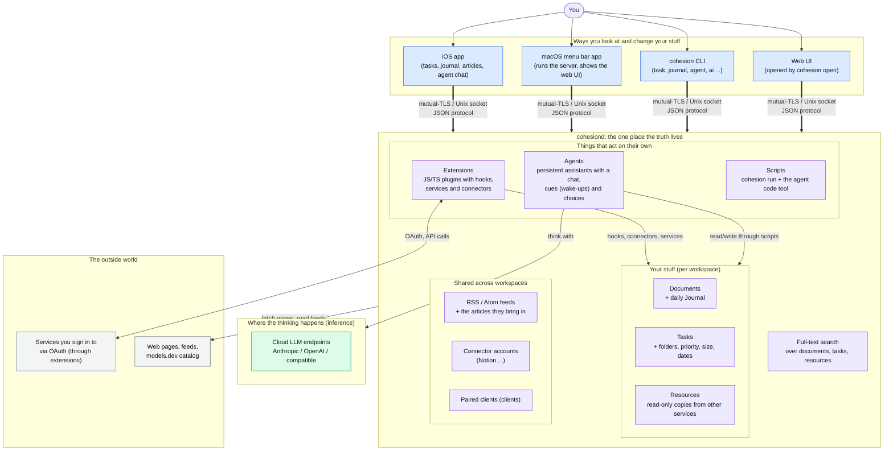
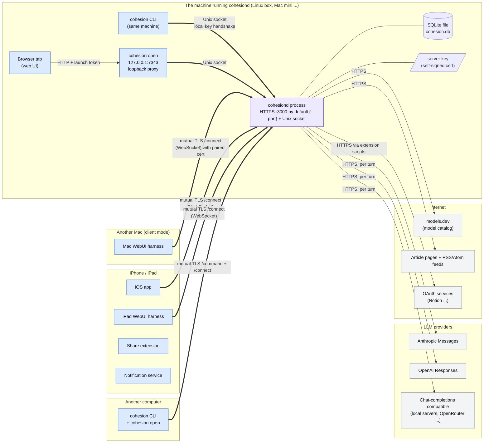
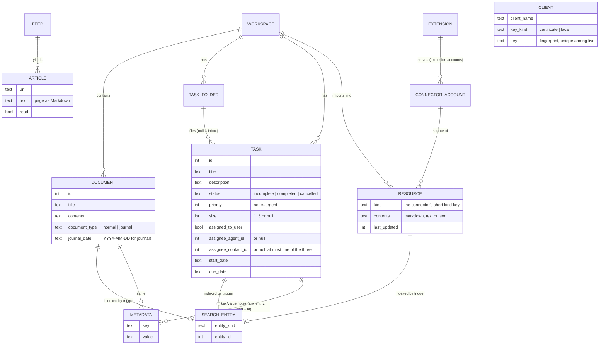
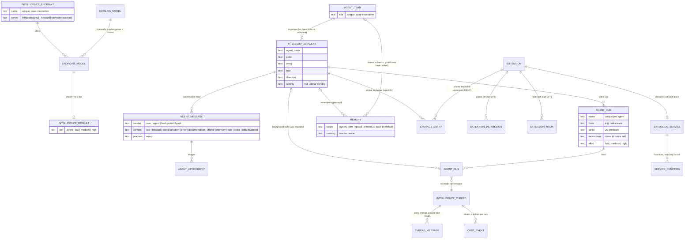

# Part A: The product

## A1. What Cohesion is, as a product

One person, one daemon, many screens. Everything the person owns lives in a single database on the machine that runs `cohesiond`; every app is just a window onto it. Agents and extensions are the two ways the system does things on its own.

## A2. Who talks to whom (runtime topology)

Three kinds of party: the daemon, clients, and the outside world. The thick arrows are the paired, authenticated links.

## A3. What your data looks like (the content model)

Tables that matter to a person, and how they relate. `Workspace` is the container for your work; agents, feeds, accounts and clients sit outside any one workspace.

## A4. What lives *outside* any workspace: intelligence and agent data

