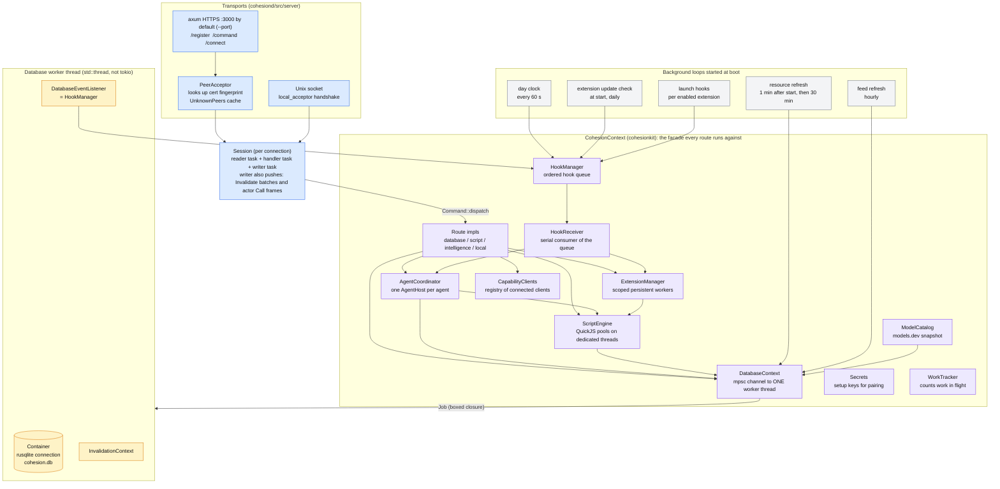
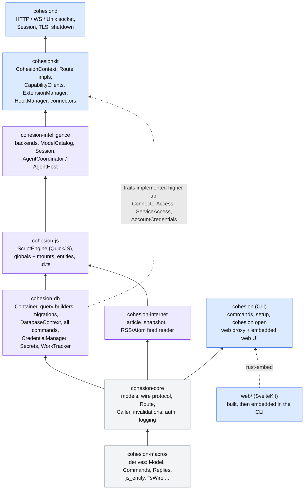
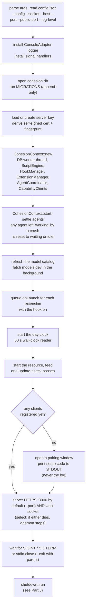
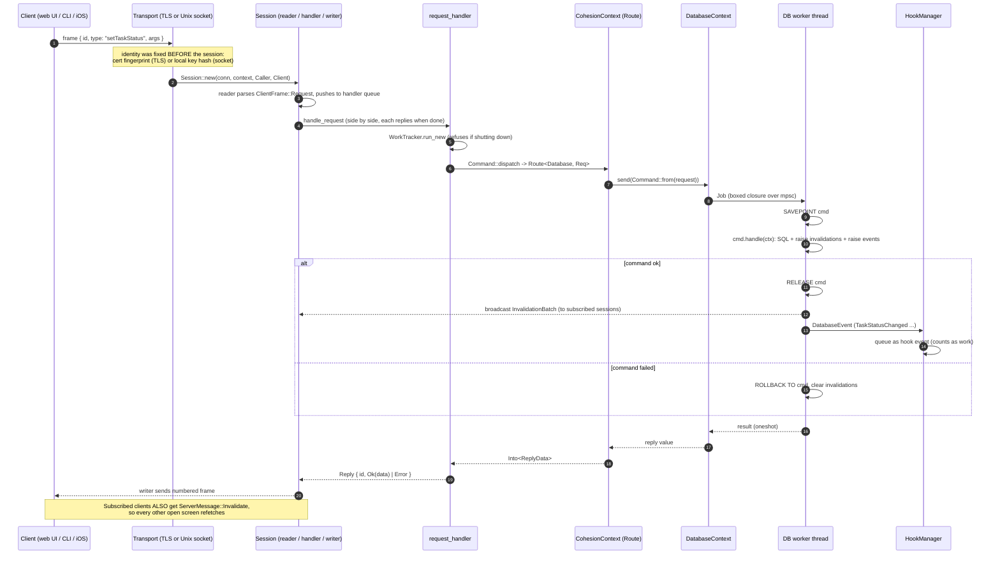
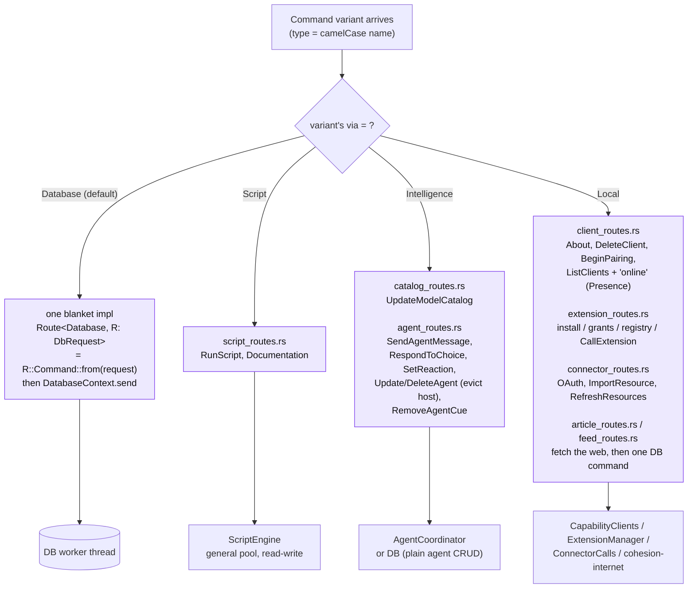
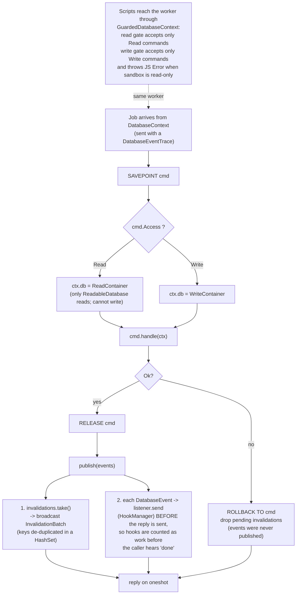
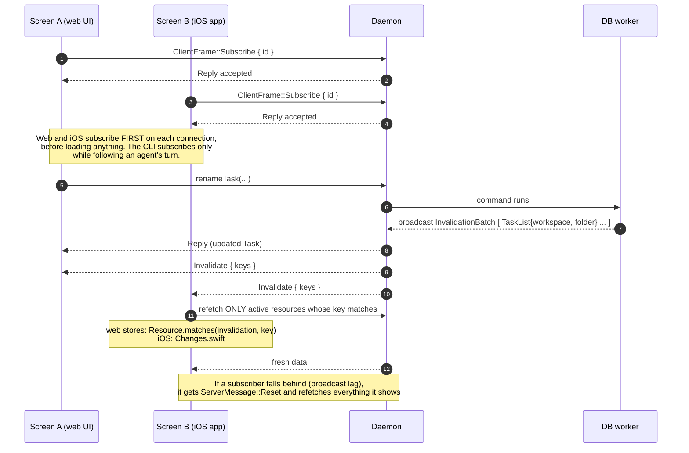
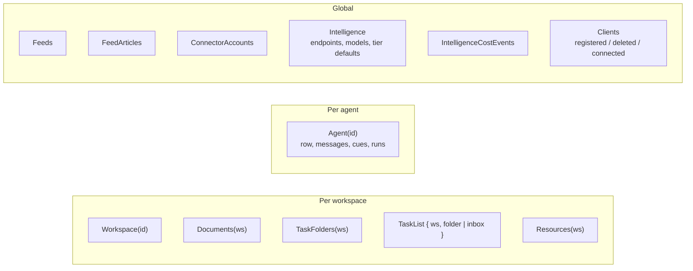

# Part B: Inside the daemon

## B1. The parts of `cohesiond`, and the threads they run on

`CohesionContext` (in `cohesionkit`) is the bag of handles every request handler gets. Everything is a cheap clone around shared state. The one thing that is *not* async is the database: a single OS thread owns the SQLite connection.

## B2. Crate layering (what may depend on what)

One-way dependencies. The CLI never links SQLite, QuickJS or the LLM code. A lower crate that needs something from a higher one declares a tiny trait (`ConnectorAccess`, `ServiceAccess`, `AccountCredentials`) and the higher crate implements it.

## B3. Daemon startup, in order

## B4. One request, end to end (the canonical request flow)

Example: you tick a task as done in the web UI. The same path serves every command from every client.

## B5. Which kind of Route handles a command?

`#[derive(Commands)]` on `Command` generates `dispatch`. Each variant says which kind of route it uses; the default is `Database`.

## B6. Inside the database worker: why every command is atomic and observable

## B7. Live updates: how every screen stays in sync

The server never pushes data, only *what is now stale*. Clients refetch what they are showing.

### Invalidation keys (what "stale" can mean)

