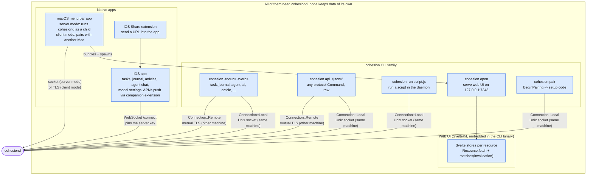
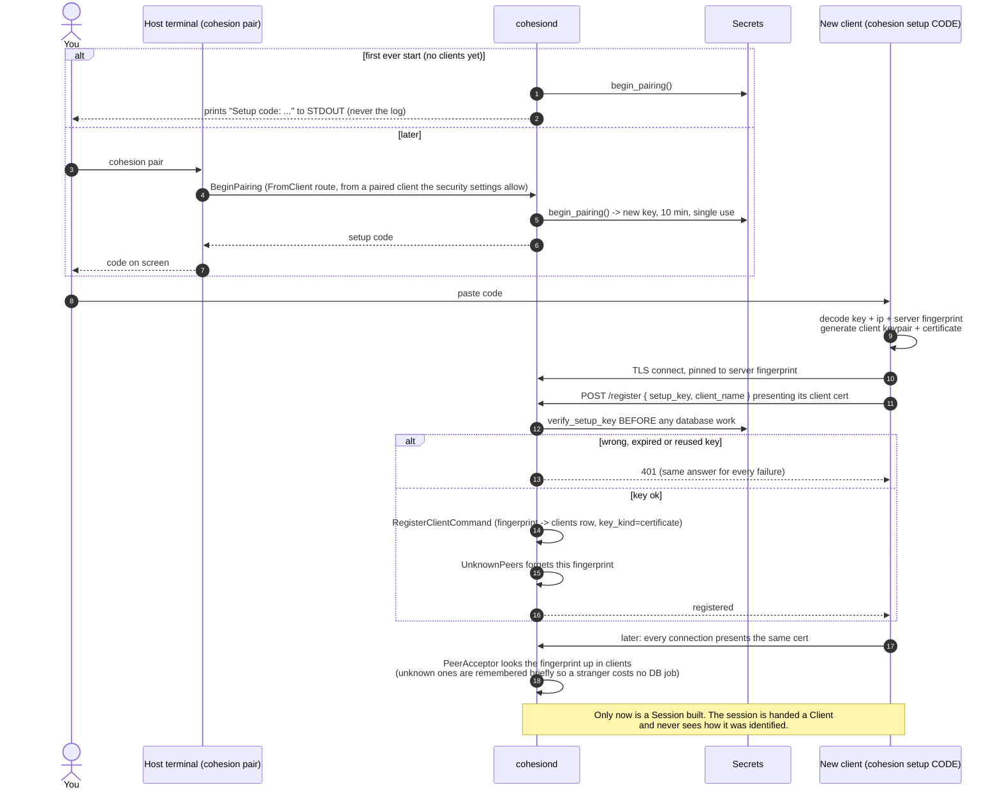
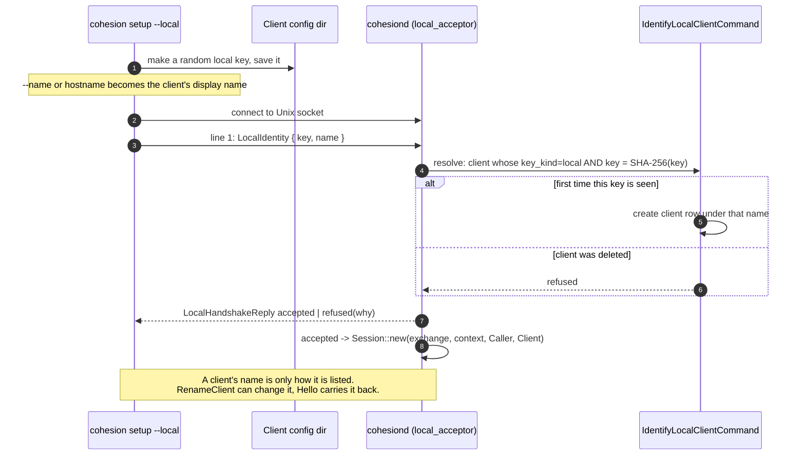
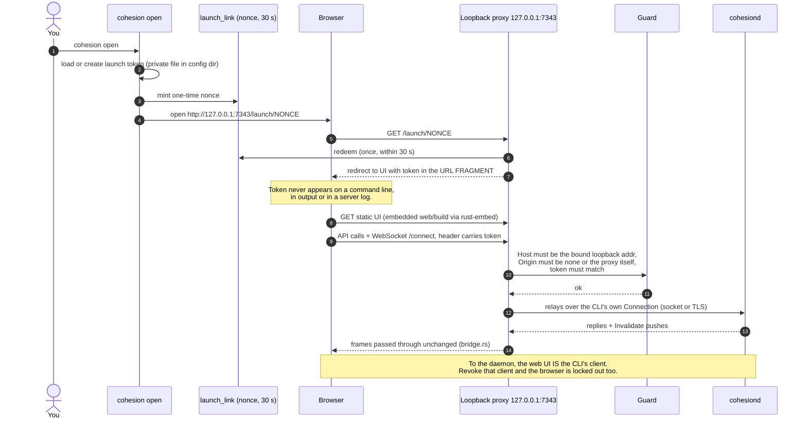
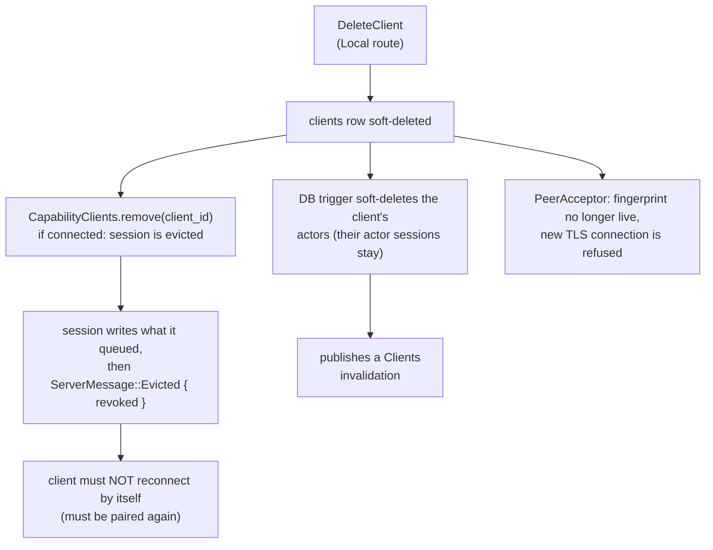

# Part C: Clients, identity and pairing

There is no username or password anywhere. A **client** is a row in the `clients` table, identified by *how it proved itself before the session began*: a TLS certificate fingerprint (`key_kind = certificate`) or a local key hash (`key_kind = local`). A client has no "type"; whether it offers capabilities is just whether it sends a `Hello`.

## C1. The family of clients

## C2. Pairing a new client (remote, over the network)

A **setup key** exists only during a *pairing window*: it dies after one registration or ten minutes. The setup code is `base64("key|host|server-fingerprint")`, so it carries the secret, where to connect and which server key to expect. The host is an ip or a DNS name (`--host`). When clients connect on a port other than the default 3000 (`--public-port`, else `--port`), the address is `host:port` (`[v6]:port` for IPv6); a code without a port means 3000.

## C3. Local clients on the Unix socket

No TLS here. The socket file's permissions are the trust.

## C4. The web UI path: `cohesion open`

The browser has no identity of its own. A loopback proxy owned by the CLI lends it the CLI's.

## C5. What happens when you delete a client (revoke a device)

