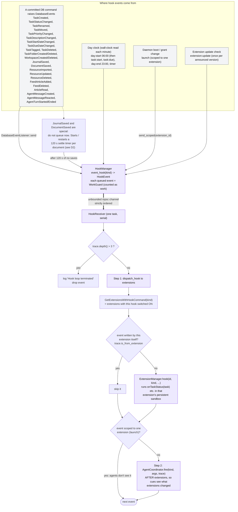
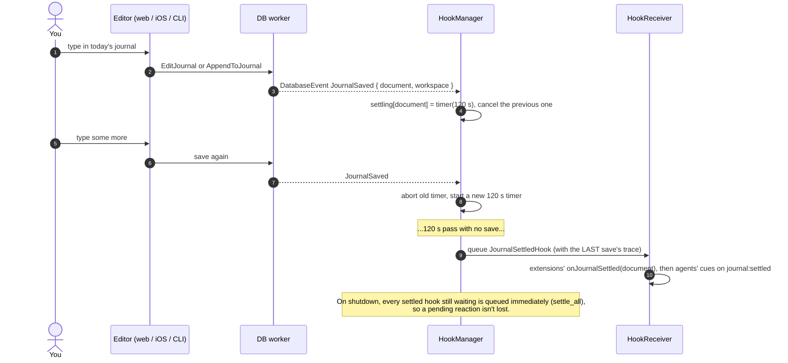
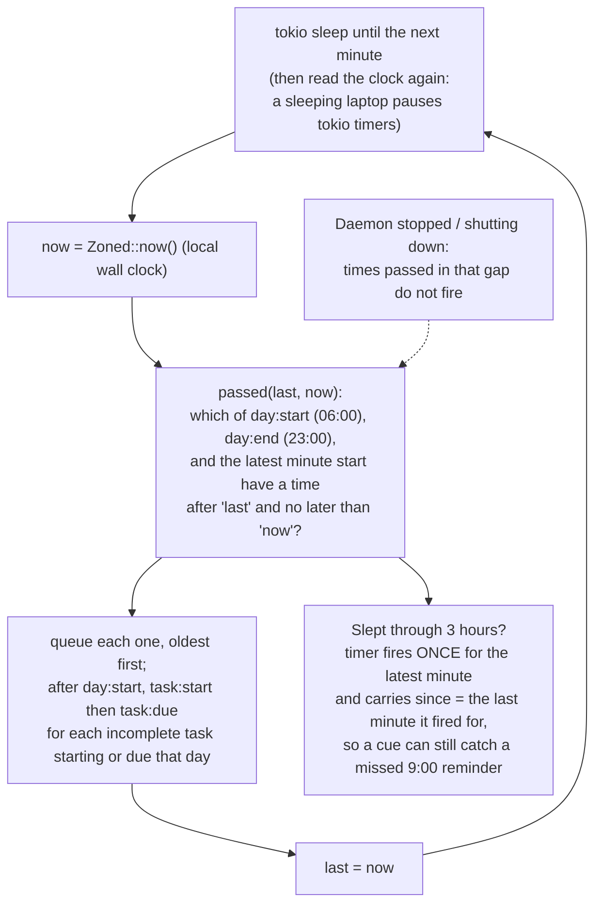
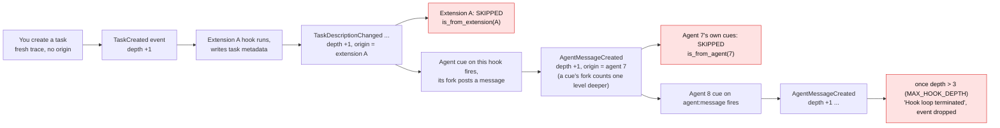

# Part D: Events, hooks and time

Nothing in Cohesion polls your data. When a command commits, it can raise a *database event*; the **HookManager** turns that (and wall-clock ticks) into *hook events* on one ordered queue; the **HookReceiver** runs them one at a time, first in extensions, then in agents' cues. This is the "what wakes it up" for everything automatic.

## D1. The event bus

## D2. Journal "settling" (why `journal:settled` is delayed)

A journal is saved on every pause while you type. Waking an agent on each save would be absurd, so the save only restarts a timer. Any other document does the same with `DocumentSaved` and `document:settled`.

## D3. The day clock

## D4. Loop protection: why agents and extensions can't wake each other forever

Every database event carries a **trace**: a depth counter plus an origin (which extension or which agent wrote). A write made while handling an event continues that trace. The trace also counts **hops**, the forks a chain was handed through, separately from the depth that limits hooks (3). An actor-session follow-up is a hop, and so is a question between agents: its fork carries its asker's trace one hop further. Hops are logged, never limited; the spend limits hold a chain that runs on.

