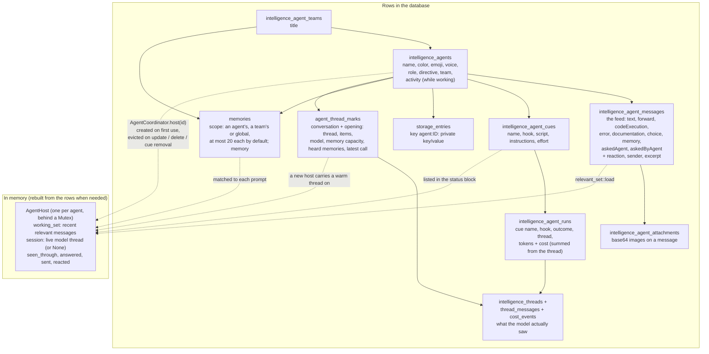
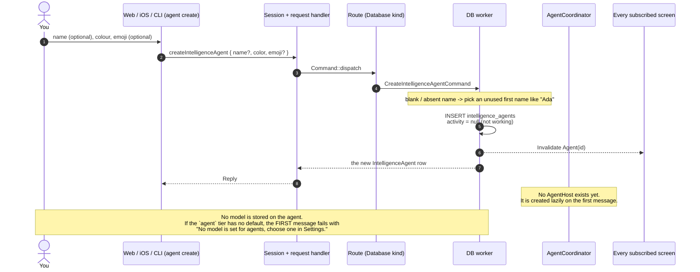
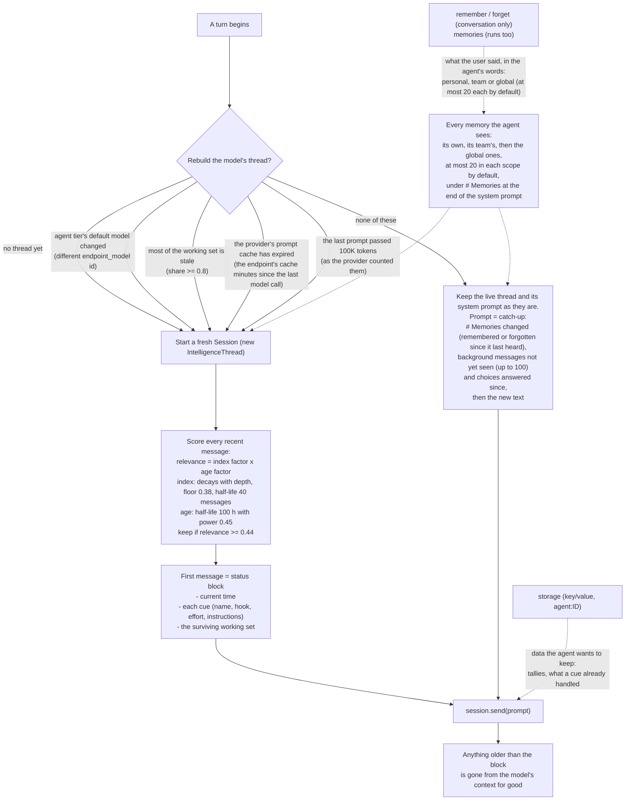
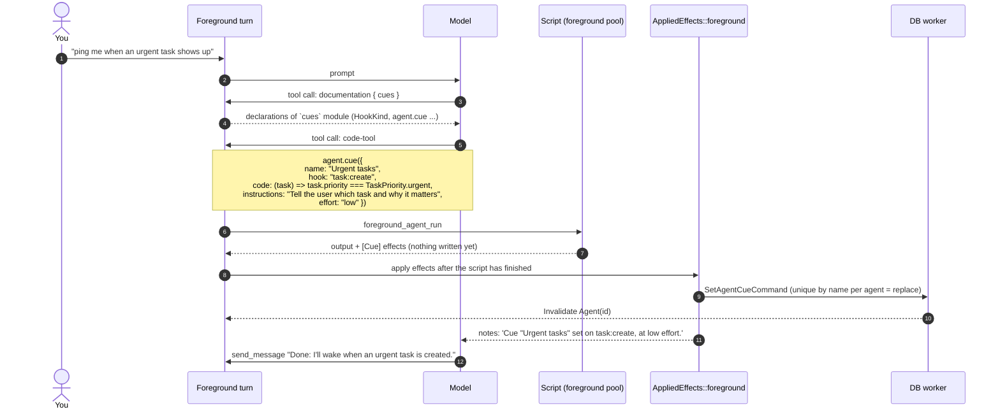
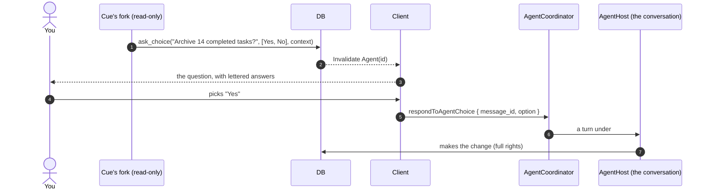
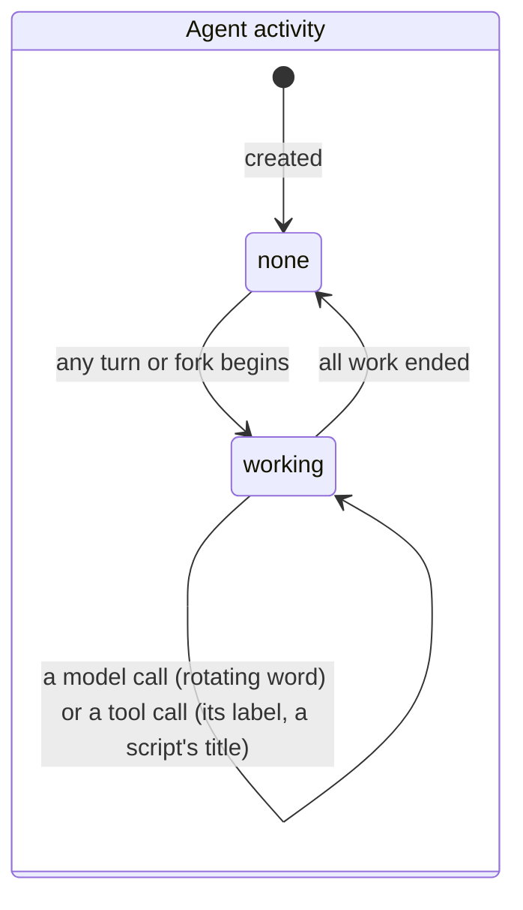
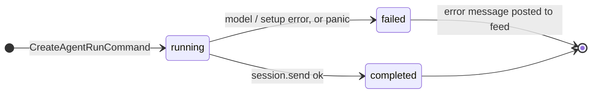
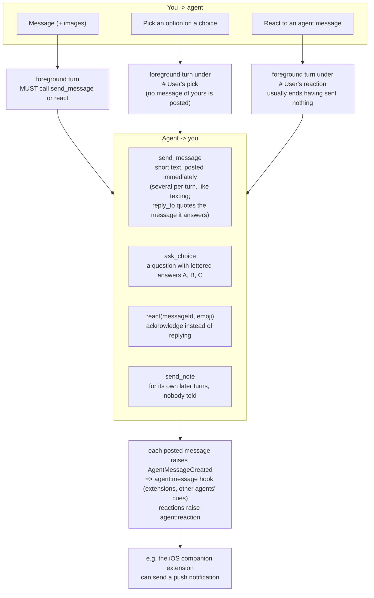

# Part E: Agents

An **agent** is a persistent assistant: one standing conversation, an activity line while it works, and **cues** (hooks that wake it up in the background). It is *not* a long-running process. Between events it is just rows in the database; a thread to a model is built when something needs it.

Two modes, with deliberately different powers:

| | Foreground (chat) | Background (a cue's run) |
|---|---|---|
| Started by | you: message, choice pick, reaction | a hook event whose cue predicate returns truthy |
| Model | the `agent` tier's default | the tier named by the cue's `effort` (`low` / `medium` / `high`) |
| Script role | `AgentRole::Turn(User)`: read-write `cohesion`, `network`, `connectors`, `storage`, `agent` | `AgentRole::Turn(Event)`: the same tools, read-only `cohesion`, **no `network`**, no cues or memories set |
| May change data | yes, on the strength of your message | **no**: reads, messages you, notes, and asks with `ask_choice` before any change |
| Can set cues / remember | yes | no (reads memories only) |

## E1. Anatomy of an agent (what is stored, who uses it)



## E2. "User creates an agent"

Note what is *not* chosen at creation: the model. An agent has no model of its own; it uses whatever the `agent` tier points at *at the time of each turn*.



## E3. "User sends a message": the foreground turn

The request returns immediately (`AcceptedResponse`); the turn runs on its own task. Clients follow it through invalidations: the activity is set while it works, messages land in the feed as the agent's tools post them.

```mermaid
sequenceDiagram
    autonumber
    actor You
    participant UI as Client
    participant RT as agent_routes
    participant AC as AgentCoordinator
    participant H as AgentHost (locked)
    participant DB as DB worker
    participant SE as Session (cohesion-intelligence)
    participant LLM as Backend (HTTP provider)
    participant JS as ScriptEngine foreground_agents

    You->>UI: "watch my inbox folder for new tasks"
    UI->>RT: sendAgentMessage { agent_id, message, attachments? }
    RT->>AC: send_message
    AC->>AC: queue(): poll the host lock ONCE to take a FIFO place<br/>(turns run in the order requests arrived)
    AC->>DB: CreateUserAgentMessageCommand (+ attachments)
    DB-->>UI: Invalidate Agent(id) (your message appears)
    AC->>AC: spawn(job) on its own task, counted in WorkTracker
    AC->>AC: activity.begin -> activity = "Thinking"
    AC-->>RT: returns once the activity is set
    RT-->>UI: AcceptedResponse
    Note over AC,H: --- the turn, in the background ---
    AC->>H: answer_message (lock acquired when its turn comes)
    H->>DB: tier_model(Agent): current default endpoint_model + endpoint
    alt default changed since the thread began OR no thread OR working set mostly stale OR cache expired OR prompt over 100K tokens
        H->>DB: relevant_set::load + list cues
        H->>DB: ListMemoriesCommand: every memory it sees (its own, its team's, global; at most 20 each by default)
        H->>SE: Session::new(model, ForegroundAgent prompt + # Your team / # Other agents + # Memories, tools, cache_key)
        SE->>DB: CreateIntelligenceThreadCommand
        H->>H: prompt = status block (time, cues, recent messages)
    else live thread still fresh
        H->>DB: ListMemoriesCommand
        H->>SE: hear_memories: what changed since the thread last heard (its system prompt never changes)
        H->>H: prompt = "# Memories changed" + "# Since your last reply" catch-up + your message
    end
    H->>SE: send(prompt, images)
    loop up to 50 rounds (MAX_ROUNDS)
        SE->>LLM: transcript + tool definitions
        LLM-->>SE: assistant text and/or tool calls
        SE->>DB: record every transcript item + IntelligenceCostEvent
        opt tool call: code-tool
            SE->>JS: foreground_agent_run(agent_id, code)
            JS->>DB: read / write commands via GuardedDatabaseContext
            JS-->>SE: output + AgentEffects (cue, removeCue, follow)
            SE->>DB: record codeExecution message, apply effects
        end
        opt tool call: send_message / ask_choice / react
            SE->>DB: CreateAgentMessageCommand (agent's text, choice, or reaction)
            DB-->>UI: Invalidate Agent(id) (appears live in the feed)
        end
        opt tool call: remember / forget
            SE->>DB: CreateMemoryCommand / DeleteMemoryCommand + a memory message in the feed
        end
        opt tool call: memories
            SE->>DB: ListMemoriesCommand
        end
        opt tool call: documentation
            SE-->>LLM: declarations of a script module on demand
        end
    end
    H->>AC: turn ends
    AC->>DB: activity.end -> activity = null (or the older work's)
    DB-->>UI: Invalidate Agent(id)
    Note over SE: The model's FINAL text reply is never shown.<br/>The user sees only what send_message / ask_choice / react posted.
```

## E4. What the model "remembers": context, memories and the rolling thread

The model's thread is disposable. What survives is the feed (database) plus memories and `storage`.



## E5. An agent sets a cue ("what wakes it up")

A cue is a (hook, predicate-script, instructions, effort) tuple. The agent writes it from inside the chat by running a script that calls `agent.cue(...)`.



## E6. A cue fires: a fork started by an event

This is the whole "something happened, so the agent wakes and acts" path. Cheap first (a JS predicate on a small pool), expensive only if it passes (an LLM call).

```mermaid
sequenceDiagram
    autonumber
    actor You
    participant W as DB worker
    participant HM as HookManager
    participant HR as HookReceiver
    participant AC as AgentCoordinator.fire
    participant JS as ScriptEngine (cue evaluation on background pool)
    participant BR as run_background
    participant DB as DB (commands)
    participant SE as Session
    participant LLM as Model of the cue's effort tier
    participant BJ as cues pool

    You->>W: create task "Pay rent" priority urgent
    W-->>HM: TaskCreated { task, workspace } (after commit)
    HM->>HR: queued hook event task:create
    HR->>HR: extensions with task:create ON run first
    HR->>AC: fire(task:create, [Task args], trace)
    AC->>DB: ListAgentCuesForHookCommand(task:create)
    loop each cue
        AC->>AC: skip if trace.is_from_agent(cue.agent_id)
        AC->>JS: evaluate_cue(agent, cue.script, args)
        JS-->>AC: CueEvaluation { fired, subject, payload }
        Note over AC,JS: predicate returns true -> payload is the whole subject.<br/>Any other truthy value -> that value is the payload (saves tokens).<br/>Falsy -> nothing happens.
        alt fired
            AC->>AC: WorkTracker.begin (taken BEFORE spawn so shutdown waits)
            AC->>BR: tokio::spawn(run_background)
        end
    end
    Note over AC: fire() returns once cues are evaluated.<br/>Model calls happen on spawned tasks, so the hook queue never waits on a model.
    BR->>DB: ListMemoriesCommand (its own, its team's and the global ones)
    BR->>DB: tier_model(cue.effort -> low|medium|high)
    BR->>SE: fork of the conversation (cue effort's model, same prompt and tools)
    Note over BR,SE: the conversation's tools, but writes throw,<br/>no network, no cues or memories set
    BR->>DB: CreateAgentRunCommand (outcome running, thread id)
    BR->>SE: send(wake message: cue instructions + hook + payload)
    loop model turns
        SE->>LLM: transcript + tools
        LLM-->>SE: tool calls
        opt code-tool
            SE->>BJ: traced_foreground_agent_run(code, Event)
            BJ->>DB: READ-only commands
            BJ-->>SE: output + effects
            Note over SE: writes throw; it asks with ask_choice instead.
        end
        opt send_message
            SE->>DB: message to the feed (trace continues from the event)
        end
    end
    BR->>DB: FinishAgentRunCommand(completed | failed)
    Note over DB: failure -> run `failed` + an `error` message posted in the feed
    DB-->>You: Invalidate Agent(id) (phone / web shows the message)
```

## E7. Asking first: how a turn the user didn't start changes anything

A fork a cue started only reads. To change something it asks with `ask_choice`, putting in `context` what to do on each answer; your pick starts a turn of the conversation, started by you, which makes the change.



## E8. State machines





## E9. Choices and reactions (the lightweight ways to talk to an agent)


