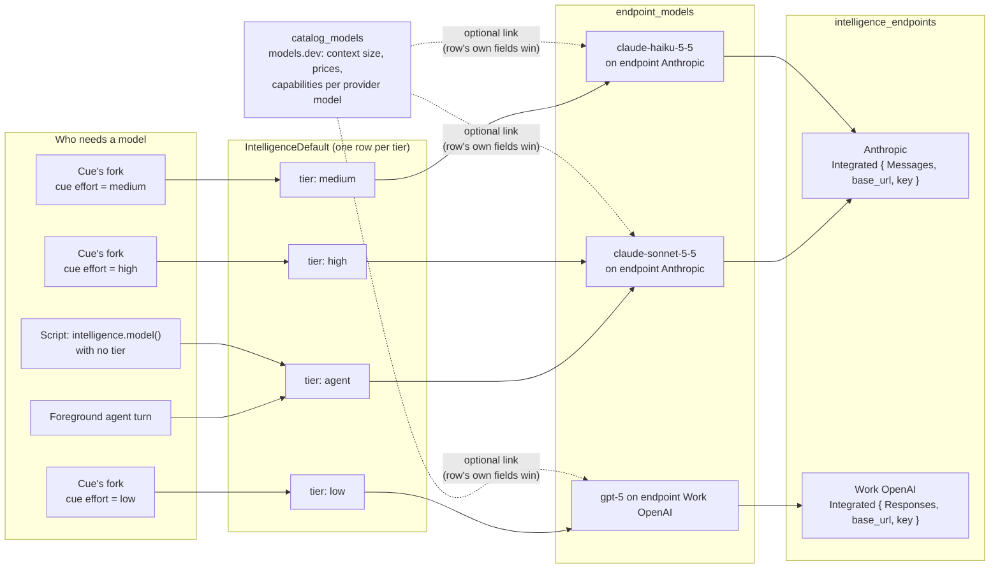
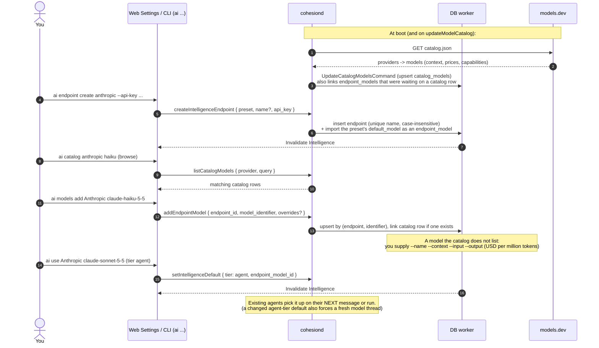
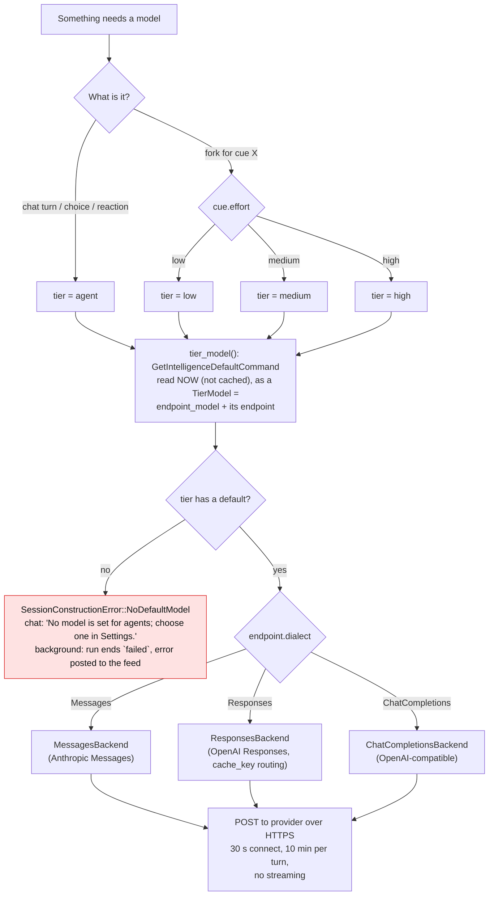
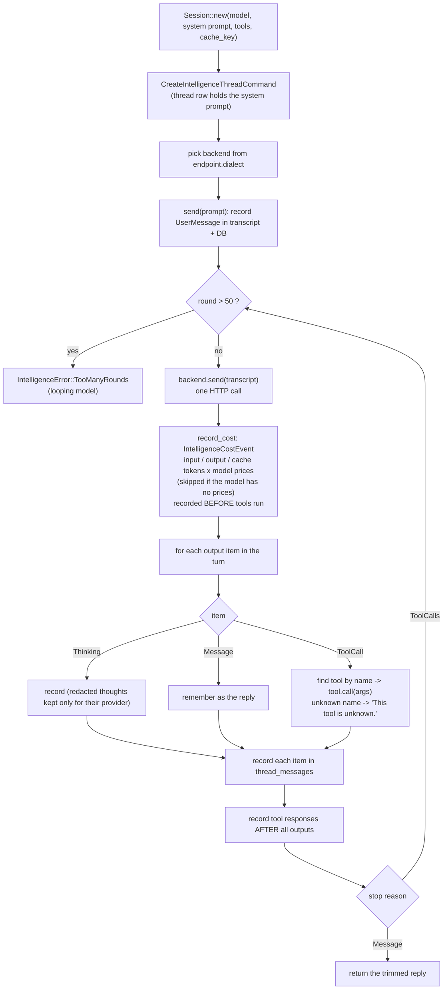
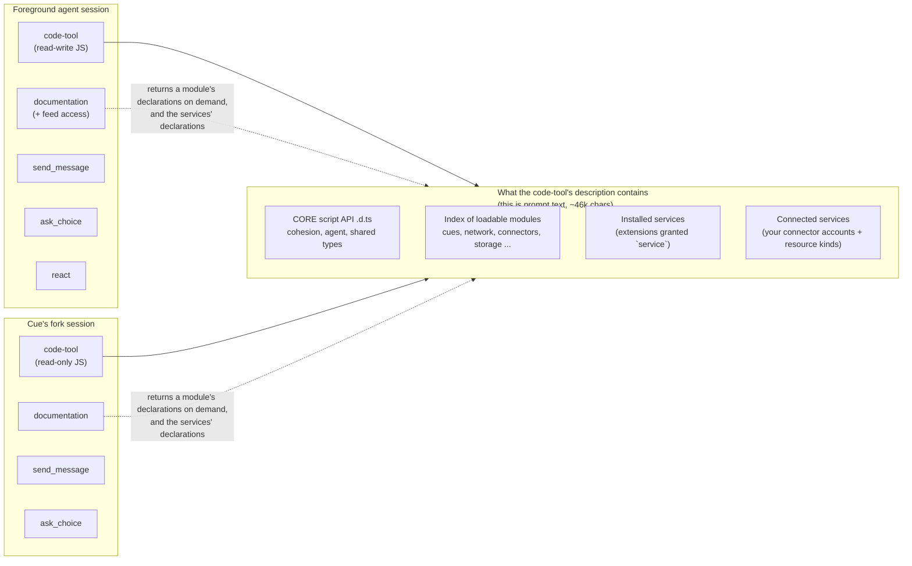

# Part F: Inference (how a model gets chosen and called)

Four ideas, in order of indirection:

1. An **endpoint** is *where* a model runs: a provider account (Anthropic, OpenAI, an OpenAI-compatible server), reached with an API key or by signing in through an extension's connector account.
2. An **endpoint model** is *which* model that endpoint offers, optionally linked to a **catalog model** (models.dev) for price and context size.
3. A **tier** (`agent`, `low`, `medium`, `high`) is a named slot that points at exactly one endpoint model.
4. A **session** never names a model. It asks for a tier, at the moment it starts.

## F1. The indirection chain

Deleting a model or an endpoint **unsets the tiers that used it** (database cascade), so a tier can be empty; asking an empty tier fails with `NoDefaultModel`.

## F2. "User sets up inference"

## F3. "Which model does *this* run use?" (decision flow)

## F4. One model turn, inside `Session`

`Session` is the conversation engine for *every* model use; agents are just callers with particular tools and system prompts.

Every session but the user's own foreground turn (every fork) is built `capped` with a `SpendCap`: before each `backend.send` it checks the spend limits (Settings › Agents: per hour, day and month, each rolling and unset by default), and a reached one ends the answer with `IntelligenceError::SpendLimitReached`. The agent's feed hears so once per period, not once per run. A job checks before it starts too, so a timer cue held back records nothing.

## F5. Tools available to each kind of session

