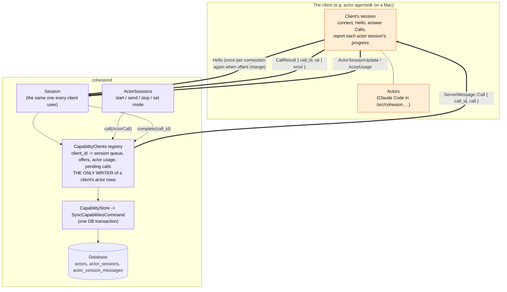
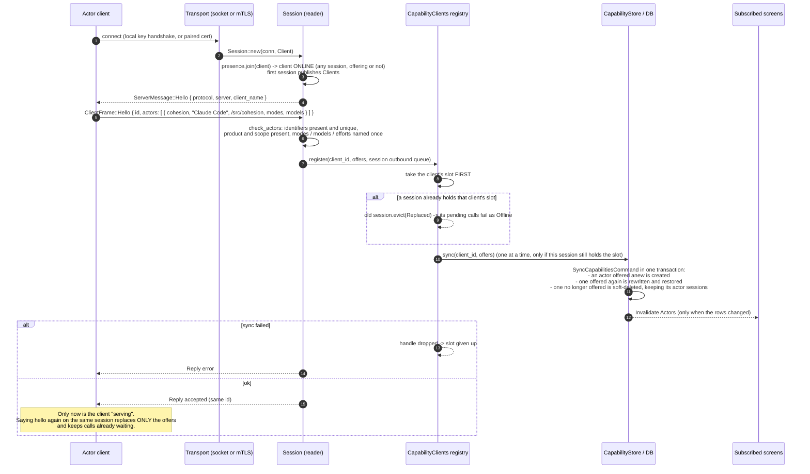
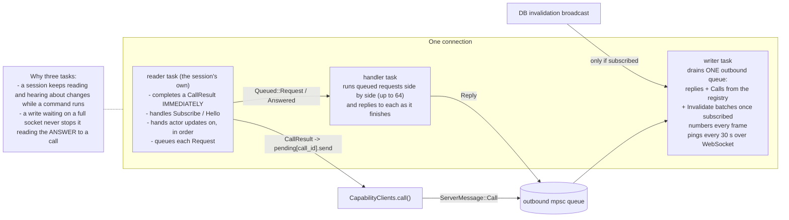
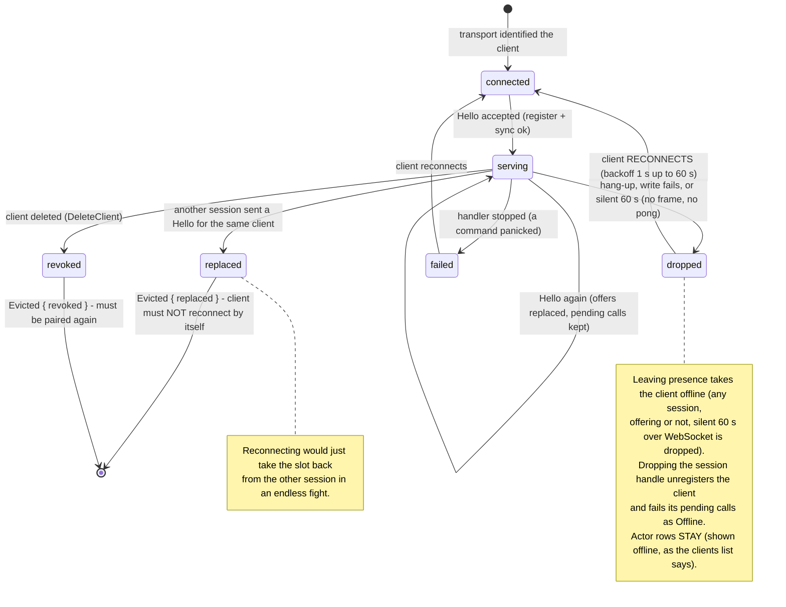
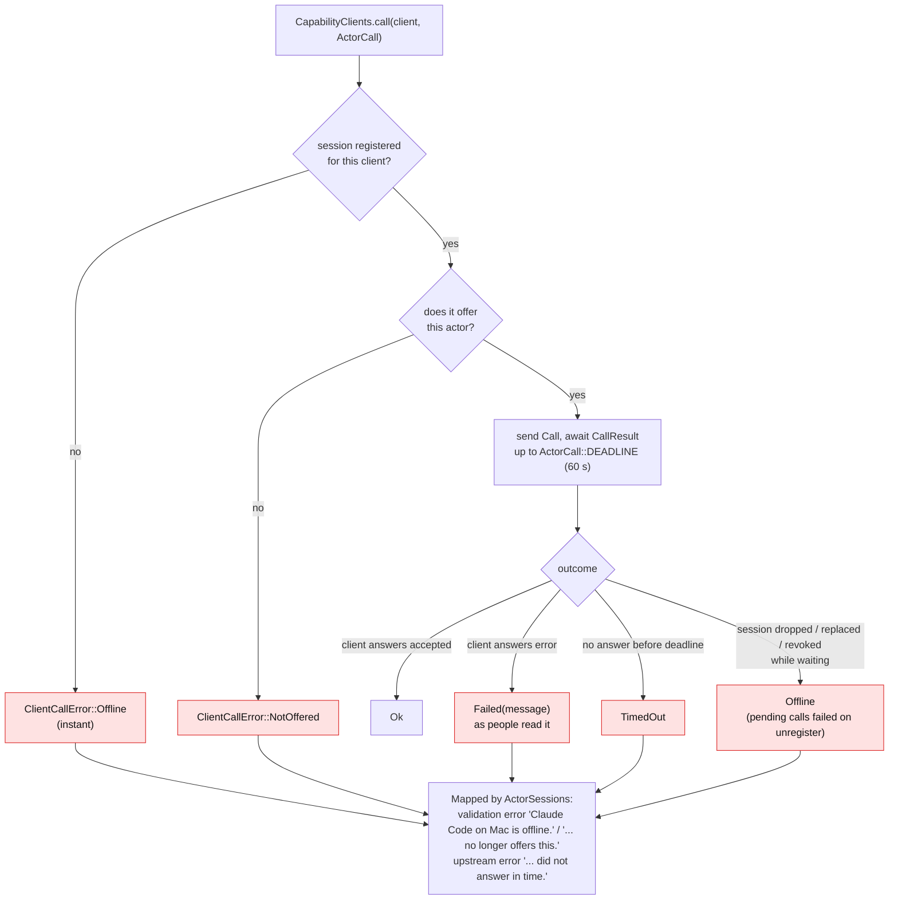
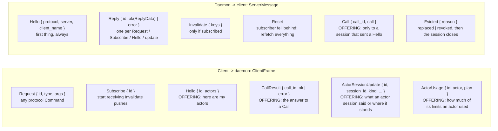

# Part G: Capabilities (clients that serve the daemon)

Ordinary clients *ask* the daemon for things. A client may also *offer* **capabilities**: the **actors** on its device (an agent such as Claude Code in one directory, that Cohesion hands actor sessions to), and then *answers the daemon's calls* to them. It is the same session, the same connection, the same identity; it just sends a few extra frames (`Hello`, `CallResult`, `ActorSessionUpdate`, `ActorUsage`) and handles a few extra inbound ones (`Call`, `Evicted`). [actors.md](../actors.md) walks through an actor's session frame by frame.

A `Hello` lists the client's actors, each an `ActorDefinition` (identifier, product, scope, modes, models and efforts). Each becomes an `Actor` row, read as "Claude Code on Ada's MacBook Pro"; one the client stops offering is soft-deleted and keeps its actor sessions.

## G1. The big picture: who owns what

> Lower crates never see a connection. The database only sees `SyncCapabilitiesCommand`.

## G2. Connecting and offering (sequence)

## G3. Inside one session: three tasks and a registry

## G4. What ends a session (and what the client must do)

## G5. Everything that can go wrong calling a client

> A session on an actor that is offline **fails with that error rather than waiting**. Nothing queues for it.

## G6. Frame vocabulary (the whole protocol on one page)

