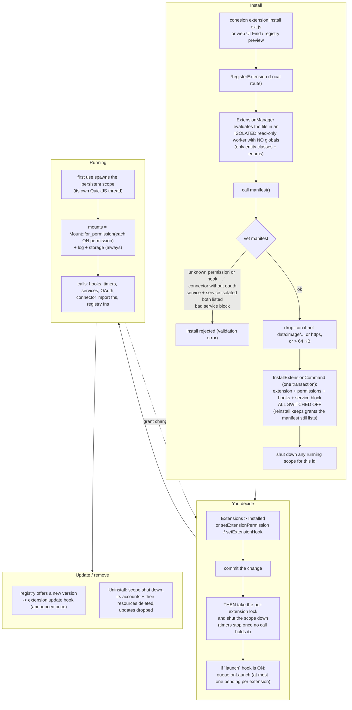
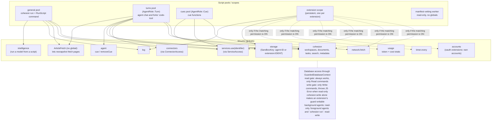
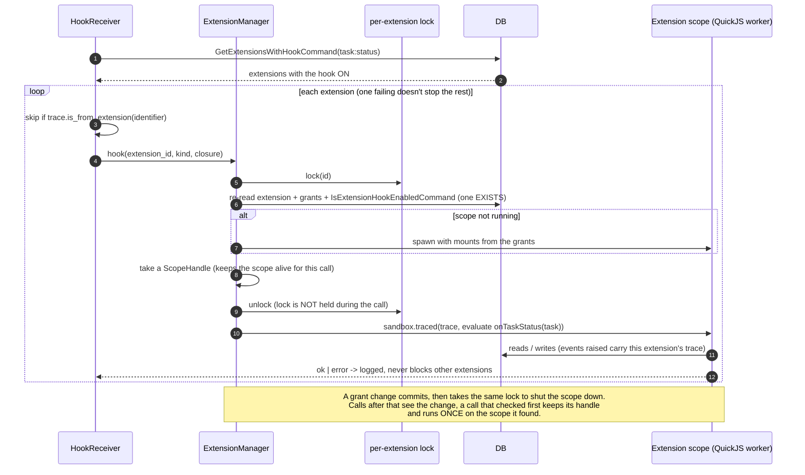
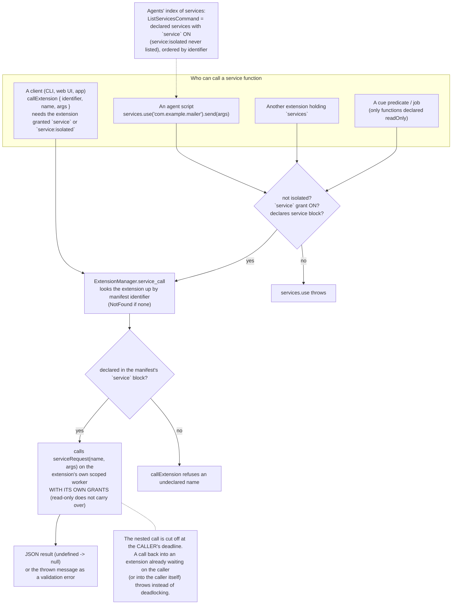
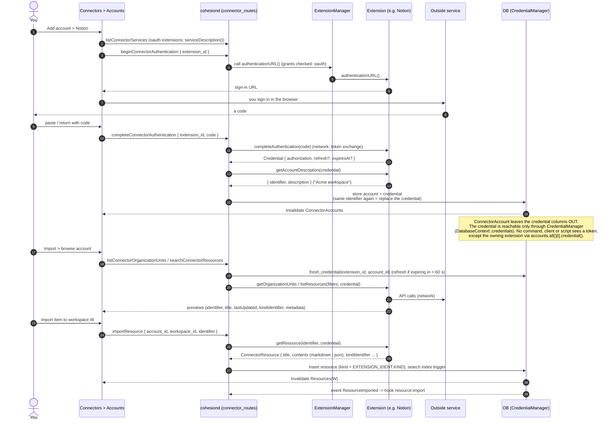
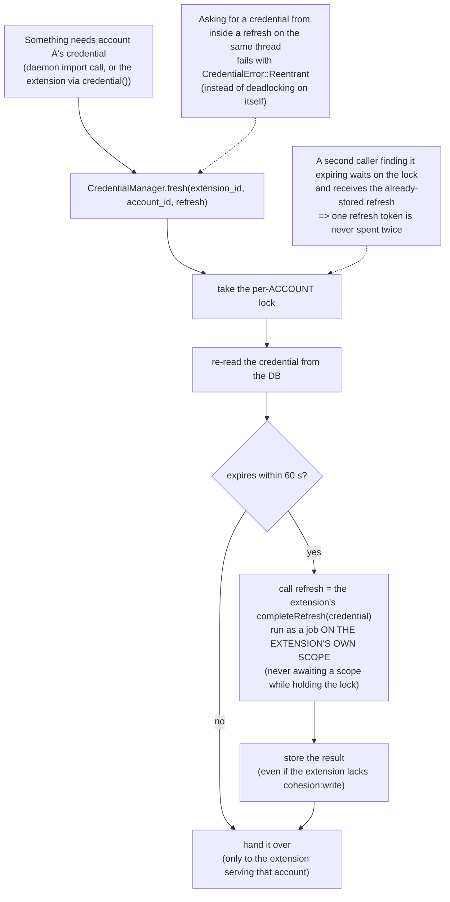
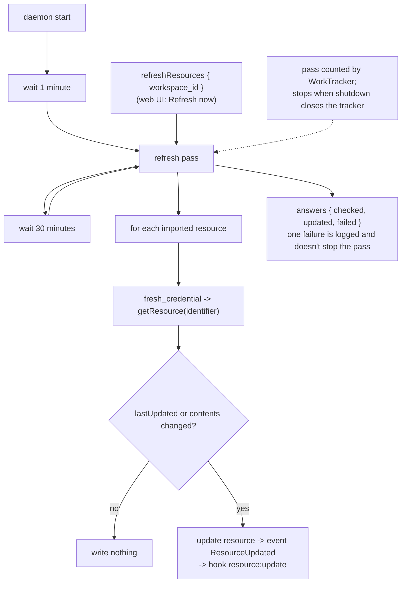
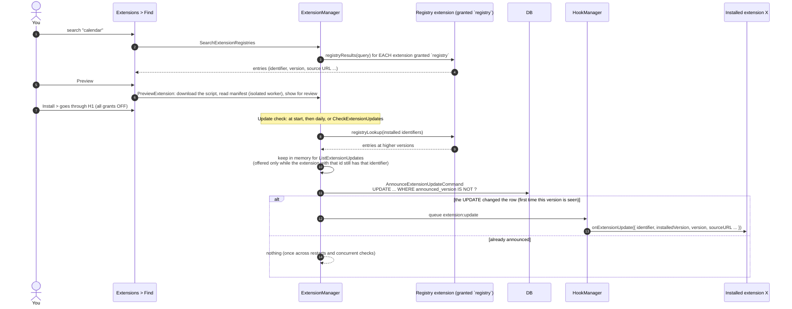

# Part H: Extensions, connectors and scripts

An **extension** is one JS/TS file with a `manifest()` and some hook functions. It is the way to add behaviour *without* changing Rust: react to events (hooks), expose callable functions (services), sign you in to outside services (OAuth accounts), import items (connectors), offer other extensions to install (registries), or run on a timer.

Trust rule: an extension is trusted **once installed and a grant is on**. Everything starts **off**. A grant decides which *mounts* (JS globals) its sandbox gets; nothing inside a mount second-guesses the grant.

## H1. Lifecycle of an extension

## H2. Script sandboxes: who gets which globals

Every script runs on a dedicated thread in a fresh QuickJS runtime; scopes never share prototypes. What differs is the pool and the mounts.

Quick reference of the permission → mount map (`Mount::for_permission`):

| Permission | Mount / effect |
|---|---|
| `cohesion:read`, `cohesion:write` | `cohesion` global (write makes the guard writable and hook arguments writable) |
| `network` | `network` |
| `timer` | `timer` |
| `oauth` | `accounts`; daemon may call the sign-in functions |
| `services` | `services` (call other extensions' declared functions) |
| `usage` | `usage` |
| `registry`, `connector`, `service`, `service:isolated` | **no global**: they let the *daemon* (or clients) call certain functions in the extension |

## H3. A hook reaching an extension (concurrency detail)

## H4. Services: extensions calling each other, and clients calling extensions

## H5. Connectors: adding an account (OAuth) and importing

An extension holding `oauth` + `connector` is a connector. The daemon calls *its* sign-in and import functions.

## H6. Credentials are refreshed exactly once

## H7. Resource refresh loop

## H8. Registries and update announcements

