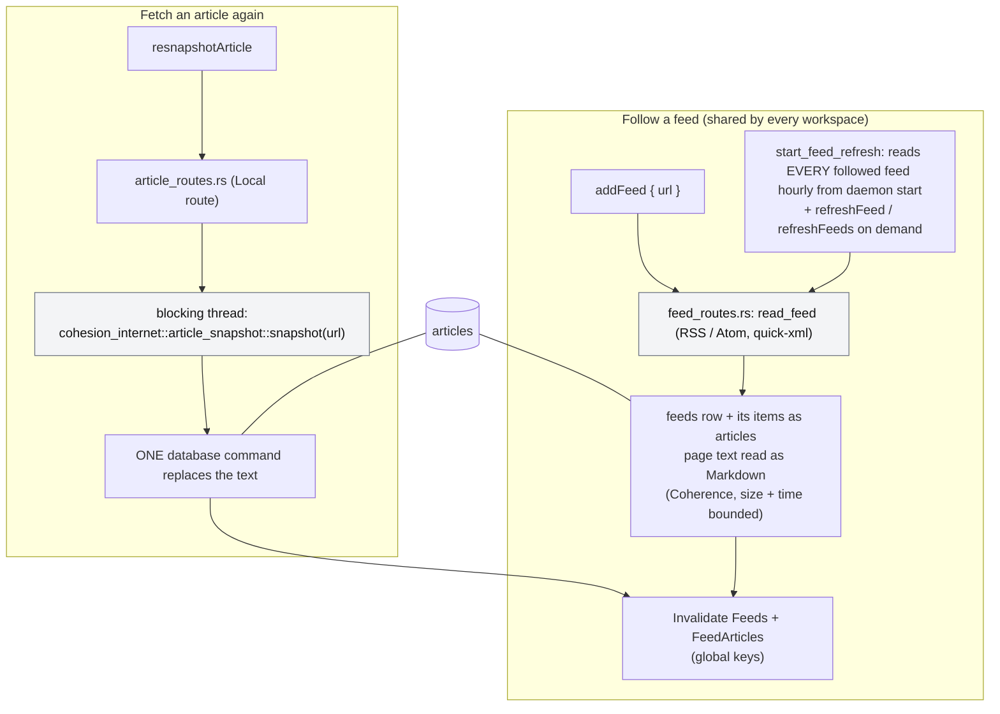
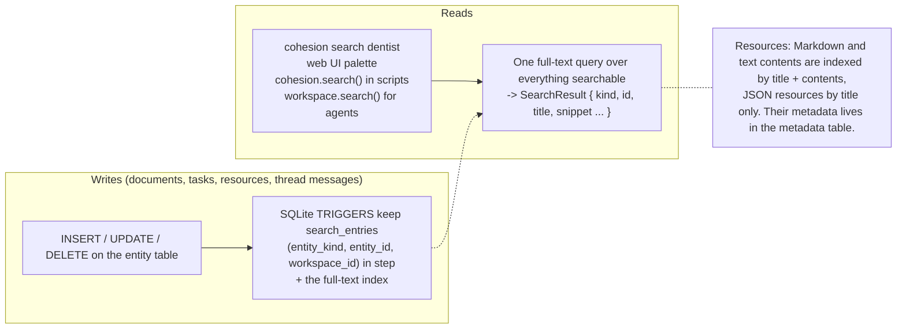
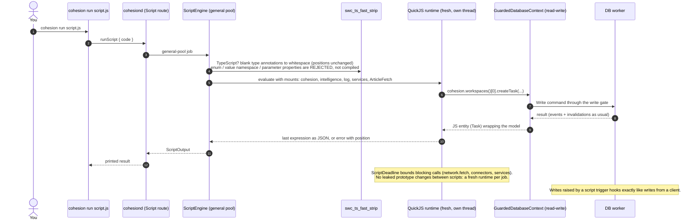
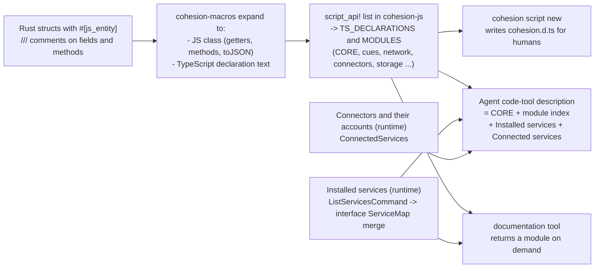
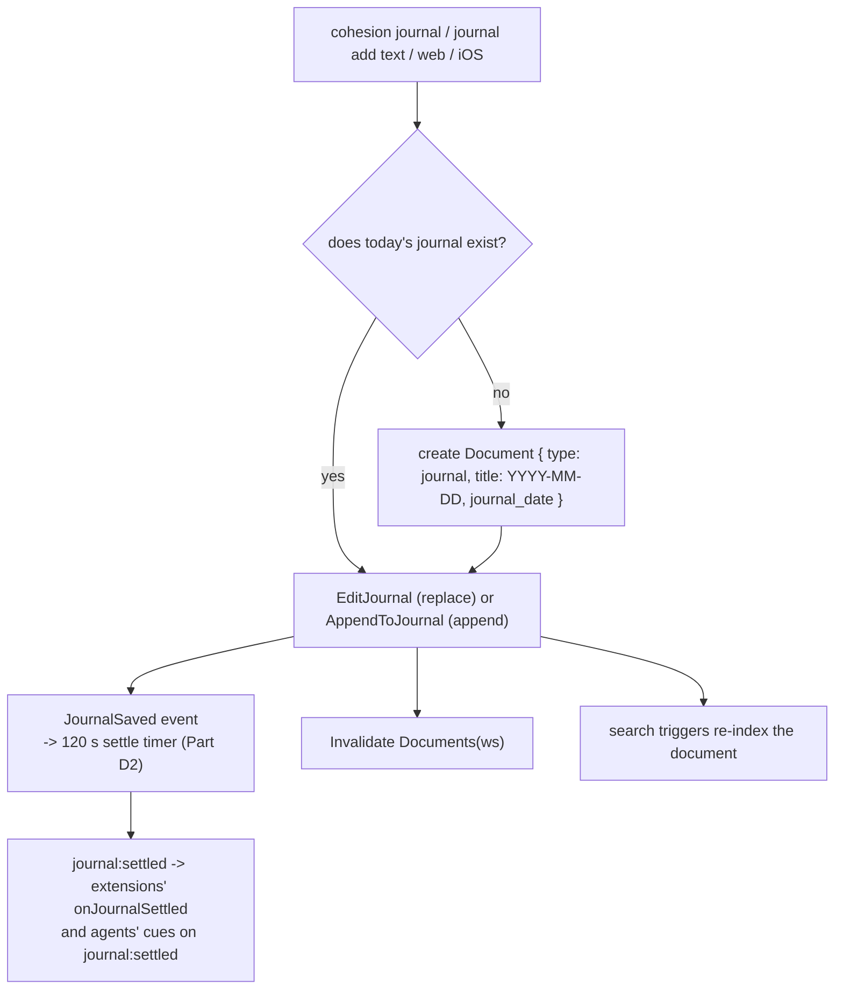

# Part I: Content flows (documents, tasks, articles, feeds, search, scripts)

## I1. Following a feed and reading its articles

Feeds are shared by every workspace, and every article comes from a feed. Read state and text belong to the article itself. The Articles page reads them; Research searches them.

## I2. Search

## I3. Running a script yourself (`cohesion run`)

## I4. How the script API reaches an LLM (one source of truth)

## I5. Journal: one document per workspace per day

