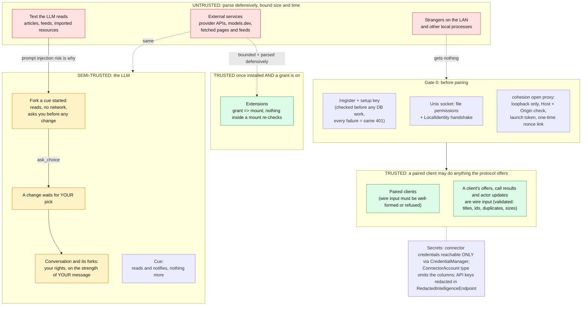
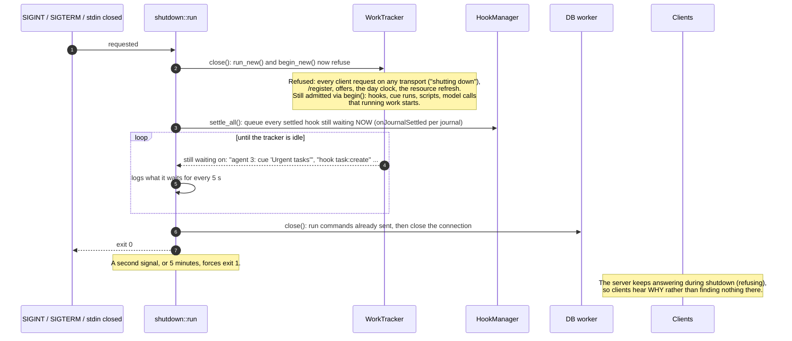
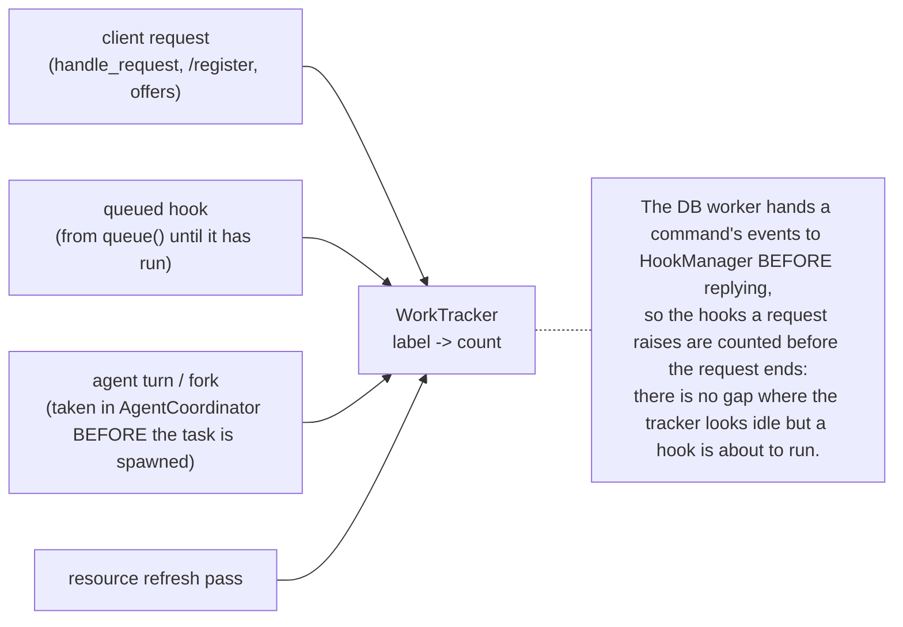
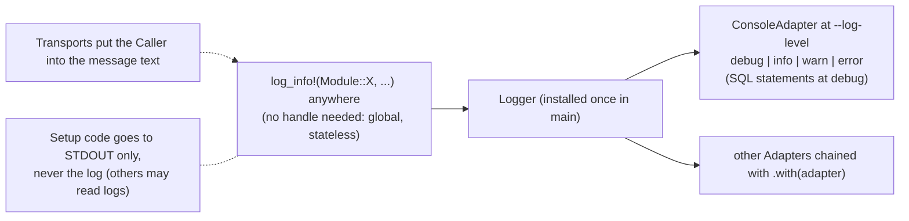
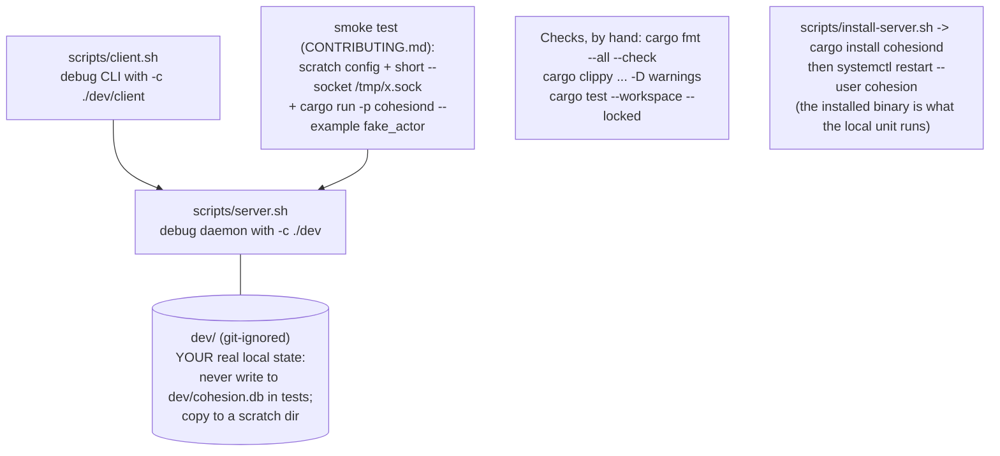

# Part J: Trust boundaries and operations

## J1. Who is trusted for what

The design rule: validate at these boundaries and nowhere else. A capability a pool lacks is a *mount it does not have*, not a check inside a mount.

## J2. Graceful shutdown

## J3. What counts as "work in flight"

## J4. Logging

## J5. Development and local deployment (on this machine)

