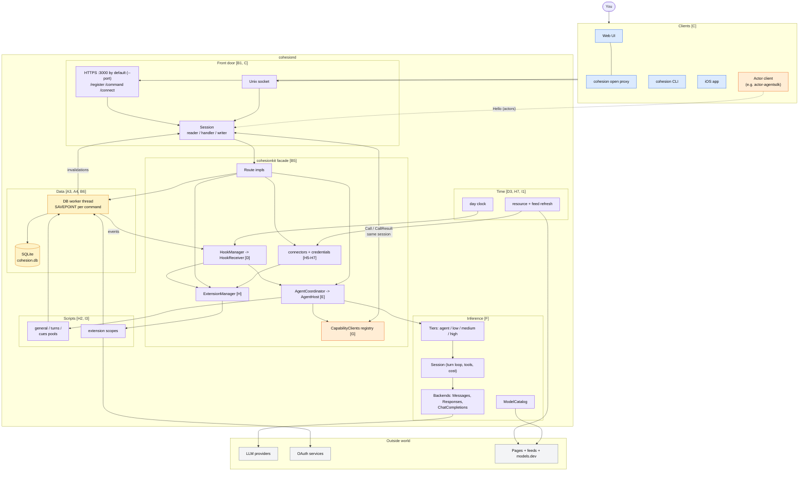
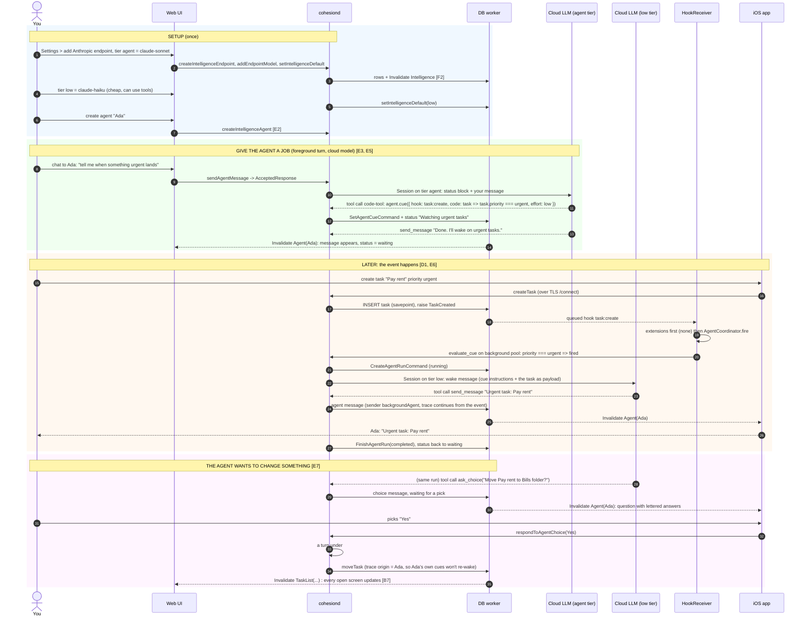
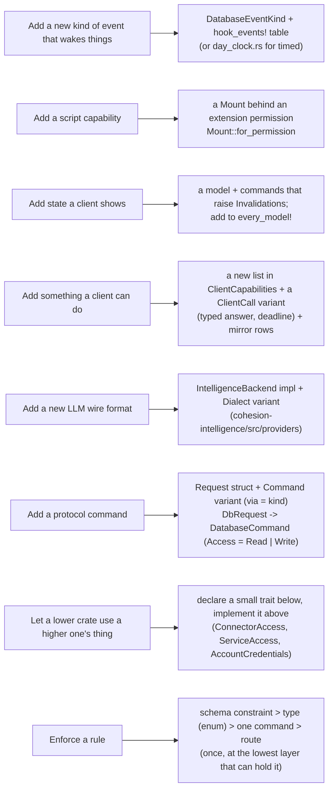

# Part K: Putting it all together

## K1. The master map: every moving part and the arrows between them

Read this once, then use Parts A to J as zoom-ins. Letters in brackets point at the part that expands each box.

## K2. A whole story: "Tell me when something urgent lands"

One timeline touching clients, DB, hooks, cue evaluation, inference tiers, a choice, and the phone. Every step maps to a diagram above.

## K3. "Where does X live?" cheat sheet

